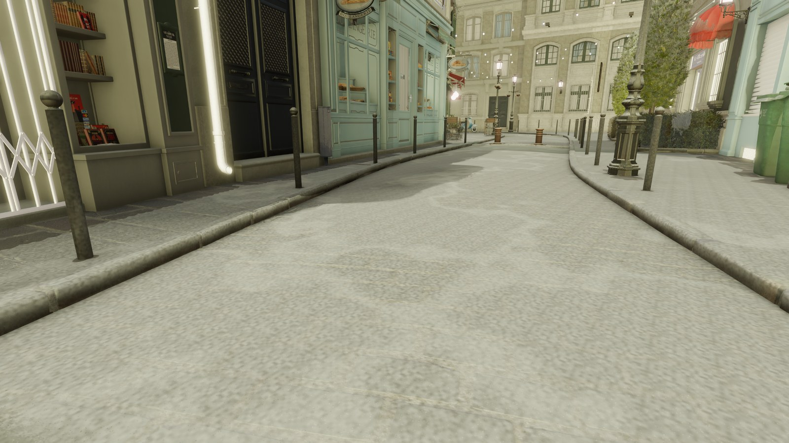
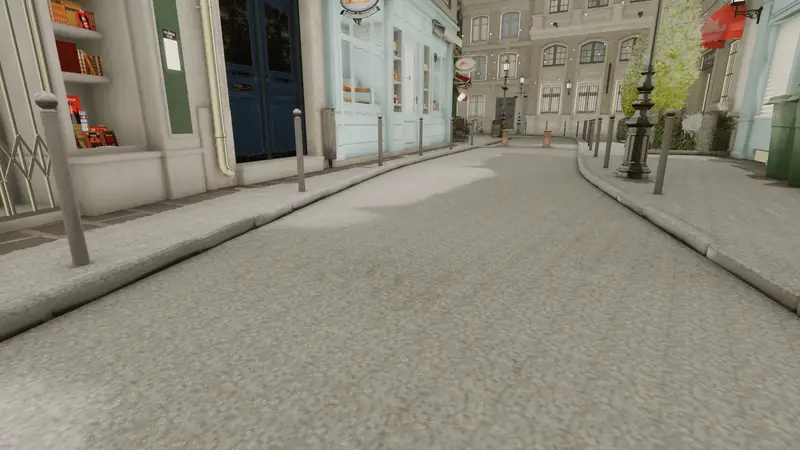
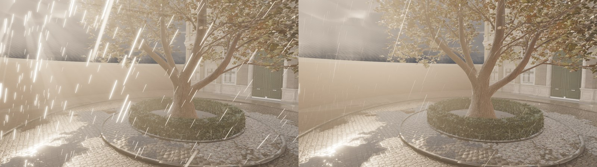
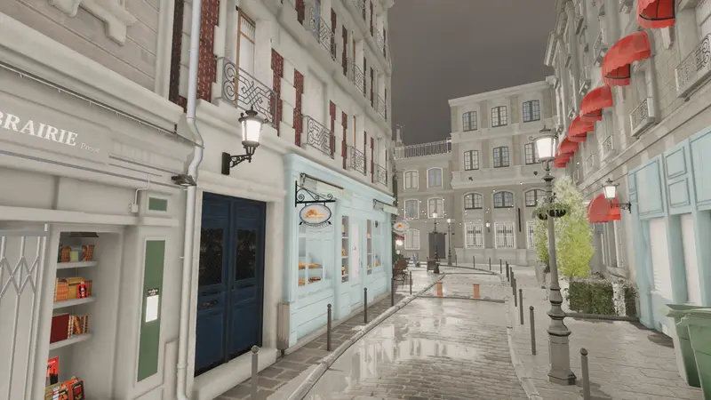
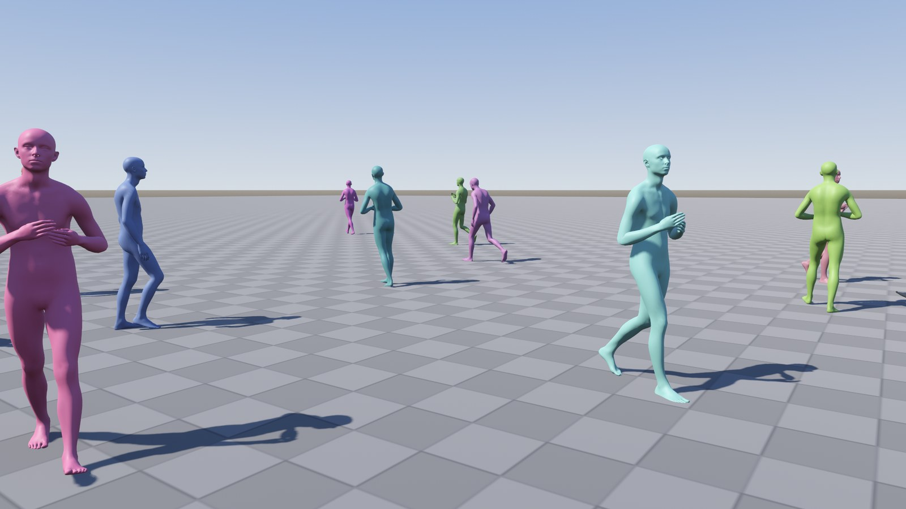
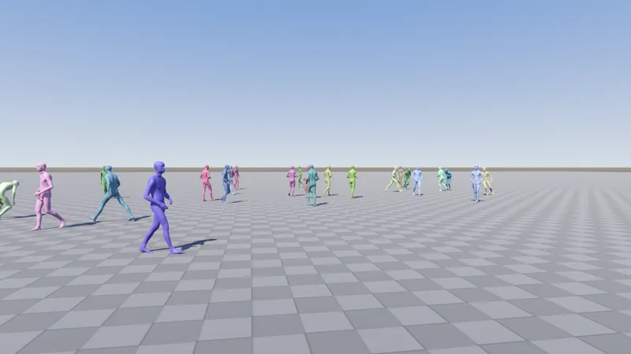

# FellowEngine

<p align="center">
  
</p>

**FellowEngine is a fork of [Godot Engine](https://github.com/godotengine/godot) 4.7.2-stable** that makes the
Forward+ renderer faster and adds real-time effects that stock Godot does not have: water with FFT waves, rain and wet
surfaces, snow, lightning, wind with gusts and a weather controller that changes them all over time, GPU smoke and
fire, wood that burns to char and ash, automatic HLOD, a terrain with scattered foliage, ray tracing and a set of
post-processing effects.

* **Faster with the same image.** With the default settings FellowEngine renders eight of the nine benchmark scenes
  16-54 % faster than stock Godot, the ninth 3-12 % (table below). The changes that are on by default are *exact*:
  verified bit for bit against stock on lavapipe, and at the run-to-run floor on an RTX GPU.
* **New effects, off until used.** The visual features and the new nodes do nothing until a project turns them on
  or adds the node. With them off, the frame is stock's.
* **Everything behind a setting.** All behaviour sits under *Project Settings → Rendering → Fellow*
  (`rendering/fellow/*`): see [docs/FELLOWENGINE_OPTIONS.md](docs/FELLOWENGINE_OPTIONS.md). Every change has a
  decision record with its measurements in [docs/decisions/](docs/decisions/).

The work is organised in milestones, from 2026-09-30 on. See the [changelog](FELLOWENGINE_CHANGELOG.md), the milestone reports
in [docs/](docs/) and the [showcase](docs/SHOWCASE.md).

## Showcase

<p align="center">
  
  
  
  
  
  
  
  
  
  
  
  
  
  
  
  
  
  
  
  
  
  
  
  
  
  
</p>

These are real-time captures from the benchmark scenes on an RTX 5070 Ti Laptop GPU, with FellowEngine's visual
features, nodes and (in Bistro) ray tracing on. Captions, settings and more images are in
[docs/SHOWCASE.md](docs/SHOWCASE.md).

To try it yourself: [showcase/](showcase/README.md) is a small playable valley built with these nodes — terrain and
foliage, a lake, a village with a campfire, weather from sun to blizzard, a day's sky — with a character to walk it
(MotionBricks' mannequin moved by the neural network when its files are installed, a simple one otherwise). Open it in
a FellowEngine editor build and press F5.

## Performance

Stock Godot 4.7.2 against FellowEngine with its defaults, frame time in ms. Measured on an Acer Predator PHN16S-71
(RTX 5070 Ti Laptop GPU, Core Ultra 9 275HX, Windows 11) at 1920 × 1080 with the benchmark's "high" preset. Three
runs per scene after a pass that fills the shader caches (`m41_f317_final`, build `084ba55`, milestone 41).
FellowEngine was faster in every scene and every pair of runs except Stress Lab, within its runs' spread this time
(2 of 3 pairs faster): its frame is bound by the render thread, and its GPU time is 2.4 ms against stock's 3.2 ms. The
weather of milestones 32-42 costs nothing without its nodes: against milestone 35's build in the same session each
scene was within its runs' spread.

| scene | stock | FellowEngine | change |
|---|---:|---:|---:|
| Sponza | 13.521 | 6.170 | **−54.4 %** |
| Bistro exterior | 6.646 | 4.164 | **−37.4 %** |
| City Lab (18 800 meshes) | 3.145 | 2.230 | **−29.1 %** |
| Bistro interior | 4.261 | 3.254 | **−23.6 %** |
| Lights Lab | 3.076 | 2.365 | **−23.1 %** |
| Crowd Lab (256 animated characters) | 6.234 | 5.028 | **−19.3 %** |
| Foliage Lab | 3.679 | 2.985 | **−18.9 %** |
| PBR Lab | 2.585 | 2.197 | **−15.0 %** |
| Stress Lab | 4.984 | 4.893 | −1.8 % (within the spread) |

Where the time goes:

* **Render thread**: parallel culling and command recording, persistent instance data, batched shadow lists.
* **GPU**: the directional shadow cache, frustum culling inside large surfaces, MultiMesh instances culled one by
  one on the GPU, and colour passes compiled without the code the frame cannot run. Also faster light clustering,
  glow, tone mapping and fog passes, async compute and parallel command buffers.
* **Autotune**: measures the scene-dependent options per scene and keeps the faster setting.

Loading is faster as well: shaders are created in parallel and only when first needed, and a scene loads to its first
frame 12-62 % faster. With the defaults and autotune off, two runs at a fixed frame rate render the same frames bit
for bit, where stock's runs differ.

Opt-in options that change the image a little, within measured limits, gain more: variable-rate shading takes Lights Lab
to −21 %. They are listed in the [options](docs/FELLOWENGINE_OPTIONS.md).

## Features

| node or setting | what it is | cost (RTX 5070 Ti Laptop, 1080p) |
|---|---|---|
| `FellowWater3D` | lakes and seas: JONSWAP wind waves simulated by FFT in cascades, foam, screen-space reflections traced over a Hi-Z depth pyramid, refraction, absorption, shore foam, caustics, the sun's glitter | 1.6 ms of Water Lab's frame; reflections 0.61 ms |
| `FellowShallowWater3D` | a mass-conserving shallow-water simulation on the GPU (rivers, obstacles, moving bodies), drawn alone or blended into a `FellowWater3D` | 512²: 0.21 ms, 1024²: 0.75-0.79 ms per step |
| `FellowRain3D` | rain around the camera: GPU drops that stop and splash on the scene, roofs sheltering the ground, wet materials, puddles with ripples, a rainbow when the sun shines on it, curtains of rain in the distance under the clouds, showers that pass with the clouds, walls wet on the windward side, a street drying in patches, ice and hoarfrost below freezing; or snow: flakes drifting in the wind and a snow cover on what faces up, bare under roofs and trees, glinting in the sun, with footprints and wheel ruts (`FellowSnowTracker3D`) | 0.36 ms (Rain Lab); snowing 0.37 ms; the rainbow 0.05 ms; the rain shafts 0.05 ms; wind-driven 0.06 ms, ice and frost 0.06 ms (Bistro) |
| `FellowWind3D` | wind with gusts rolling over the landscape: plants bend, sway, flutter and shine with it; shadows and motion vectors follow; water, smoke and fire, and particles (`ParticleProcessMaterial`'s Wind group) take the same wind | 0.56 ms (Wind Lab); projects' own `TIME`-based sway costs 1.81 ms |
| `FellowLightning3D` | lightning strikes around the camera: a few return strokes flashing over the scene with shadows, a branching bolt, a lit cloud, a signal for the thunder | +0.04 ms on average with a strike every 2 s (Rain Lab) |
| `FellowWeather3D` | the weather from one node: clear, cloudy, overcast, rain, a thunderstorm, snow, a blizzard or a state of its own, changing smoothly; it drives the wind, rain, snow and lightning, the clouds, the sun on the scene, the fog and the ground (wet, drying, under snow, melting into slush, frozen and frosted below 0 °C) | the parts it turns on (Bistro: clear weather not measurable, rain +0.5 ms) |
| `FellowMotionMatcher3D` | motion matching: a skeleton animated by searching a database of clips (`FellowMotionDatabase`, BVH import) every tenth of a second for the pose that continues the current one along the desired path, blended by inertialization, feet locked with two-bone IK, LOD by distance, many characters on the worker threads | 15 µs a character (CPU); 256 characters 3 ms with LOD; foot sliding 0.32 → 0.11 m/s (cloud CPU) |
| `FellowMotionCharacter3D` | characters that walk, jog, run, turn, stop and stand by themselves with no animation clip: NVIDIA's MotionBricks model generates their whole-body motion on the GPU (Vulkan compute, tensor cores), a desired velocity in; the weights are NVIDIA's and not in this repository | a request 4.0 ms, 16 at once 12.6 ms, 64 at once 41 ms; Motion Lab's 64 characters 7.3 ms a frame waiting for them, 3.6 ms on a worker thread |
| `FellowGasVolume3D` | smoke and fire simulated on the GPU (sparse bricks, multigrid pressure solve), physics bodies as obstacles, blackbody flames lighting the scene | Fire Lab's three volumes (0.47 M cells): the simulation 1.58 ms per step, the drawing 0.31 ms |
| `FellowBurnable3D` | a mesh burns like wood in the gas's fire: voxels pyrolyse to char and glowing embers, the surface recedes, burns through and falls as a heap of ash and charcoal | drawing 0.35 ms (Burn Lab) |
| `FellowHLOD3D` | automatic HLOD: repeated far meshes instanced and culled on the GPU, the rest merged per cell with LODs, optional octahedral impostors | City Lab: render thread −23 to −42 % |
| `FellowPipelineWarmer3D` | the pipelines a scene's materials need compiled while it loads: its world drawn from the camera's place in six directions into a small viewport set up as the game's; with `frame/stable_scene_bits`, lights, decals and rain that come and go need no new pipelines either | lavapipe: a camera turning to 24 unseen objects compiles 0 pipelines instead of 7 (with MSAA 0 instead of 13, 6 of them compiled while the frame waited); a scene's 21 changes 5 instead of 28 |
| `pipelines/record`, `pipelines/replay` | a play-through's pipelines recorded to `res://fellow_pipelines.json` (each under its material shader's code hash, its formats described) and compiled in the background when those shaders are made at load: what the game met later (other weathers, lights, autotune's variants) is ready at its first frame | Slice Lab's soak (lavapipe): 18 pipelines compiled in play → 0, ubershader draws 268 → 7 |
| `FellowWorldStreamer3D` | world streaming: a level in cells (`FellowStreamingCell3D`, each a PackedScene) loaded on worker threads and freed around the camera, a few a frame, the same images as the whole level | World Lab at 1080p: 289-612 MiB of video memory instead of 740 MiB with texture streaming (lavapipe) |
| `FellowTerrain3D` | terrain: a height field with continuous levels of detail (patches morphing onto the next coarser grid, one MultiMesh culled patch by patch, motion vectors of a static ground), 9 layers blended by splat maps and their heights, triplanar, collision, height queries; `FellowTerrainFoliage` scatters plants and rocks over its layers around the camera; sculpted and painted in the 3D view with undo (`sculpt()`, `paint()`: only the touched region updated, bit-exact with a rebuild); holes (not drawn, no collision, no foliage), foliage shrinking out at its range, tree impostors baked into files | Slice Lab's 1 km valley at 1 m (16× its 4 m chunks' vertices near the camera): +0.26 ms of GPU at 1080p, the render thread unchanged; no crack in any view of a 4 km map |
| `upscaling/fsr3` | AMD FSR 3.1 upscaler in Godot's FSR 2 scaling mode (built from the FidelityFX SDK's source on the RenderingDevice): less ghosting and flicker than FSR 2.2, a quality mode within about 0.5 dB of native TAA | FSR 2.2's cost (Bistro at 50 %: 2.72 ms, TAA 4.13 ms); in motion at 2× error −9 to −24 %, flicker −10 to −14 % against FSR 2.2 (lavapipe) |
| `streaming/textures` | texture streaming: VRAM-compressed textures load only their small mips; the rest is loaded on worker threads as the cameras need it and released when they no longer do, within a budget; the same images once loaded | Streaming Lab at 1080p: 3-77 MiB of its 384 MiB of textures resident, video memory 377-457 instead of 667 MiB, the first frame 838 → 103 ms |
| `raytracing/*` | hardware ray tracing (`VK_KHR_ray_query`): ambient occlusion, sun shadows, dynamic diffuse GI with probes, reflections | — |
| `post/*` | motion blur, histogram and local exposure, contact shadows, sky atmosphere with aerial perspective, volumetric clouds with their shadows on the scene, bloom with lens dirt and flare, light shafts, sharpening, white balance, lens effects | the clouds' shadows 0.17 ms (Bistro) |

FellowEngine's work is in the Forward+ renderer. The Mobile and Compatibility renderers run every lab (milestone 49):
the Mobile renderer gives stock's images in stock's labs and runs FellowEngine's nodes, but draws no gas volumes; with
Compatibility the nodes that need a RenderingDevice step aside with a warning. Other GPUs are checked by simulating
them (`FELLOW_VULKAN_PROFILE`: Android's baselines, Intel, AMD, older NVIDIA, Apple M1), the Windows and Linux arm64
templates by running them under Wine and qemu ([decision 0150](docs/decisions/0150-platform-checks.md)); the web
template runs in a headless browser with threads, its image desktop OpenGL's.

In the editor (milestone 50, [decision 0151](docs/decisions/0151-editor-tools.md)) FellowEngine's nodes have icons and
gizmos (a gas volume's box with handles, emitters, water extents, shallow-water domains, streaming cells, the wind's
arrow, lightning's band, snow trackers), `.bvh` motion capture imports as animations, **Project > Tools > Split into
Streaming Cells** turns a level into a streamed world whose cells still show in the editor, and the debugger's
Monitors tab shows texture streaming, world streaming and motion matching. From milestone 52
([decision 0153](docs/decisions/0153-editor-idle-warnings-handles.md)) an untouched editor costs nothing unless
something in the scene moves (the 3D toolbar's **Animate** toggle stills FellowEngine's nodes), the nodes warn when they
cannot work where they are, every node's shape has handles, and every `rendering/fellow/*` setting has a tooltip.
Milestone 53 ([decision 0154](docs/decisions/0154-editor-scene-open-presets.md)): scenes with FellowEngine's nodes open
again without recompiling their shaders, and the 3D toolbar's **FellowEngine** menu adds ready-made, wired-up setups.

## Building

FellowEngine builds like Godot 4.7 ([compiling docs](https://docs.godotengine.org/en/stable/engine_details/development/compiling/index.html)):

```
scons platform=windows target=editor           # the editor
scons platform=windows target=template_release # an export template
```

Windows templates also build with MinGW-w64, Linux arm64 ones with GCC's cross-compiler, and Android's and the web's
with the NDK and Emscripten, in containers: `benchmarks/tools/platforms/platforms.sh build windows|linux-arm64|android|web`
(see its README).

The work happens on the `fellow/geometry` branch. The other `fellow/*` branches are earlier stages it grew from.

## Benchmarks

`benchmarks/` holds FellowBench: a Godot project with the labs used for every measurement (Sponza, Bistro, City, Lights,
PBR, Foliage, Stress, Crowd, Physics, Fire, Burn, Fluid, Water, Rain, Wind...). It also has the runner
`run_benchmarks.py`, which runs builds A/B in alternating order with heat soak, telemetry, per-camera statistics and pass
timestamps, plus analysis tools. See [benchmarks/README.md](benchmarks/README.md).

## Documentation

* [FELLOWENGINE_CHANGELOG.md](FELLOWENGINE_CHANGELOG.md): what each milestone added and measured (Godot's own changelog is [CHANGELOG.md](CHANGELOG.md)).
* [docs/FELLOWENGINE_OPTIONS.md](docs/FELLOWENGINE_OPTIONS.md): every setting and node, with its cost.
* [docs/decisions/](docs/decisions/): one record per change, covering the problem, the change, the measurements and
  the decision, including what was tried and rejected.
* `docs/fellow_milestoneN_report.md`: the milestone reports.
* [docs/fellow_aaa_readiness.md](docs/fellow_aaa_readiness.md): an assessment of FellowEngine's readiness for AAA
  production — what is ready, what is missing, and a path.
* [AGENTS.md](AGENTS.md): for AI agents working on the engine; [tools/fellow_agent/](tools/fellow_agent/README.md):
  the toolkit agents use to render, describe, check and measure a project's scenes from the command line;
  [tools/fellow_regression/](tools/fellow_regression/README.md): the image regression suite run before a change.

## Credits and license

FellowEngine is built on [Godot Engine](https://godotengine.org) by Juan Linietsky, Ariel Manzur and the Godot
contributors, released under the MIT license ([LICENSE.txt](LICENSE.txt), [COPYRIGHT.txt](COPYRIGHT.txt)).
FellowEngine's own changes are released under the same MIT license. This fork is not affiliated with or endorsed by the
Godot Foundation. The benchmark assets are not in the repository, and `benchmarks/scripts` fetches them. They keep their
own licenses: Intel New Sponza (CC BY 4.0, Intel) and Amazon Lumberyard Bistro (CC BY 4.0, Amazon Lumberyard / NVIDIA
ORCA), both shown in the showcase images.
