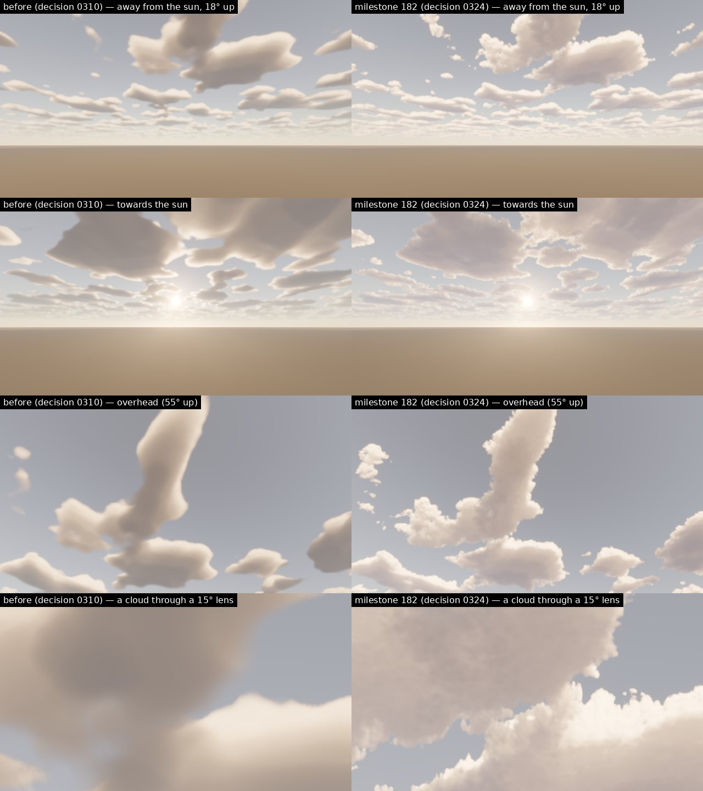

# 0324 — The clouds' realism: sharp edges, finer octaves, diffused light, the aerial perspective

Status: **KEEP**, on wherever the clouds and their detail are on (`post/clouds/enabled`, off by default;
`post/clouds/detail`, on) · Branch `fellow/geometry` · Setting `rendering/fellow/post/clouds/realism` (on) · Code:
`shaders/effects/fellow_clouds.glsl` (`weather_field()`, `cloud_density_lod()`, `integrate_sample_real()`,
`sky_view_radiance()`, the trace's aerial perspective, the composite's upsampling), `effects/fellow_clouds.{h,cpp}`,
`forward_clustered/render_forward_clustered.cpp`, `fellow_settings{.cpp,_look.h}` · Measured with
`showcase/tools/sky_look.gd` (new: the showcase's sky without its square, from the ground and from 20 km up) and
`benchmarks/tools/sky/sky_metrics.py` (new).

Checks: lavapipe only (the owner's GPU paused at their wish): the showcase's sky in seven views, the image regression
suite (37 scenes unchanged; the sky's with `realism` off its golden bit for bit, on a new golden). The GPU's cost is
still to be measured on the RTX.

## Problem

The owner: our clouds "look like dough, quite close". Over the rooftops (decision 0310's clouds under milestone 168's
layer of stratocumulus, the sun 10 degrees up) they were rounded, smooth, cream-coloured blobs, their edges soft over
40 pixels on a cloud overhead, their insides one even shade, dimmer than the sky behind them. Four causes:

* **Soft edges.** The density rose from nothing at a cloud's rim to its full value over 100-200 m (the shape noise's
  slow ramp under the coverage). At the showcase's density (100 per km) the light went tens of metres into that thin
  rim: a cottony halo, out of focus — the look of something small and near. A real cloud's water appears within metres
  of its edge.
* **No small detail.** Its finest erosion was decision 0310's billows of 150-600 m; the surface one sees is the outer
  few tens of metres. Smooth at the scale a cloud 3 km away shows in pixels, it read as a lump of dough.
* **Grey light.** Wrenninge's four octaves of multiple scattering (decision 0109) gave a sunlit side about a third of
  what a thick cloud reflects (its albedo over 0.8: radiance 0.8 E / π, white paper in the sun), and lit every part of
  it alike. Milestone 168 had made the whole sky four times brighter to make up for it.
* **The fade.** Distant clouds faded into the sky by a fixed 40 km exponential, not by the air between them and the
  camera: their colour and contrast did not tell their distance.

## Change

With `post/clouds/realism` (and `post/clouds/detail`), the trace's density and light:

* **Sharp edges**: the density ramp at a cloud's edge made eight times steeper at its tops (three at its bottom
  quarter: the wisps), the inside even. Light samples beyond 120 m and the thickness above a sample use the smooth
  ramp (summed, the sharp one's steps drew contour lines on the bases).
* **Finer octaves**: the detail noise's coordinates warped by a smooth field (the detail noise over 10 km; at the
  bottoms twice as much as at the tops: ragged bases); its billows of 150-600 m eroding as before; then two finer
  octaves (cauliflower of 40-150 m, turbulence of 10-40 m) bumping the edges in and out where the cloud is thin, as far
  as they are a pixel or more (25 and 6 km at 1280 pixels across 70°; further with smaller pixels, nearer with larger:
  the angle between the trace's neighbouring rays). Fine steps inside the clouds of 12 m near the camera (25 before),
  3 m longer per km.
* **Rougher outlines**: the weather field (where clouds stand) given two finer octaves (4 and 16 times its frequency)
  and the shapes' coordinates warped by the same 10 km field (typically ±200 m): irregular, sheared outlines instead of
  the noise's round cells.
* **The light**: the single scattering as before (the dual-lobe phase, the powder term); the multiple scattering by
  diffusion — 0.8 E / π where the cloud is thick, falling off as 1 / (1 + 3/4 (1 − g) τ) with the optical depth towards
  the sun (two-stream diffusion, g = 0.85) or down from the layer's top, whichever brings more — dimmed on a billow's
  side the sun's light crosses the cloud within 120 m to reach (down to a third: the cosine a volume has no normal for);
  the sky's light diffused down through the cloud above (three samples to the layer's top: a base under a thin part
  lighter than under a thick one). The light march: eight samples (8 m doubling to 1 km, the first four with the finer
  octaves).
* **The aerial perspective**: with the atmosphere (decision 0108) the clouds' light at their mean distance (weighted by
  the light each sample hides) dimmed by the air's transmittance from the atmosphere's table, and the air's own light in
  front of them laid over them where they hide the sky — the share of the sky-view table's in-scattering the air's
  optical depth to them is of the whole ray's (looking down on them, the horizon's sky's). It replaces the fade.
* **Upsampling**: the half-resolution clouds composited by Catmull-Rom (nine bilinear taps) clamped to their 2 × 2
  texels, bilinear before.

Off, the clouds are decision 0310's bit for bit.

## Measurements

The showcase's sky (`sky_look.gd`, lavapipe, 1280 × 720, a camera 30 m over the plain: the layer at 2.5 km, 0.6 km
thick, coverage 0.6, density 2.5, the sky's sun 10° up), against the same views without clouds (`sky_metrics.py`):

| view | edges (levels a pixel along them) | texture inside (levels) | cloud luminance p5 / p50 / p95 (the sky behind) | cover |
|---|---|---|---|---|
| overhead (zenith) | 1.26 → 3.33 | 0.91 → 1.91 | 136 / 163 / 222 → 165 / 185 / 235 (171) | 0.20 → 0.21 |
| 55° up, away from the sun | 2.32 → 4.06 | 0.93 → 1.74 | 140 / 177 / 227 → 166 / 193 / 238 (176) | 0.32 → 0.33 |
| across the sun, 14° up | 2.21 → 2.53 | 1.79 → 2.05 | 141 / 192 / 225 → 168 / 204 / 234 (193) | 0.27 → 0.28 |
| away from the sun, 18° up | 2.29 → 2.92 | 1.68 → 2.11 | 143 / 195 / 228 → 171 / 209 / 238 (193) | 0.31 → 0.33 |
| towards the sun, 12° up | 2.16 → 2.09 | 1.21 → 1.21 | 138 / 174 / 228 → 163 / 191 / 226 (190) | 0.43 → 0.41 |

* The clouds overhead: their edges 2.6 times as steep, their texture twice as strong; a cloud's middle (p50) now
  brighter than the sky behind it (185 against 171), dimmer before (163). Towards the sun (the clouds' undersides
  against the brightest sky) unchanged in sharpness and texture.
* The cover the same within 0.02: the finer octaves bump the edges in and out.
* **Stability**: a still camera, 24 frames after the clouds settled (the wind moving them): the mean change from frame
  to frame 0.021 → 0.043 levels, its 99th percentile 0.87 → 1.09 — about a level.
* **The outlines from 20 km up** (the satellite view, 98-333 clouds): their perimeters grow as their areas to the
  power D/2 with D 1.27 before and 1.24 after (Lovejoy's satellites: 1.35). This measure does not see the change:
  from 20 km the finer octaves are under a pixel and the lit tops merge.
* **Cost (lavapipe, not the RTX)**: a frame of the sky view 131 ms without clouds, 169 ms with decision 0310's, 246 ms
  with these: the clouds' share three times as large (38 → 115 ms) — eight light samples (six) and three above, each
  through the weather's finer octaves and the warp; finer steps. Coarser fine steps (18 m + 4 m a km) with three
  detailed light samples saved 4 %. The RTX will say what it costs a frame.

## How it got there

* The finer octaves first eroded only (as decision 0310's): the edges ragged, but the clouds shrank (cover overhead
  0.20 → 0.13) and the light march's shorter detailed samples with fewer octaves turned them grey-lavender and flat.
  Bumped in and out, the cover came back.
* The sharp edges drew contour lines across the bases: the thickness above a sample (three samples) and the far light
  samples summed the sharp ramp's steps. They read the smooth ramp now.
* The multiple scattering by diffusion made the clouds bright but evenly so (the bases as bright as the sunlit sides,
  the cauliflower flat); the billows' facing (the cloud crossed within 120 m towards the sun) brought their relief back.
* The weather's finer octaves and the shapes' warp gave irregular outlines; the warp's lookup is shared with the
  edges' (one texture read less a sample).
* The image regression suite's sky (512 × 288) showed the finest octave as noise at first: their reach had been fixed
  in kilometres (right at 1280 pixels across); it follows the pixels' angle now.
* The showcase's `sky_brightness` (4, milestone 168) now makes the lit clouds near white (p95 235-238); at 2 they keep
  more tonal range and the sky turns greyer. Left at 4 for the owner to judge.

## Decision

KEEP, on: the clouds sharp-edged, detailed down to 10 m, lit as thick clouds are, and fading with distance as the air
does. The GPU cost is to be measured on the RTX.

## Rejected / not done

* The trace at full resolution (four times the rays): the sharper upsampling instead.
* A path-traced reference of the same clouds to check the diffusion's levels against: not built; the levels follow
  two-stream diffusion (the albedo of a thick cloud, its fall-off with optical depth).
* Cloud types (cumulus, stratocumulus, altostratus, cirrus) from a weather map; Nubis' voxel clouds.
