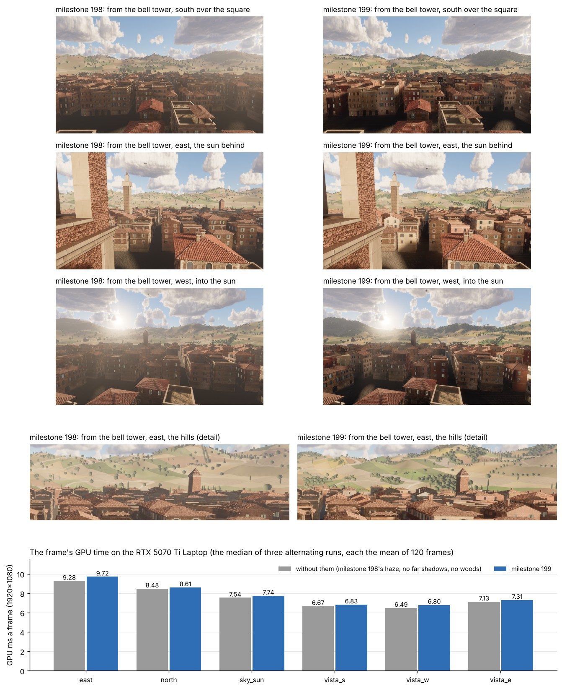

# 0341 — The view from the bell tower: the hills' light baked, the woods, the far city's finishes and shadows, the haze from 150 m out

Status: **KEEP** · Branch `fellow/geometry` · Showcase only (no engine change) · Code:
* `showcase/tools/build_rooftops.gd`: the country's light baked into the terrain's vertex colours (`SUN_DEGREES`,
  `SUN_PENUMBRA`, `_sun_seen()`: the hills' soft shadows on each other; `_sky_seen()`: the sky a valley's sides hide;
  `_wood()`: the woods), what stands on the terrain read from it (`_mesh_h(x, z, values)`); the woods filled with trees
  (`Trees_wood`, a crown-only `wood` tree), rows of trees along a third of the landscape shader's hedges (its plots' frame
  ported: `_hash12()`, `_vnoise()`, `_plot_q()`, `_plot_p()`), lone oaks; every city house casting shadows, the sun's to
  320 m (splits 0.044, 0.0875, 0.22); the far houses' finishes (`far_plaster`); the streets' stone (`paving`'s
  `fan_tint`); the depth fog in Godot's depth mode; the volumetric fog's global density 0 and the town's dust a
  `FogVolume` (`DustLayer`, `materials/dust_layer.tres`);
* `showcase/rooftops/shaders/landscape.gdshader`: the sun's light through the baked shadows (`light()`), the baked sky as
  `AO`, the woods' floor and (past the trees) their crowns, a wider palette, each plot its own shade;
* `showcase/rooftops/shaders/facade_pbr.gdshader`: `plaster_share`, `brick_share`, `stone_house_tint`, `brick_tint`,
  `brick_lum` (each instance's finish by its seed; 0, 0, 1: as before);
* `showcase/rooftops/shaders/paving_pbr.gdshader`: `fan_tint`, `fan_lum`, `fan_tint_strength` (0: as before);
* `showcase/tools/weathering_look.gd`: `--node=<path>:<property>=<value>`, `--cast_city=1`, `--timing=1` (each view's
  GPU and CPU time, the mean of 120 frames), `--setting=<project setting>=<value>`, `--mat` on any material.

## Problem

The owner: "I would also improve the showcase's graphics in general" (left from an earlier list), and after milestone
198: "carry on towards AAA with the GPU"; asked what first: "materials and light, the distant view". The view from the bell tower's beam (milestone 196's
viewpoint, `weathering_look.gd`'s `vista_s`, `vista_w`, `vista_e`) is where the showcase is widest.

## What was found (the RTX at 1920x1080, `weathering_look.gd`; jobs f560-f570)

* **The country lit as if flat**: past the sun's shadows' reach (140 m) no hill shaded another under a sun 24° up;
  the valleys as bright as the ridges.
* **Dots for trees**: 5,839 broadleaf trees strewn one by one over every slope steeper than a fifth (70 % of the
  country: its median slope is 0.36), round blobs on the fields; the shader's woods only on slopes steeper than about
  a half; the plots' colours a narrow band of beiges.
* **One brown city**: the 794 houses beyond the square all the square's ashlar, tinted to their plaster's colour (a
  sienna's, a rose's: brick from afar); the houses past 95 m cast no shadows (their streets and the houses behind them
  lit).
* **Black streets**: Poly Haven's patterned cobblestone (the streets beyond the square) is a dark basalt, its mean
  albedo 0.074 (the fronts' sandstone 0.36). Lit no other way: SDFGI's six cascades (+1 ms), SSAO and SSIL off, the
  weathering off — each 2-10 % lighter.
* **A milky veil** over everything seen from the tower (vista_s: its darkest 1 % at 48 of 255; 8 with no haze at
  all): Godot's exponential depth fog (0.0008 a metre: 4 % at 50 m, 15 % at 200 m — a few per cent of a bright fog
  colour lifts a dark shadow most of the way to grey) and the global volumetric fog (its 64 m of sunlit,
  forward-scattering dust — the froxels' reach — applied to everything past them). Neither the light shafts, the
  bloom nor the atmosphere's aerial perspective (each within 1-2 levels).

## Change

* **The hills' light baked** (each terrain vertex, 1.3 s when the scene is built): how much of the sun a point sees
  past the hills towards it (a march to 2.6 km, the penumbra as wide as the hazy sun's 2.5°), and how much of the sky
  (its horizon eight ways out to 300 m). The landscape shader lights the sun through the first and takes the second as
  its ambient occlusion; the trees standing in a hill's shadow darker as the ground under them.
* **Woods**: `_wood()` — the steepest slopes (a sixth of the country), the valleys' folds (a tenth), copses the noise
  scatters (a twenty-fifth): a quarter of the country within 1.6 km. Baked into the terrain (the shader draws their
  floor, and past the trees their crowns) and filled with 13,727 trees, one each 8 m by the walls, sparser and larger
  out to 1.5 km (a crown of 56 triangles). Rows of trees along a third of the hedges the landscape shader draws (its
  plots' frame ported to GDScript, each row's places found back through its warp): 2,343. Lone oaks in the fields: 528
  (the 5,839 strewn trees gone), the single cypresses three in five.
* **The fields**: gold wheat, lucerne's deep green and sunflowers in bloom, brown and grey (the crete's) ploughed clay
  beside the pasture, the vineyards and the olive groves; each plot its own shade (±12 %).
* **The far city**: each house its own finish by its seed — a third smooth plaster in its colour (264), a fifth Siena's
  brick (158), the rest the square's honey sandstone with a quarter of its colour (372). Every house casts shadows; the
  sun's to 320 m, its first three splits where they had been (14, 28, 70 m: the square's shadows as sharp), the last
  from 70 m.
* **The streets**: the cobbles' basalt toned 0.8 of the way to a warm grey stone (their mean albedo 0.074 → about 0.2).
* **The haze from 150 m out**: Godot's depth fog in its depth mode — smoothstep(150 m, 3 km) to the power 0.5, at most
  0.8: none by the square, 2 % at 200 m, 37 % at 1 km, 68 % at 2 km (55 and 80 % before).
* **The dust low over the town**: the global volumetric fog off and a `FogVolume` over the city instead (640 by 24 by
  640 m, its middle at the paving): as dense at the paving as the global fog had been (0.0004), two thirds of it at 6 m,
  gone at 12 m. The square's shafts and its reference shot as they were; from the tower only the last metres of a look
  down pass through it.

## Measurements (the RTX 5070 Ti Laptop, 1920x1080)

| | milestone 198 | milestone 199 |
|---|---|---|
| vista_s: the darkest 1 %, 5 % of the frame (of 255) | 46, 51 | **16, 22** |
| vista_w (into the sun) | 48, 56 | **17, 24** |
| vista_e (the sun behind) | 41, 54 | **22, 38** |
| east (across the square) | 45, 63 | 40, 61 |
| the reference shot's view (`ref`) | 20, 25 | 13, 20 |
| broadleaf trees: strewn / in the woods / in rows / lone | 5,839 / 0 / 0 / 0 | 0 / **13,727** / **2,343** / 528 |
| the far city's houses: ashlar in a plaster's colour / plaster / brick / sandstone | 794 / 0 / 0 / 0 | 0 / 264 / 158 / 372 |
| the city's houses casting shadows; the sun's shadows' reach | 142 (within 95 m); 140 m | **794; 320 m** |

GPU time a frame (the median of three runs alternating with the milestone's additions off — milestone 198's haze, no
far shadows, no woods — each the mean of 120 frames; f570):

| view | before | after |
|---|---|---|
| east | 9.28 ms | 9.72 ms (+0.44) |
| north | 8.48 ms | 8.61 ms (+0.13) |
| sky_sun | 7.54 ms | 7.74 ms (+0.20) |
| vista_s | 6.67 ms | 6.83 ms (+0.16) |
| vista_w | 6.49 ms | 6.80 ms (+0.31) |
| vista_e | 7.13 ms | 7.31 ms (+0.18) |

The scene's build: the bake 1.3 s, the woods' and rows' places 1-2 s more.

## How it got there

* The baked shadows alone (f564): the hills' relief back, the far city still one colour and its streets black.
* The far houses' own colours, stronger (f563: their plaster's colour at 0.75): a brown in more shades; their finish
  per house (f565): plaster, brick and stone side by side.
* The streets: the dark one suspected first (SDFGI's reach, SSAO, SSIL, the weathering: f565) — 2-10 %; the cobbles
  drawn red (f567) were the dark ground, and toned they were barely lighter (f566: 56 → 60 of 255): the veil over them
  outweighed what they reflect (drawn pure red, their red 64 → 96, their green — no green light reflected — still 56).
* The veil's parts one by one (f568): without the volumetric fog the darkest 1 % 48 → 40, without the depth fog 32,
  without both (and the shafts, the bloom, the aerial perspective) 8.
* The haze's strength between two tries (f569: 0.75 to the power 0.55 — the hills clear; 0.85 to the power 0.45 — the
  middle hills paler again): 0.8 to the power 0.5.

## Decision

KEEP: the showcase's rooftops as described; `facade_pbr`'s and `paving_pbr`'s new uniforms default to what they did.

## Rejected / not done

* The fog's light bluer, with the sun's scattering (f561, f563): the vista veiled further.
* SDFGI's six cascades for the far streets (f565): 2 % lighter, +1 ms.
* A gentler tone for the string courses and cornices (smooth since milestone 159's reference): left.
* The lone trees and the rows' crowns are the far trees' low meshes (round from the tower's 200-1500 m); the woods past
  1.5 km are the shader's painted crowns.
* The ref view's darkest shade 20 → 13 of 255 (the depth fog had lifted it by 0-5 % over the square's 30-60 m): left as
  it is.
