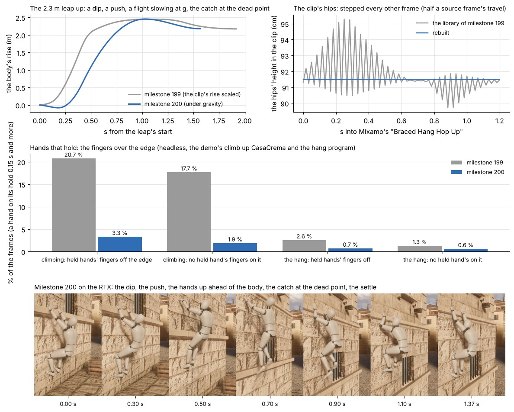

# 0342 — Held hands that stay hooked, a leap up under gravity, the mocap clips' hips no longer stepped

Status: **KEEP** · Branch `fellow/geometry` · Code:
* `modules/fellow_animation/fellow_traversal_pose_3d.{h,cpp}`: a hand on its hold keeps its fingers over the edge
  wherever its knuckles are (`_shape_grip`'s hold, eased over `GRIP_HOLD_EASE`); with `ledge_grip`, `hang_fit` follows
  its goal's steady drift at once (`GRIP_FIT_FOLLOW`, 1.2 m/s; its jumps eased over 0.1 s as before);
* `modules/fellow_animation/fellow_traversal_3d.{h,cpp}`: `leap_gravity` (a timed leap up flies under gravity: a dip,
  a push from rest, the flight, the catch at the dead point, the settle — `LEAP_DIP`, `LEAP_DIP_TIME`,
  `LEAP_PUSH_SHARE`, `LEAP_PUSH_MAX`, `LEAP_PUSH_MOST`, `LEAP_OUT`; the hands up with the body, `LEAP_HANDS_LEAD`),
  `get_leap_phases()`;
* `showcase/scripts/rooftops_player.gd`: `LEAP_GRAVITY` 9.8 (`--leap_gravity=`), the leap's clip played over its
  phases (`_warp_clip`);
* `showcase/tools/blender/mixamo_retarget.py`: an anchored clip's hips taken out at the very moment (not the nearest of
  the source's 30 frames), the takeoffs' and landings' lift interpolated between them, the travels' window weighted;
  the library rebuilt (`build_mocap_clips.gd`; not committed — Mixamo's licence).

## Problem

The owner, after milestone 199: "why, hanging, do the hands alternately straighten and bend? The character would fall
in reality; the push up still looks unnatural."

## What was found (headless, `climb_look.gd`: the demo's climb up CasaCrema and the hang program; `anim_quality.gd`)

* **Hands that let go while they hold**: milestone 198's grip curled the fingers over the edge by the knuckles' height
  over the top (2 cm: curled; level with it: open, up the face — meant for a hand still on its way to a hold). A held
  hand whose arm fell a centimetre or two short of its hold — the body settling into the hang after a leap, the other
  hand's reach pulling it — had its fingers spring open, both hands at once after each leap: in the climb, 20.7 % of
  the held hands' frames (settled on their holds) with the fingers off the edge, 17.7 % of the hanging frames with no
  held hand's fingers on it. The arms fell short because `hang_fit` (the body moved within the arms' reach of the
  holds) was eased over 0.1 s: 8 cm behind a body settling at 0.8 m/s.
* **The leap up**: milestone 198 scaled Mixamo's hop (its hips 0.7 m up, then 0.28 m over the end at the catch) onto
  the 2.3 m leap — the rise at up to 7.3 m/s, stopped at 3.5 g in a tenth of a second, then creeping on at 1 m/s for
  0.4 s and floating at the top. Mixamo's own hop is ballistic: its hips leave the push at 2.9 m/s and slow at 9.7
  m/s² to the dead point, where the hands catch. The hands, eased from one hold to the other, stayed by the chest (26
  cm under the shoulders) while the body flew past them, reaching up only at the top (the RTX's film, f571).
* **Hips that shivered**: the mocap clips' hips (Mixamo's, retargeted, their travel taken out) zigzagged every other
  frame — the hops' by 4.5-6.7 cm a frame on average, the reaches' 3, the jump at the wall's 7: the retarget took out
  the hips' place at the nearest of the source's 30 frames a second from hips sampled at 60 (half a frame's travel
  stepped in and out). In the climb the hips against the body: 40 m/s² at the median, 126 at the 90th percentile.

## Change

* **Held hands hooked**: a hand on its hold (the traversal's `hand_grips`) keeps its fingers and thumb over the edge
  onto the top wherever its knuckles are (eased in over 0.04 s as it takes the hold); they open up the face only on the
  way to a hold.
* **The arms on their holds**: `hang_fit` (with `ledge_grip`) follows its goal's steady drift at once, up to 1.2 m/s —
  only its jumps (a hand taking a hold far above) eased over 0.1 s as before.
* **The leap up under gravity** (`leap_gravity`, the showcase's 9.8 m/s²): the body dips 8 cm (0.2 s); pushes from rest
  at a constant acceleration over a quarter of the rise to the dead point (at least the clip's push, 0.33 m, at most
  0.65 m) to the speed that carries it there; flies decelerating by gravity alone, out from the wall 6 cm in mid-flight;
  the hands catch at the dead point (the clip's settle, 0.28 m, above the hang); it settles into the hang over the
  clip's own settling time (0.53 s). Mixamo's hop is played over the phases: its push (to its last hand's let-go) over
  the dip and the push, its flight over the flight, its settle over the settle; its hands let go and catch there,
  and between they go up with the body — fast off the push, slowing to the dead point (1 − (1 − t)^2.5: a little ahead
  of the body's 1 − (1 − t)²).
* **The clips' hips**: retargeted with the hips taken out at the very moment (an anchored clip's), the lift between the
  source's frames interpolated (a takeoff's, a landing's), the travels' window weighted to nothing at its ends.

## Measurements (headless; the demo's climb and the hang program at 60 fps, `anim_quality.gd` at 120)

| | milestone 199 | milestone 200 |
|---|---|---|
| climbing: settled held hands' frames with the fingers off the edge | 20.7 % | **3.3 %** |
| climbing: hanging frames with no held hand's fingers on the edge | 17.7 % | **1.9 %** |
| the hang program: the same | 2.6 %, 1.3 % | 0.7 %, 0.6 % |
| the leap up (2.3 m): its time; the body's fastest; its sharpest stop | 1.93 s; 7.3 m/s; −62 m/s² | **1.58 s; 5.9 m/s; −10 m/s² (gravity)** |
| the leap up: the push's acceleration | — (no push: the clip's rise scaled) | 26 m/s² over 0.23 s, after a 8 cm dip |
| the leap up: the wrists over the shoulders in flight | −26 to +28 cm (by the chest as the body flew past) | **+11 to +43 cm** (reaching up) |
| hanging, the hips against the body: median, 90th percentile | 40, 126 m/s² | **9, 60 m/s²** |
| the clips' hips, the mean change of their step from frame to frame (the hops; the reaches; the jump at the wall) | 4.5-6.7; 3.0; 7.4 cm | **< 0.2 cm** |
| `anim_quality.py`: from hold to hold, the hips' acceleration p95; the fastest joint p95 | 311 m/s²; 1,299°/s | **143 m/s²; 1,257°/s** |
| `anim_quality.py`: gates | 31 / 38 | 31 / 38 |

`climb_check.gd` and `traversal_check.gd`: every lane identical (all of it is opt-in: `ledge_grip`, `leap_gravity`).
On the RTX (jobs f571-f572): the climb up CasaCrema filmed at 60 fps, the hands close up (held over the edges, the
window sills, the moulding's step), the leap against milestone 198's film (f559).

## How it got there

* The fingers hooked alone: 28.2 → 20.6 % of the held hands' frames off the edge (all, arrivals included); the rest the
  arms short of their holds as the body settled after a leap — both hands at once.
* A hard reach (the body moved at once until each held hand's shoulder was within its arm's reach of the knuckles'
  place): 8.4 %, but the hips jumped wherever a hand took a hold (the catch's hips 437 → 1,655 m/s²); eased in over
  0.1 s, then 0.25 s, still 833. Removed: the fit's goal followed instead (its steady drift at once, its jumps eased).
* The fit's speed limited (1.5 m/s): the arms short again, the hips' jumps worse (752 m/s²).
* The hips' zigzag found in the leap's film data: not the pose (the fit, the sway, the joint speed limit off: the
  same) but the clip itself — its hips alternating every frame in the library.
* The leap under gravity filmed (f571): the body's flight right, the hands by the chest until the top — their way
  eased in and out; up with the body (f572).

## Decision

KEEP: the held hands' hook and the fit's follow (with `ledge_grip`), `leap_gravity` opt-in (the showcase's 9.8), the
retarget's fix (the library rebuilt).

## Rejected / not done

* The hard reach (above). The fit's speed limit (above).
* A hand just catching a hold far from where its arm is (the across move's lead hand, 6 frames) still arrives after
  the traversal says it holds; the reaches' hips spikes (up to 430 m/s² for a frame as a hand takes a hold above and
  the fit pulls the body up 40 cm in 0.15 s) are milestone 153's fit.
* The leaps along and across: still Mixamo's hops' timing scaled (milestone 198).
