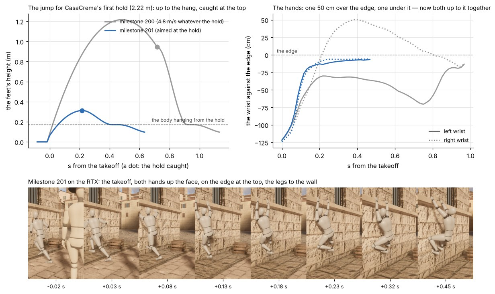

# 0343 — A jump at a wall aimed at its hold: the hands on it at the jump's top

Status: **KEEP** · Branch `fellow/geometry` · Code:
* `modules/fellow_animation/fellow_traversal_3d.{h,cpp}`: `aim_jump_at_hold(direction, gravity, max_speed)` finds a hold
  the body would hang from (as one caught in the air; the wall up to `AIM_REACH`, 1 m, further than `reach_distance`)
  and returns the takeoff speed that brings the body to its top `AIM_CATCH_LIFT` (0.08 m) over its hang from it (the
  physics' steps counted); while the body rises its pose hints reach the hands for the hold (`_step_aim`: their IK in
  over the first `AIM_REACH_IN` of the rise, from in front of the chest up the wall's face to `AIM_OUT` out of the edge
  and `AIM_UP` over it by `AIM_OVER` of the way, in over the top by `AIM_ON`, the fingers hooked from there), and at
  the top (rising no faster than `AIM_CATCH_SPEED`) the hang begins with the hands on (`hang_hands_on`: their weights
  whole, the hands' slide along the edge and the feet's brace eased in over `AIM_FEET_SETTLE`); nothing else is looked
  for while it flies; `is_aiming()`; `PoseHints::air_reach`, `PoseHints::foot_clear`;
* `modules/fellow_animation/fellow_traversal_pose_3d.cpp`: reaching from the air, no sway and the grip's shape in at once
  (`GRIP_EASE_AIR`); with `foot_clear`, a foot the clip puts into the stone put on its face (`FOOT_CLEAR`,
  `FOOT_KNEE_CLEAR`), the leg's own plane kept;
* `showcase/scripts/rooftops_player.gd`: the jump at a wall aimed (`AIM_JUMP`, `AIM_MAX_SPEED`; `--aim_jump=0`), its clip
  played from its push off the ground (`JUMP_WALL_PUSH`) to its hand on its hold (`JUMP_WALL_SET`) over the rise, its
  limbs the catch's first frame's (`jump_wall_arms`).

## Problem

The owner, after milestone 200: "why does the character jump very high, reach with one hand and fall onto the edge
instead of jumping straight to the edge?"

## What was found (headless, `climb_look.gd`: the demo's run at CasaCrema and its jump for the first hold, 2.22 m up)

* **The same jump for every hold**: the jump at a wall was the player's jump (4.8 m/s), whatever the hold's height. For
  CasaCrema's first hold the body rose 1.22 m — its hips 0.87 m over where they hang, its shoulders 27 cm over the edge
  — and the hold was caught only on the way down (the grab waits for the edge to be about `hang_reach` over the feet):
  0.72 s after the takeoff, the body falling at 2.4 m/s, 0.77 m over its hang, which it then dropped into in 0.2 s (the
  hips at up to 5.3 m/s).
* **One hand**: Mixamo's "Run To Start Climbing" (the clip of milestone 197) starts up a climbing wall — one hand up to a
  hold at the head, the other on a hold at the hip. The right wrist rose 50 cm over the edge; the left stayed 13 cm
  under it, 57 cm from its hold at the catch; the fingers over the edge 0.75 s (right) and 0.98 s (left) after the
  takeoff.

## Change

* **The jump aimed** (`aim_jump_at_hold`): as fast as brings the body to its top 8 cm over its hang (the arms a little
  bent) — for CasaCrema's hold 2.13 m/s, not 4.8; a hold that needs more than the player's jump (× 1.05) is caught on
  the way down as before.
* **Both hands reach**: while the body rises the pose's IK takes the hands up in front of the wall's face to 18 cm out
  of the edge and 8 cm over it, then in over the top, on the hold a little before the top, the fingers hooked; the
  eyes on it. Blended from the clip's arm straight to the hold, the hand low by the wall had come up through the stone
  under the edge.
* **Caught at the top**: the hang begins at the jump's top with the hands on the hold (their weights whole: they had
  let go and come back); the body settles the last 14 cm into its hang over 0.2 s; the hands' slide along the edge and
  the feet's brace eased in over 0.4 s.
* **The clip's limbs the catch's**: the jump's clip plays from its push off the ground to its hand on its hold over the
  rise, its arms and legs the catch's first frame's ("hang_catch": both arms up on the hold, the legs bent under) — the
  clip's own left arm hung down to its low hold (the IK lifting it kept its turn: the forearm and the wrist twisted half
  round as the catch's clip came in), its right foot stepped up the wall to the hips' height (the knee swung across the
  body and back as the catch's braced legs came in).
* **The pose**: no sway spring while the body flying is the controller's (at g it had swung the hips up); the grip's
  shape in at once (what the grip left of the clip's hand, half round from it, flicked the wrist over as the shortest
  way between them changed sides); a foot the clip puts into the stone kept 10 cm off it, its knee 8 cm (until 0.4 s
  after the catch).

## Measurements (headless; the demo at 60 fps, `anim_quality.gd` at 120)

| | milestone 200 | milestone 201 |
|---|---|---|
| the jump for CasaCrema's first hold (2.22 m): the takeoff speed; the body's rise | 4.8 m/s; 1.22 m | **2.13 m/s; 0.31 m** |
| the hips' top over their hang; the shoulders' top against the edge | +0.87 m; 27 cm over it | **+0.06 m; 47 cm under it** |
| the takeoff to the catch; the body at the catch over its hang; its drop into the hang | 0.72 s (falling); 0.77 m; in 0.2 s | **0.22 s (at the top); 0.14 m; in 0.2 s** |
| the hips' fastest fall after the catch | 5.3 m/s | **0.6 m/s** |
| the wrists at the catch from their holds (left, right); the highest over the edge | 57, 28 cm; 50 cm (the right) | **9, 3 cm; none** |
| the fingers over the edge after the takeoff (left, right) | 0.98, 0.75 s | **0.30, 0.23 s** |
| climbing: settled held hands' fingers off the edge; no held hand's on it | 3.3 %; 1.9 % | **0.2 %; 0.0 %** |
| the hang program: the same | 0.7 %; 0.6 % | **0.0 %; 0.0 %** |
| `anim_quality.py`, hanging: the fastest joint p95, max; the hips' acceleration p95, max | 937, 1,227 °/s; 234, 437 m/s² | **809, 959 °/s; 147, 150 m/s²** |
| `anim_quality.py`: limbs through walls, the approach (the run, the jump); hanging | 4.0 %; 0.0 % | **0.0 %; 0.0 %** |
| `anim_quality.py`: the approach's fastest joint (the takeoff's frame) | 1,659 °/s | 2,061 °/s |
| `anim_quality.py`: gates | 31 / 38 | 31 / 38 |

`climb_check.gd`, `traversal_check.gd`: every lane identical (the aim is the controller's call). On the RTX (job f573):
the jump filmed from the side at 60 fps, the hands catching close up, the demo's climb.

## How it got there

* The jump aimed alone (the clip's arms): the body caught at the top, the left hand 28 cm from its hold, coming up
  through the stone under the edge (12 cm into it).
* The hands' way out of the stone: the IK whole as soon as it comes in (the hand's share between holds,
  `hand_flight_weight`, had left the clip's low arm 40 % of the say), up the face first, in over the top — on the hold
  by the catch.
* The clip at its own pace: its foot still swinging up the wall at the catch, which the catch's blend carried on to the
  shoulder (the ankle 52 cm over the hips); played from its push to its hand set on its hold: 7 cm under them.
* Its arms and legs then the catch's: the wrist's twist (2,000 °/s for 0.1 s after the catch) and the knee's swing across
  the body gone.

## Decision

KEEP: `aim_jump_at_hold` (the controller's call), the pose's reach from the air; the showcase's jump at a wall aimed.

## Rejected / not done

* The clip's left arm mirrored from its right in the retarget: the catch's first frame's arms do it without a library
  rebuild.
* The jump's top a little higher than aimed (0.14 m over the hang, not 0.08): the takeoff's frame climbs 2.7 cm more
  than its speed (the body leaving the floor) and the next is not slowed.
* A hold higher than the player's jump reaches is caught on the way down as before; the leaps from hold to hold keep
  milestone 200's ballistic leap.
