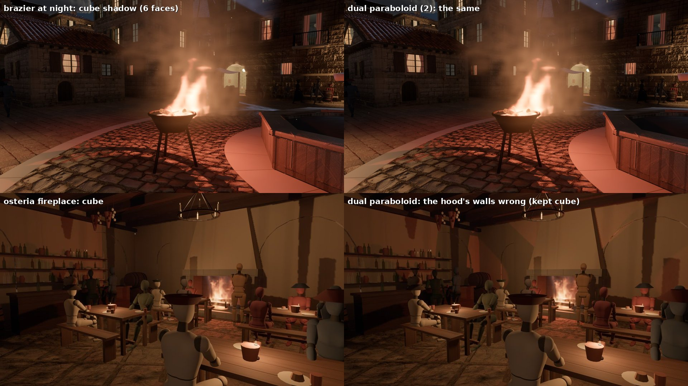

# 0361 — The brazier's fire light: a dual paraboloid shadow

Status: **KEEP** · Branch `fellow/geometry` · Code: `showcase/scripts/rooftops_fire.gd` (the brazier's fire light's
`omni_shadow_mode`); `showcase/tools/climb_look.gd` (`--omni_dp=all|fire|lamps|cube`: the shadowed omni lights' mode,
an A/B).

## Problem

Decision 0359's pass profile: the omni lights' shadows took 0.86 ms of the rooftops' GPU frame in the square (fenced),
1.89 ms in the osteria. Three omni lights cast shadows there — the brazier's fire light (FellowGasVolume3D's
`fire_light_shadows`), the osteria fireplace's and its chandelier — and their flames move: each frame their shadow is
drawn again, a cube's six faces. Godot's other omni shadow, the dual paraboloid, draws two hemispheres; its projection
bends straight edges between the vertices (it is done per vertex), so it is wrong near large flat faces close to the
light.

## Measurements

The RTX 5070 Ti laptop, 1920x1080, `climb_look.gd --perf=1` (480 frames after 3 s): the GPU's frame time and the render
thread's CPU, twice, alternating.

Every shadowed omni light dual paraboloid (job f616), against all of them cube:

| view | GPU ms, cube | dual paraboloid | the frame's pixels differing by more than 16 levels |
|---|---|---|---|
| the square | 9.77, 10.07 | 9.42, 9.65 | — |
| the brazier | 9.67, 9.78 | 9.15, 9.19 | 0.09 % (mean 0.56: the flames' flicker) |
| in the osteria | 9.09, 9.17 | 7.84, 7.99 | 8.7 % |

In the osteria one light at a time (f617): none 8.93 / 9.10 ms, the fireplace's dual paraboloid 8.39 / 8.46, the
chandelier's 8.48 / 8.55; the fireplace's shadow differs on 4.3 % of the pixels, the chandelier's on 4.9 %. The
fireplace sits under its hood, a hand from its walls: dual paraboloid, the hood's sides and the chimney breast are lit
and shaded wrongly — a dark wedge beside the hood, the beams' shadows bent (the figure).

The brazier's fire light alone dual paraboloid (the change; f618), against cube (`--omni_dp=cube`):

| view | GPU ms, cube | dual paraboloid | render thread's CPU ms, cube | dual paraboloid |
|---|---|---|---|---|
| the square | 9.98, 10.06 | 9.34, 9.62 | 2.45, 2.67 | 2.19, 2.11 |
| the brazier | 9.69, 9.79 | 9.17, 9.28 | 2.16, 2.32 | 1.94, 1.77 |

0.4-0.6 ms of GPU and 0.2-0.5 ms of the render thread (four fewer shadow passes recorded) in the square. At night, the
brazier lighting the square alone (its legs' shadows across the cobbles): 0.35-1.1 % of the pixels differ by more than
16 levels between the two, as between two frames of the flames.

## Decision

KEEP: the brazier's fire light dual paraboloid; the osteria's fireplace and chandelier cube.

## Rejected / not done

* Every shadowed omni light dual paraboloid (1.1-1.3 ms in the osteria): its fireplace's light is wrong under the hood.
* A FellowGasVolume3D property for its fire light's shadow mode: `get_fire_light_node()` gives the light; the choice is
  the scene's (open air or a hearth).
