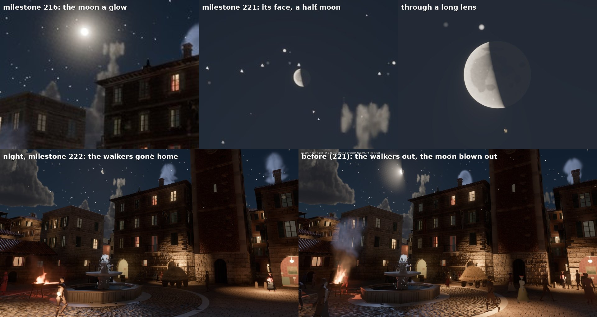

# 0363 — The moon's face

Status: **KEEP** · Branch `fellow/geometry` · Code: `showcase/shaders/atmosphere_sky.gdshader` (`moon`, `moon_sun`,
`moon_earthshine`, `moon_light()`, `moon_albedo()`; the stars a point in narrow views), `showcase/scripts/rooftops_night.gd`
(`moon_disk`, the shader's moon parameters, `--night_set=disk:`), `showcase/tools/climb_look.gd` (`--view=moon`).

## Problem

Milestone 216's open point: the moon was the sun's disk turned blue — "a soft bright circle", no phase. At the night's
exposure (the eye 2.5 stops up) its disk, a tenth of the sun's, was white with a glow; through a long lens (the RTX,
1920x1080, 6° across, job f620) the face drawn with this milestone's shader at that brightness was still blown out: the
lit half white, and the light shafts (FellowEngine's, smeared radially from the light) drew it into a half-disk glow
with a straight edge along the terminator.

## Change

* **The sky's shader draws the moon's face** when told the disk is the moon's (`moon`, 0-1, blended from the sun's
  disk): a sphere lit from `moon_sun` — the sun's direction, under the horizon at night — so its phase and terminator are
  where the set sun puts them (the rooftops' moon 86° from the sun: a half moon, lit on the side towards the sunset);
  Lommel-Seeliger's law (μ₀ / (μ₀ + μ): the full moon as bright at its limb as at its centre, the terminator soft);
  earthshine on its dark side (`moon_earthshine`, 0.4 % of the lit side's); its albedo a pattern on its face — the
  large seas where they are (Imbrium, Serenitatis, Tranquillitatis, Crisium, Fecunditatis, Nectaris, Procellarum,
  Nubium, Humorum, Frigoris: sums of Gaussians, their shores cut ragged by noise) at 0.56 of the highlands', the
  highlands mottled, Tycho and its rays, Copernicus, Kepler and Aristarchus bright; its edge antialiased; its light
  greyer than the moonlight's blue on the square.
* **Its brightness** (`rooftops_night.gd`'s `moon_disk`, the disk's share of the sun's): 0.004 (0.1 before): the face
  as bright as the night's exposure shows it, the brightest thing in the sky.
* The stars a point however narrow the view (their glow as many pixels across as at 50°; standard views unchanged).
* `climb_look.gd --view=moon`: the moon through a 6° lens from the square's corner.

## Measurements

The RTX laptop, 1920x1080, night at once (`--night=1`), the moon through the long lens and from the square's corner
(jobs f620, f621): the 99.9th percentile of the close view's luminance (sRGB) by the disk's share.

| `moon_disk` | 0.1 | 0.2 | 0.4 | 0.001 | 0.002 | **0.004** |
|---|---|---|---|---|---|---|
| the close view's p99.9 | 255 (the lit half white) | 255 | 255 | 179 | 193 | **214** |

At 0.004 the seas and the bright craters read on the lit half, the dark half a faint disk over the sky. Checked on
lavapipe first (a scene of the shader alone: the half moon, its seas, the stars round dots). By day the shader draws as
before (the moon branch only when `moon` > 0).

## Decision

KEEP.

## Rejected / not done

* A photograph of the moon as a texture: the repository is public and the face is a few lines of shader.
* The moon's own light of a phase (a half moon a tenth of the full moon's): the square's moonlight is the owner's look
  (milestone 216).
