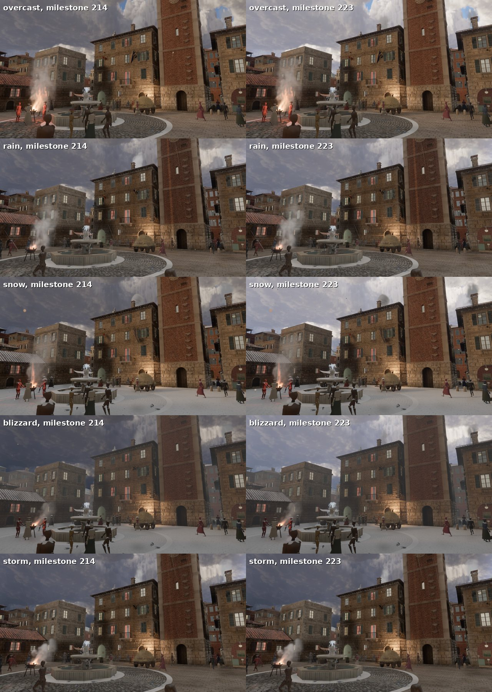

# 0365 — The clouds' light under each weather

Status: **KEEP** · Branch `fellow/geometry` · Code: `showcase/scripts/rooftops_weather.gd` (`SKY_DIM`, eased as the
weather turns; `--weather_sky_dim=<share>`).

## Problem

Milestone 214's open point: under snow the rooftops' sky was a storm's — dark grey clouds over a white square. The
weather keys dim the sky's own sun (rooftops.gd's SkySun, which lights the clouds and the sky seen; since milestone
214 not the sky's light on the square) by 0.85 of the weather's dimming of the sun, whatever the weather: under a
closed deck the clouds were lit as a storm's.

## Change

The clouds' light per weather (`SKY_DIM`, the share of the weather's dimming the SkySun takes; keys 1-7): the fair and
cloudy weathers as before (0.85: their sun hardly dimmed), overcast 0.4, rain 0.7, a storm 0.85 (as before), snow 0
(its clouds lit by the whole sun over them: a bright white-grey sky), a blizzard 0.2; eased as the weather turns, with
the eye's adapting. The square itself is lit as before (the sky's light on it does not follow the SkySun).

## Measurements

The RTX laptop, 1920x1080, the square from its corner, each weather at once and 4 s on (job f623; f622 tried 0.85, 0.4
and 0 under overcast, snow and a storm): the mean sRGB luminance of the sky over the left houses.

| | overcast | rain | storm | snow | blizzard |
|---|---|---|---|---|---|
| milestone 214 (0.85) | 102 | 98 | 88 | 91 | 76 |
| milestone 223 | 153 | 124 | 88 | 162 | 138 |

Snow turning to a storm and then to overcast (10 s each): the sky's luminance 161 → 88 → 155, eased. The square under
the sky unchanged (the frames' lower parts as before; the fire's flicker aside).

## Decision

KEEP.

## Rejected / not done

* The clouds lit by the whole sun under every weather (0): a storm's sky white-grey, no darker than an overcast one.
* A closed deck (no gaps in the clouds above a coverage): FellowEngine's clouds at a coverage of 0.9-1 stand as a
  broken layer with thin patches; for the snow's and the overcast sky the light was what was wrong.
