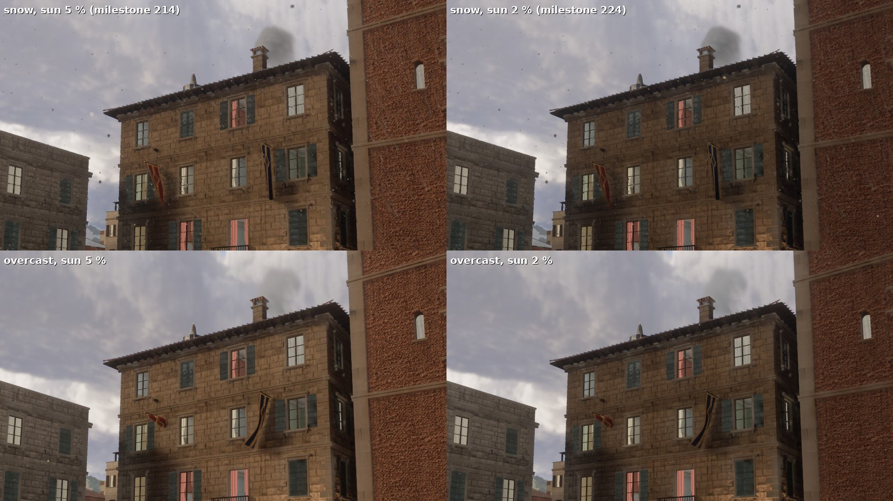

# 0366 — Less sun under a closed deck

Status: **KEEP** · Branch `fellow/geometry` · Code: `showcase/scripts/rooftops_weather.gd` (`SUN`, `DARKER`;
`--weather_sun=<key>:<share>`).

## Problem

Milestone 223's open point: under snow and overcast the rooftops' houses still took 5 % of the sun (decision 0356's
`SUN`): their fronts warm and golden where it fell, the bell tower's shadow across PalazzoOcra's front — a sun seen
through a deck the sky shows closed.

## Change

The sun's share under the closed decks lowered again: overcast and snow 2 %, rain 1.5 %, a storm and a blizzard 1 %
(5, 3, 1.5, 5 and 2 % before). The square's light under them is the sky's (milestone 214's overcast light). The eye
adapts to what the less sun takes (`DARKER`: overcast and snow measured, +0.23 and +0.21 stops; the others estimated
from those).

## Measurements

The RTX laptop, 1920x1080, the square from its corner, each weather at once and 4 s on (job f624): PalazzoOcra's front,
its part out of the tower's shadow over its part in it (linear luminance), and the frame under the sky in stops under
the fair evening's.

| sun's share | 5 % | 2 % | 1 % | 0.5 % |
|---|---|---|---|---|
| snow: lit / shaded | 1.32 | 1.17 | 1.09 | 1.05 |
| snow: stops under the fair evening | 0.78 | 0.99 | 1.08 | 1.12 |
| overcast: lit / shaded | 1.28 | 1.16 | 1.09 | 1.05 |
| overcast: stops under the fair evening | 1.00 | 1.23 | 1.31 | 1.37 |

A storm: 1.5 % 0.99, 1 % 0.95 (its tower's shadow gone already). At 2 % the fronts lose the golden sun's warmth; the
square a fifth of a stop darker than before after the eye's adapting.

## Decision

KEEP.
