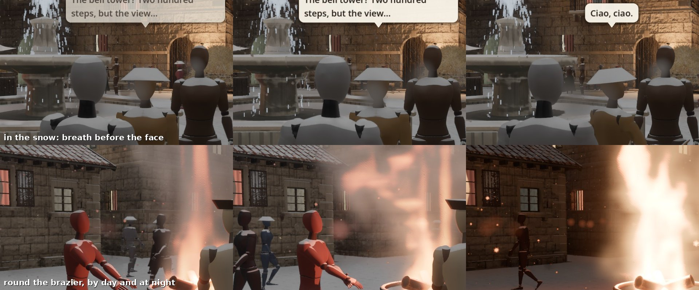

# 0367 — Breath in the cold

Status: **KEEP** · Branch `fellow/geometry` · Code: `showcase/scripts/rooftops_crowd.gd` (`BREATH_NEAR`, `_breathe()`,
`_make_breaths()`; `--breath=0`).

## Problem

In the rooftops' snow and blizzard (milestone 211) the square's people warm their hands at the brazier and say
"Brr…" — but nothing in the air shows the cold before their faces.

## Change

Under `COLD` (5 °C: the snow and the blizzard) everyone within `BREATH_NEAR` (22 m) of the camera, and the player,
breathes out a small puff of mist every 3-3.7 s (each person at its own pace): a `GPUParticles3D` on the head bone,
before the mouth, six soft billboards a breath (0.22 m, growing to 0.4 m, at most half opaque, fading over 2.2 s),
blown forward at 0.4-0.6 m/s, slowed by the air and rising a little, left in the air as the person walks on — lit by
the scene (pink by the brazier, grey under the snow's sky). Made the first time it is cold (one material, mesh and
process material for all); off in the warm, out of view and beyond the distance.

## Measurements

The RTX laptop, 1920x1080, the brazier's ring in the snow (`--perf=1`, 480 frames, twice, alternating; job f625, the
first, smaller puffs): GPU 9.83, 9.98 ms with the breaths, 9.84, 9.84 without; the render thread's CPU 1.85, 1.88
against 1.80, 1.85 ms — up to 0.1 ms. The puffs seen close in a talk (f626): before the faces, a breath every few
seconds, each its own.

## Decision

KEEP.

## Rejected / not done

* The first puffs (0.16 m, a third opaque): unseen against the snow at 4 m (f625).
