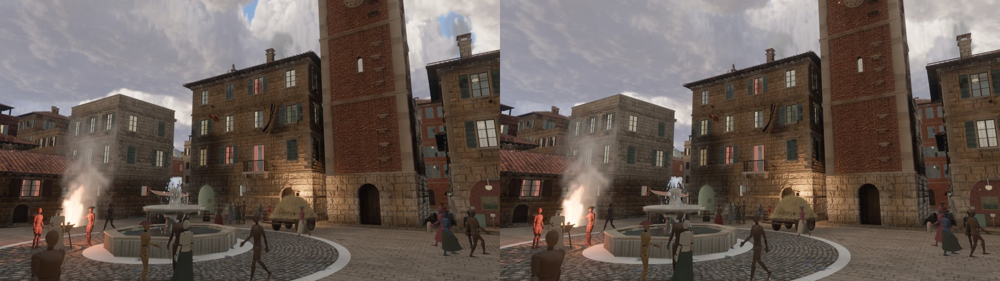

# 0368 — An overcast sky closed; the breath's pace

Status: **KEEP** · Branch `fellow/geometry` · Code: `showcase/scripts/rooftops_weather.gd` (`COVER`, `DARKER`),
`showcase/scripts/rooftops_crowd.gd` (the breaths' pace).

## Problem

* Under the rooftops' "overcast" (key 3) FellowWeather3D's preset coverage, 0.9, left the blue sky showing between the
  clouds over the square — an overcast sky is closed (eight oktas).
* Milestone 225's open point: the breaths came at a steady pace, standing or hurrying home.

## Change

* `COVER`: the clouds' coverage where the square takes more than the preset — overcast 0.97 (turned to with the weather,
  as `SUN`). The eye's darkening under it measured again (`DARKER` 2.45 stops: the frame under the sky with the eye not
  adapting, against the fair evening's; 2.42 at 0.9 with 5 % of the sun, milestone 214).
* The breaths quicker with what the people do: walking 1.25 times, leaving or coming back 1.4, talking or pointing 1.5.

## Measurements

The RTX laptop, 1920x1080, the square from its corner, overcast at once and 4 s on (job f628, against f624's frame at
0.9): the blue between the clouds gone, the deck grey and closed; the square under it as before (its ambient light the
overcast sky's at 0.97 of the way, 0.97 at 0.9).

## Decision

KEEP.
