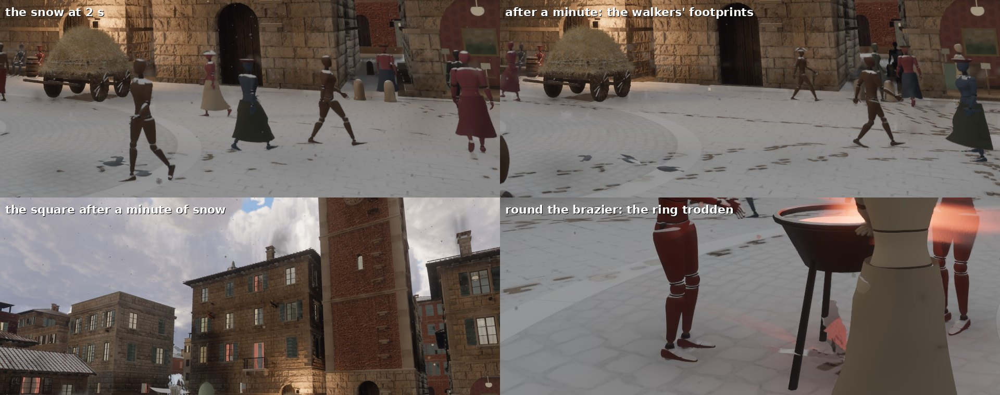

# 0369 — Footprints in the rooftops' snow

Status: **KEEP** · Branch `fellow/geometry` · Code: `showcase/scripts/rooftops_crowd.gd` (`_foot_trackers()`;
`--tracks=0`).

## Problem

The rooftops square fills with snow (keys 6 and 7, milestone 211) but nobody leaves a mark in it: FellowEngine's snow
tracks (decision 0130, `FellowSnowTracker3D`) were under the main showcase's walkers only — the square's 63 people and
its player walked over the snow as over a floor.

## Change

A `FellowSnowTracker3D` under each foot (a `BoneAttachment3D` on `LeftFoot` and `RightFoot`) of every person and of the
player: radius 6 cm, pressing within 14 cm of the snow's top, down to the cobbles (10 cm: the snow's 8 cm trodden
through — at decision 0130's default 0.8 of the depth the dents hardly showed under the snow's flat light). 128
trackers, within FellowRain3D's 256 stamps a frame; the snow falling fills the tracks back over 15 minutes.

## Measurements

The RTX laptop, 1920x1080, snow at once (jobs f630, f631): after a minute the walkers' ways across the square are lines
of prints showing the cobbles, the brazier's ring trodden round. The frame with and without the trackers (`--perf=1`,
twice, alternating; f632):

| view (snow) | GPU ms, trackers | without | render thread's CPU ms, trackers | without |
|---|---|---|---|---|
| the square | 9.98, 10.76 | 10.42, 10.61 | 2.47, 2.42 | 2.43, 2.36 |
| the brazier | 9.76, 9.76 | 9.96, 9.88 | 2.11, 2.12 | 2.09, 2.12 |

No cost measurable (within the runs' spread).

## Decision

KEEP.
