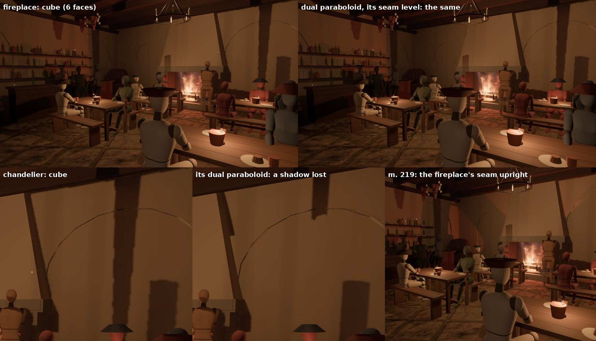

# 0370 — The osteria fireplace's shadow: a dual paraboloid, its seam level

Status: **KEEP** · Branch `fellow/geometry` · Code: `showcase/scripts/rooftops_osteria.gd` (the fireplace's fire light:
`omni_shadow_mode`, its basis); `showcase/tools/climb_look.gd` (`--omni_dp_level=1`, `--omni_dp=fire_cube`).

## Problem

Milestone 219's open point: inside the osteria its two shadowed lights — the fireplace's fire light and the chandelier —
took 1.9 ms of the RTX's frame. Their shadows dual paraboloid had been 1.2 ms cheaper but wrong: the fireplace's light
drew a dark wedge beside its hood. Godot's dual paraboloid splits the light's surroundings into the hemispheres in
front of and behind its own z axis; the fire light's z was the world's, so the seam stood upright through the hearth's
opening — through the hood's sides, a hand from the light.

## Change

The fireplace's fire light (FellowGasVolume3D's `get_fire_light_node()`) dual paraboloid with its own z turned up: the
seam level with the fire, the hemispheres the hood over it and the room under its height. The chandelier keeps its
cube: with its seam level it lost the long shadow on the room's right wall, which lies at its height (the seam).

## Measurements

The RTX laptop, 1920x1080, inside the osteria and at its door, stills against the cube's (job f633): the share of the
pixels differing by more than 16 levels (the flames' flicker and a bench's shadow edge; milestone 219's upright seam:
4.3 % inside, 0.93 % at the door).

| light dual paraboloid, seam level | inside | at the door |
|---|---|---|
| the fireplace's | **1.07 %** | **0.21 %** |
| the chandelier's | 3.05 % (a wall's shadow lost) | 0.93 % |
| both | 4.09 % | 1.18 % |

Both, the frame inside: GPU 8.04, 8.10 against 9.14, 9.16 ms; the render thread 2.12, 2.18 against 2.98, 3.05 ms
(f633). The fireplace's alone (this change; f635, against `--omni_dp=fire_cube`, twice, alternating):

| view | GPU ms, dual paraboloid | cube | render thread's CPU ms, dual paraboloid | cube |
|---|---|---|---|---|
| inside | 7.76, 7.76 | 8.31, 8.18 | 3.11, 3.09 | 3.55, 3.61 |
| at the door (the brazier's light in view too) | 8.02, 7.98 | 9.02, 9.09 | 3.49, 3.25 | 4.34, 4.46 |

(`fire_cube` turns both gas fire lights to cubes — the brazier's too, milestone 219's; inside the osteria the brazier's
light is out of view.) Inside: 0.4-0.5 ms of GPU and of the render thread less. The room as built (f635) against it with the cube: 1.08 % of
the pixels differing by more than 16 levels.

## Decision

KEEP: the fireplace's light dual paraboloid, its seam level; the chandelier cube.
