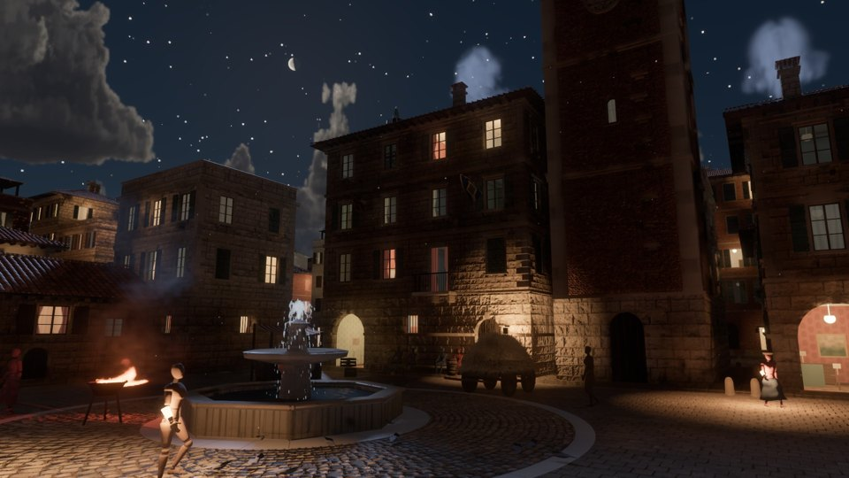

# 0371 — The stall keepers go home at night

Status: **KEEP** · Branch `fellow/geometry` · Code: `showcase/scripts/rooftops_crowd.gd` (`_weather_acts()`).

## Problem

Milestone 222's open point: at night the square's walkers and groups went home, but its stall keepers stayed behind
their stalls (they only huddle under their awnings in the rain).

## Change

At night (not in the rain, when they huddle as before) the keepers close up and go home or into the osteria like the
groups, and come back to their stalls by day (a keeper away is let back as the others are).

## Measurements

Headless, night at once and the day back at 14 s: 30 of the 63 people away at night (28 before: the keepers); all 63
back by 34 s after the day comes back (two keepers had stayed away at first: kept out of the coming back — fixed
before this record). The RTX's frames of the square at night (f635): the stalls empty under their lamps.

## Decision

KEEP.
