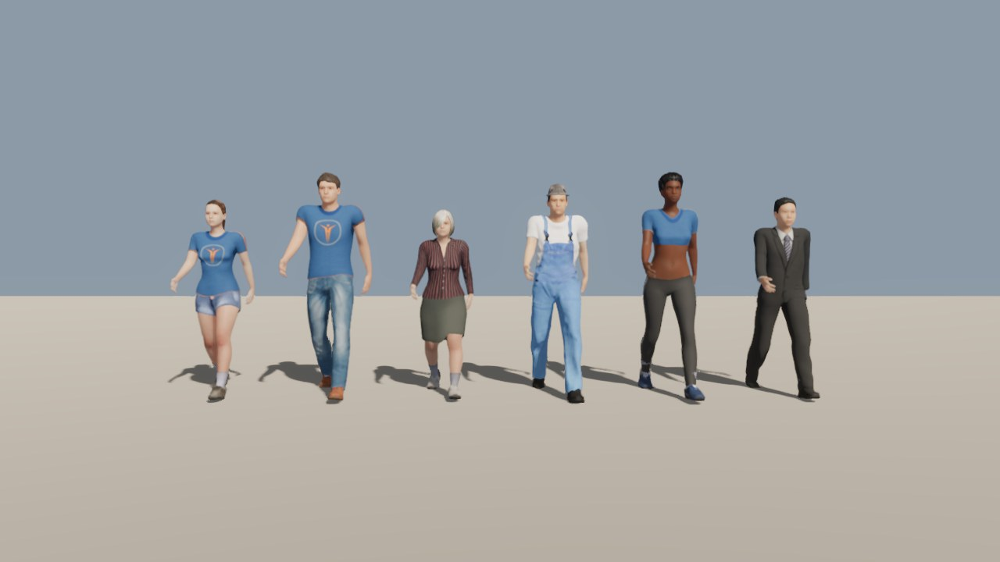

# 0374 — People made with MakeHuman, worn over the mannequins

Status: **KEEP** · Branch `fellow/geometry` · Showcase (no engine change) · Code: `tools/fellow_characters/`
(`make_characters.py`, `people.json`), `showcase/people/*.glb`, `showcase/scripts/fellow_person.gd`,
`showcase/scripts/rooftops_crowd.gd` (`PEOPLE`, `--people=0`), `showcase/tools/person_look.gd`

## Problem

The gap analysis after milestone 230 (`docs/fellow_gap_analysis_m230.md`): "characters as seen: wooden mannequins — the
largest visible gap" against Unreal Engine's MetaHumans; it proposed MakeHuman as a pipeline beside the engine. The
owner: "these main gaps sound like something we must do".

## Change

* **A pipeline in the cloud, nothing on the owner's laptop**: Blender 5.3 as a Python module and MPFB 2 (MakeHuman for
  Blender) from its source, installed into a Blender profile of the tool's own; MakeHuman's system assets pack (CC0).
  `make_characters.py` makes the six people of `people.json` (ages 25 to 77, three origins, their own skins, hair and
  clothes) in 32 s. Each: about 33 000 triangles, 53 bones (MPFB's "game_engine" rig renamed to Godot's humanoid
  profile), 1.7-2.2 MB. All of it CC0.
* Found on the way: MPFB keeps the body's macros as shape keys over the neutral base mesh, which the glTF exporter
  writes without them — the hair cap and the clothes, fitted to the shaped body, stood off a neutral one (a skin
  "collar" at the neck, a bald crown): the mix is applied before export. Blender's JPEGs carry an ICC segment Godot's
  JPEG loader (libjpeg-turbo) refuses ("Couldn't load image ... image/jpeg"): every image is encoded again with Pillow.
* **Worn over the mannequins** (`FellowPerson.dress()`): the mannequin keeps its skeleton and all that drives it (its
  clips, the crowd's reactions, the look at, the falling bodies, the footprints); its mesh is hidden and a
  `RetargetModifier3D` under its skeleton hands its pose to the person's. Its rest is a T-pose, MPFB's an A-pose:
  handed over from different rests, the arms ended crossed over the body; the person's limbs' rests are turned to the
  mannequin's directions first (only the rests — the skin's binds unchanged, so at rest the person stands as the
  mannequin does). The person keeps its own height (the hips' motion scaled by the ratio of the hips' heights). The
  modifier is kept the last of the mannequin's modifiers (the head's look and the falling bodies are added later).
* Materials for the engine: the skin with subsurface scattering (skin mode, 0.35), the hair, eyebrows and eyelashes
  alpha scissor on both sides, the eyes wet; each person's clothes and hair tinted a little of its own (63 people from
  six: no twins side by side).
* The rooftops' crowd wears them (`--people=0`: the mannequins); the breath and the footprints on the person's head and
  feet.

## Checks (lavapipe; no GPU, the owner's request)

* `person_look.gd`: each person and the cast standing, walking, from the front, the side and the face; against the
  mannequin side by side (`--mannequin=1`) the same pose. Before the rests were turned: the arms crossed over the body;
  before the shape keys were applied: the collar and the bald crown.
* The crowd script on its own (a loop of walkers, a group talking, two keepers): no error, every one dressed.

## Decision

KEEP. Next: skin shading worth a close look (its normal and roughness detail, the eyes), period clothes from the CC0
packs, the player's own person, faces (MakeHuman's visemes for FellowFaceAnimator); the GPU's time with 63 people on
the RTX.

## Rejected

* **Retargeting at import** (a BoneMap with the rest fixer in each `.glb.import`): it renames and re-rests in the
  import, but a BoneMap written by hand into the import file is fragile, and the mannequin's systems would still need
  a second skeleton; turning the rests at run time is one function and works for any MPFB rig.
* **Scaling each person to the mannequin's hip height** (feet where the mannequin's are): everyone became 1.80-1.95 m.
