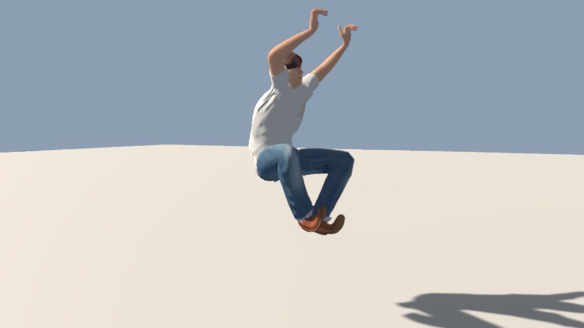

# 0375 — The player a person, its hands and feet on the mannequin's contacts

Status: **KEEP** · Branch `fellow/geometry` · Showcase (no engine change) · Code: `showcase/scripts/fellow_person.gd`
(`p_match_height`, `_contact_ik`), `showcase/scripts/fellow_person_contacts.gd`, `showcase/scripts/rooftops_player.gd`
(`PLAYER_PERSON`, `--player_person=0`), `tools/fellow_characters/people.json` (`luca`)

## Problem

After decision 0374 the rooftops' people were people and the player still a mannequin. The player is not like the
crowd: its traversal puts the mannequin's hands on holds and ledges and its feet on the wall (FellowTraversalPose3D),
and a person's arms and legs are not the mannequin's.

## Change

* A seventh person for the player, Luca (athletic, 25), worn over the player's mannequin as the crowd's are, but scaled
  so that his hips stand at the mannequin's.
* Measured with the player's 54 clips (each at 12 times): the person's hands and feet against the mannequin's — 11-16 cm
  apart when hanging, mantling, vaulting (the arms' proportions). A two-bone IK on the person's limbs fixes that, the
  elbows and knees in the plane of the mannequin's, the hands and feet keeping their turn. Its place matters: a
  TwoBoneIK3D on the person's own skeleton ran before the hand-over and was overwritten by it (the person's skeleton
  updates before the mannequin's), and BoneAttachment3Ds on the mannequin follow its pose before its modifiers (1.2 m
  off the hanging hands). So the IK is a modifier on the mannequin's skeleton right after the RetargetModifier3D
  (`fellow_person_contacts.gd`), in the same update.
* What was left was the reach: the mannequin's arms are long, the person's hands fell up to 6.8 cm short. A limb is
  stretched up to 10 % when its target is beyond it.

## Measurements (lavapipe)

| | hands and feet off the mannequin's, worst clip |
|---|---|
| retargeting only | 15.9 cm (hang_leap_up); hanging 11.0 cm |
| with the IK | 6.8 cm (jump_run), all of it out of reach |
| with the IK and up to 10 % stretch | 1.6 cm (jump_run); 0.75 dive_start, 0.4 vault; the others 0.01 cm |

## Decision

KEEP. The rooftops on lavapipe outgrow the cloud machine's 7 GB, so the player has not been seen on the walls yet: on
the RTX when allowed.
