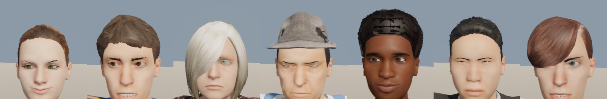

# 0377 — The people's eyes and moods

Status: **KEEP** · Branch `fellow/geometry` · Showcase (no engine change) · Code:
`tools/fellow_characters/make_characters.py` (`eye_bones`, `eye_colour`), `tools/fellow_characters/people.json`
(`eye_colour`), `showcase/scripts/fellow_person_eyes.gd` (new), `showcase/scripts/fellow_person.gd` (`_face`, `PAIN`),
`showcase/scripts/rooftops_crowd.gd` (`_mood`, the gaze in `_social`), `showcase/tools/person_look.gd` (`--look`,
`--mood`)

## Problem

After decision 0376 the people blinked and talked but their eyes stayed fixed in their heads — MPFB's "game_engine"
rig has no eye bones and the eyes' mesh was skinned to the head — and their faces had no moods: the same face greeting
the player, knocked flat by them and getting up. Every pair of eyes was also the pack's default, a red-brown.

## Change

* **Eye bones** (`make_characters.py`, `eye_bones`): Godot's humanoid `LeftEye` and `RightEye` under the head, at each
  eyeball's centre (the eyes' mesh's two halves' bounds), and each eyeball's vertices weighted wholly to its own bone.
  55 bones a person instead of 53.
* **Irises** (`eye_colour`, the spec's `eye_colour`): one of the pack's nine eye textures, or `darkbrown` — the pack's
  brown turned from its red towards a neutral dark brown (the iris's hue moved by up to 10 of 255, its saturation two
  thirds). Green, dark brown, blue-green, grey and blue across the seven.
* **The gaze** (`fellow_person_eyes.gd`, a `SkeletonModifier3D` on the mannequin's skeleton after the person's
  `RetargetModifier3D`; the mannequin has no eye bones, so the hand-over leaves the person's alone): the angles are
  FellowFaceAnimator's (its target, its range, its easing and saccades — and its eyelids' look shapes from the same
  angles). The face measures them from its mesh, which does not turn with the head's bone; the modifier gives it, each
  frame, how far the head has turned towards the target (`set_head_turn`: the angles from the body less those from the
  head, the head's turn taken from its rest), so the face's angles are the eyes' in the head; each eye is turned by them
  from its rest in the head, turned in by half the angle a target 6.4 cm wide subtends. Without a target the eyes rest
  ahead with their saccades. A face not processed (farther than 25 m in the crowd) leaves its eyes as they were.
* **Moods** (`rooftops_crowd.gd`, `_mood`: an expression for so many seconds, the one before faded out): surprised
  when staggered (1.4 s), when knocked (until down) and when pointing up at the player on a wall; in pain on the ground
  (a "pain" expression FellowPerson adds: brows down, eyes and cheeks squinting, the nose wrinkled, the mouth
  stretched); cross for 5 s after getting up; glad when the player talks to them — or cross if the player knocked them
  down before —, kept while the talk goes on. The eyes go to the player as soon as the head is to turn (the eyes lead
  it) and come back with it.
* **Found on the way**: milestone 234 stored the face animator under the person's `"face"` key, which already held the
  way the person faces at its place: a person who walked back to its place after a reaction failed at
  `float(p.face)` (a script error each frame, the person never settling). The animator has its own key now.

## Checks (lavapipe; no GPU, the owner's request)

* Aim (a scratch script: a target sweeping 20° to each side and 12° up and down 1 m from Giulia playing "idle", her head
  turning up to 15° with the clip, saccades off): each eye's axis within 1.34° of the target over the sweep (the
  easing's lag). Before the head's turn reached the face (`head_turn` set as a property, which it is not: only a
  method) the error followed the head's turn, up to 16°.
* The cast's faces, each with a mood and its eyes on a circling target (`person_look.gd --view=face --look=1
  --mood=...`): `docs/showcase/faces_m235.jpg`.
* The crowd script with a player standing by: a talk (glad, eyes on the player), one of the group knocked down
  (surprised, in pain on the ground, cross getting up, walking back to its place and settling there): no error.
* Cost: 6.8 µs a person a frame for the eyes (an editor build), only for the faces processed.

## Decision

KEEP. Next: the hair cards' dark fringes (Amara's afro, seen here: alpha scissor over mipmaps), the player's own eyes on
whom they talk to, idle glances at passers-by.

## Rejected

* **The eyes as followers of the face's look shapes** (MakeHuman's eyeLook targets fitted to the eyes' mesh, as the
  lashes follow the blink): a blend shape moves the eyeball's vertices along straight lines — the iris slides over the
  ball instead of turning with it, worse the farther it looks.
* **A `LookAtModifier3D` per eye on the person's skeleton**: its gaze would not be the face's (its saccades, the
  eyelids' look shapes following it), and a modifier on the person's skeleton does not run after the hand-over
  (decision 0375: a two-bone IK there was overwritten).
