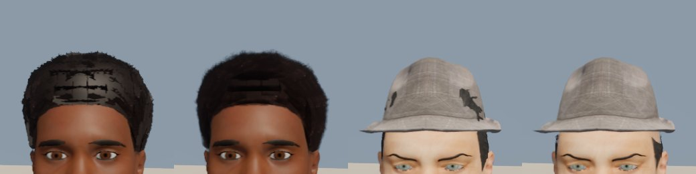

# 0378 — The people's hair: soft edges, duller, cut under hats

Status: **KEEP** · Branch `fellow/geometry` · Showcase (no engine change) · Code:
`showcase/scripts/fellow_person.gd` (`_materials`, `hair_mode`, `HAIR_ROUGHNESS`, `HAIR_SPECULAR`),
`tools/fellow_characters/make_characters.py` (`trim_under_hat`), `showcase/people/aldo.glb`,
`showcase/tools/person_look.gd` (`--hair`, `--hide`)

## Problem

Seen in milestone 235's faces (decision 0377): Amara's afro was a shiny dark cap with black patches, and Aldo's fedora
had black patches on its crown. The hair was cut by its alpha (alpha scissor at 0.45) and as glossy as the skin
(roughness 0.6, Godot's default specular 0.5): black hair shone like plastic, its cards' edges hard. The fedora's
patches were the hair: MPFB fits the hair to the head, not to the hat, and its cards came through the crown (hiding the
hair's mesh, `person_look.gd --hide=short04`, the patches went).

## Change

* **Hair drawn in two steps** (`FellowPerson._materials`, `hair_mode` 1): `TRANSPARENCY_ALPHA_DEPTH_PRE_PASS` — where it
  is opaque it is drawn before the other passes (depth written, so the strands behind it are hidden and nothing sorts
  wrongly within it), and the whole is blended after them (its edges soft). Roughness 0.8, specular 0.25. The eyebrows
  and eyelashes stay cut by their alpha (blended, the thin brows went pale). `hair_mode` 0: as in 232-235.
* **Hair cut under a hat** (`trim_under_hat`, for clothes named like a hat: fedora, hat, cap, helmet, hood): the hair's
  faces with a vertex above the hat's lowest point over it (the hat's vertices within 2 cm seen from above, less 5 mm)
  are removed; what hangs below the brim stays. A first version used the hat's lowest point overall: the fedora is
  tilted, and the hair under its brim on one side went too.

## Checks (lavapipe)

* Faces (`person_look.gd --view=face --hair=0|1`) of Amara, Giulia, Aldo and Rosa: the afro soft at its edges, its cap
  no longer shining (a few darker bands of its texture remain); Giulia's and Rosa's hair the same but for their edges;
  the brows as before. Alpha hash was tried too: its dither showed on the brows.
* Aldo with the cut (front and side): the crown clean, the hair below the brim at his sides and back.
* The cast walking: the same at a distance, the hair a little less glossy.

## Decision

KEEP. The hair is now in the transparent pass (drawn twice: its pre-pass and its blend): its cost with 63 people to be
measured on the RTX with the rest.
