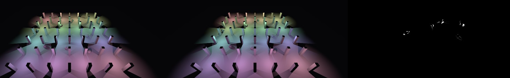

# 0380 — A budget for the omni and spot lights' shadows drawn in a frame

Status: **KEEP as an option** (0, off: it changes the image while over budget) · Branch `fellow/geometry` · Settings
`rendering/fellow/shadows/positional_update_budget`, `positional_update_max_wait` · Code: `renderer_scene_cull.{h,cpp}`
(the positional shadows' loop), `storage/light_storage.h`, `storage_rd/light_storage.{h,cpp}`
(`fellow_shadow_atlas_last_reallocated`), `fellow_positional_shadow_cache.h` (settings, counters)

## Problem

The gap analysis after milestone 230 named many shadowed lights the gap after the characters: Unreal's MegaLights
draws hundreds. Decision 0373 made each redraw of an omni or spot light's shadow cheap (its static casters copied,
only the moving ones drawn), but every light with something moving in its range is still drawn again in every frame:
a night street of lamps with people walking under them draws all of its lamps' shadows every frame. The second part of
the plan was a budget per frame. (The other half, a shadow's resolution by its size on screen, is stock Godot's: the
atlas's quadrants are chosen by the light's coverage.)

## Change

With `positional_update_budget` N > 0, the positional shadows' loop decides the redraws after it has seen every light:

* the lights whose shadow wants drawing again (stock's test: something changed in their range, or a new place in the
  atlas) are collected instead of drawn on the spot;
* drawn: every light given a new place in the atlas (what is there is another light's shadow — the atlas now tells
  whether its last update moved the light) and every light that has waited `positional_update_max_wait` renders (8);
  then, up to N in all, the largest on screen times the renders it has waited (Godot's coverage × (1 + waited)) — the
  longer a light waits, the higher it climbs, so the lights take turns; in the order stock would have drawn them;
* the others keep the shadow of the frame they were last drawn in (their slot in the atlas is untouched) and are dirty
  again, asking the next render.

0: the loop is stock's.

## Checks (lavapipe; no GPU, the owner's request)

A scratch scene: 16 shadowed omni lights (dual paraboloids) over 49 pillars, 8 balls circling among them (every
light's shadow wants drawing in every frame), 90 frames at a fixed 60 fps:

| budget | shadows drawn (90 frames) | faces drawn from the cache | image against no budget (6 frames, 30-89) |
|---|---:|---:|---|
| 0 (off) | 1 440 | 2 880 | — |
| 8 | 728 | 1 440 | 4 frames bit for bit, 2 at 52.1 / 57.2 dB; 0.02 % of pixels more than 2 levels apart |
| 4 | 372 (16 new places, then 4 a frame) | 720 | 41.6-48.0 dB, 45.6 on average; 0.17 % |

The differences are the balls' shadows from the lights waiting their turn, a frame or three behind
(`docs/showcase/shadow_budget_m238.jpg`: no budget, budget 4, their difference). No light waited 8 renders: with 16
lights and 4 a frame the waited factor turns them round every 4 frames.

Regression suite: `pos_budget_all` (budget 3, the `pos_cache` scene's three lights: all drawn) bit for bit `base`;
`pos_budget` (budget 1) its own golden, run twice the same; with the budget off the shadows' groups (`lights`,
`shadows`, `pos_cache`, `pos_cache_*`) unchanged.

## RTX laptop (2026-11-27)

The showcase's square at night (`climb_look.gd --program=weather --view=square --night=1`, 1920×1080, 840 frames, two
runs each): budget 0 → 4, GPU 8.60 / 8.39 → 8.68 / 8.10 ms — the same: no positional light there redraws its shadow
every frame (the cache's counters stay at 0 in that view), so the budget has nothing to save. It stays an option for
scenes with many shadowed lights that move or have movers near.

## Decision

KEEP as an option, off by default (over budget the shadows of moving things lag). The cost it saves is the redraws'
— on the RTX, to be measured with the rooftops at night (its lamps and 63 people) when the owner allows the GPU.

## Rejected

* **Taking the atlas's "redraw" as "the light was moved in the atlas"**: the atlas also says so when the light only
  wants a bigger place it cannot get (it keeps its old one): with 16 lights contending, 724 of 872 redraws were
  forced so. The atlas now tells only a real move.
