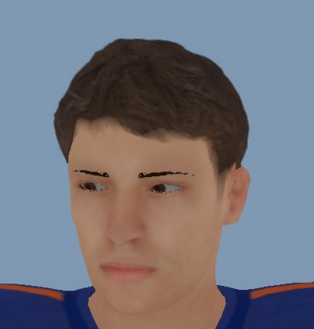

# 0382 — The people glance at each other; the player looks at whom it talks to

Status: **KEEP** · Branch `fellow/geometry` · Showcase (no engine change) · Code: `showcase/scripts/rooftops_crowd.gd`
(`_mates`, `_glance`, `_head_of`, `_player_gaze`, the head's share in `_social`)

## Problem

After decision 0377 the people's eyes followed the player when they looked at it, and otherwise rested ahead with
their saccades: a talking group stared into the middle of its circle, each at nothing, and the player's own eyes never
went to the person it talked to.

## Change

* The people standing together (a group, the ring round the brazier) know each other (`_mates`). While one does not
  look at the player, every 1.2-3.5 s it picks where to look: three times in four at one of its group who is talking
  (its clip "talk"), otherwise at any of them, or one time in four ahead. Its face's gaze goes to that one's head (a
  node kept at the head, eye height) and its head turns 45 % of the way (the same LookAtModifier3D the player's
  attention uses, at a weight of 0.45): the eyes do the rest, up to their range.
* Looking at the player still wins (and on leaving it, a new glance is picked at once).
* The player: while a conversation goes on, its face's gaze is on the other's head.

## Checks (lavapipe)

* A group of four, the player far (a scratch script): 15 glances in 10 s, about a third of the time each at nothing,
  at one talker or at the other; the eyes' angles within their range (the farthest neighbour beside one turned the
  head and took the eyes to 30°). A close-up during a glance: `docs/showcase/glance_m240.jpg` (the head half turned,
  the eyes on the neighbour).
* The crowd script with a talk and a knock-down (decision 0377's): no error.

## Decision

KEEP.

## Rejected

* **A micro-normal map for the skin** (pores and fine creases, made from noise, tiled 30 times over the body's second
  UV set — the MakeHuman skins have colour only): at the showcase's distances it averages out in the mipmaps — a face
  filling a 1280-pixel frame differed from the smooth one by 61.2 dB, 0.05 % of pixels more than 2 levels apart —
  for 0.4 MB more and a second UV set on every body. Dropped; skin up close wants scanned textures, not noise.
