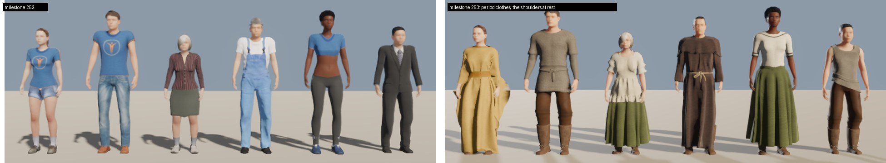
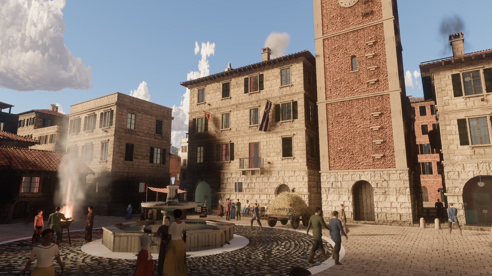

# 0394 — The people dressed for their town: period clothes, dyes and layers; their shoulders

Status: **KEEP** · Branch `fellow/geometry` · Showcase: `showcase/people/*.glb` and `<name>_ao.png` (the seven people
made again), `showcase/scripts/fellow_person.gd` (`PERIOD_DYES`, `UNDYED`, `_dye`, `_wool`; `LIMB_TAILS` without the
clavicles) · Tools:
`tools/fellow_characters/people.json` (the clothes), `make_characters.py` (`PLAIN_CLOTH`, `plain_cloth`, `LAYERS`,
`layer_clothes`), `tools/fellow_characters/CREDITS.md`

## Problem

The owner, looking at the showcase: the people do not fit the scene — modern people dropped into a town of an
Assassin's Creed kind, and it looks very bad. The rooftops are a Tuscan town of the 15th century (stone and stucco
houses, a fountain, an osteria, a hay cart, braziers), and its people (decisions 0374-0391) wore what MakeHuman's
system assets pack has: T-shirts with a logo, jeans, denim shorts, dungarees, a crop top and leggings with trainers, a
business suit and tie. Every crowd figure on the square showed the same.

## Change

* **The clothes** (`people.json`), from MakeHuman's community asset packs (dress01, dress02, skirts01, suits02,
  shirts03; CC0 and CC BY, `CREDITS.md`): Giulia a long gown with draped sleeves and a belt; Marco and Luca (the player)
  a wool tunic over hose and boots; Rosa a peasant blouse, a long full skirt and an apron; Aldo a friar's habit with
  its rope girdle; Amara a short-sleeved tunic over a long full skirt; Kenji a labourer's asymmetric tunic with a sash,
  hose and boots; everyone the same leather boots.
* **Plain cloth** (`make_characters.py`, `PLAIN_CLOTH`): five of the garments came with a modern print or emblem (a
  floral apron, a floral tunic, a blouse in a geometric print, a skirt in camouflage, a tunic with a printed emblem);
  their colour textures are replaced by a woven cloth the tool makes (a plain weave with slubs, light grey: wool
  coarser, linen finer), their normal maps kept.
* **Period dyes** (`FellowPerson._dye`): each garment's colour from what a Tuscan dyer of the time had — madder reds,
  woad blues, weld yellow, walnut browns and russet, green (woad over weld), black, undyed grey wool — chosen by the
  person's seed and the garment's name (a crowd's twins dress apart; one person's pieces differ); linen (the blouse,
  the apron, the tunic) undyed or bleached; leather and the friar's habit as they are. The sheen (decision 0383) on
  wool, not on linen or leather. Before, a person's clothes were all multiplied by one random tint of any hue.
* **Layers** (`layer_clothes`): MPFB fits each garment to the body alone, so garments worn over others crossed — the
  blouse's hem came out through the skirt in white patches, the skirt's folds through the apron. For each pair in
  `LAYERS` the inner garment's vertices under the outer one are drawn in under it along the line from the body's axis
  (the waistband's centre): the outer's surface is found along that line and four lines 15 mm around it (its folds
  between two vertices), the vertex moved to 6 mm inside the nearest; a tucked-in garment's faces wholly under the
  waistband are removed. What moves is the hidden garment, so no seam or hole opens in what is seen. The pairs: the
  skirt under the apron, then the blouse and the tunic under the skirt as it now lies.

* **The shoulders** (`fellow_person.gd`, `LIMB_TAILS`; the owner: why are some people's shoulders pushed up?): before
  the mannequin's skeleton drives a person, the person's limbs' rests are turned to point as the mannequin's do (MPFB's
  A-pose against its T-pose, decision 0374) — the clavicles too. The mannequin's clavicles rise 9 degrees from the
  neck, MPFB's fall 6-10: every person stood with its shoulders shrugged 16-20 degrees, about 5 cm, the men most (their
  clavicles fall most). The clavicles now keep their own rests (the arms from the shoulder on are still turned); the
  mannequin's clavicle motion is handed over from them.

## Checks (lavapipe, `person_look.gd`)

* The cast (`docs/showcase/period_clothes_m253.jpg`, before and after): nothing modern left; the dyes read as cloth
  of the time, not as fashion colours.
* Layers, in Blender (the rest pose, each garment its own colour) and in the engine (walking, front and side): Rosa's
  apron clean over the skirt, the blouse under its waistband; Amara's tunic tucked. The first attempt moved the
  apron's vertices out to the skirt's nearest surface: neighbouring vertices went to different folds and the apron
  tore into strips (the skirt showing through); moving the hidden garment in fixed it.
* The square by day with its 61 people (`climb_look.gd --program=weather --view=square --crowd=1`): on the RTX laptop
  (lavapipe runs out of the container's 8 GB with the crowd; below).
* The shoulders, the cast standing and walking: the shoulders level with the base of the neck where they rose over
  it (Marco, Aldo, Kenji most); the arms swing as before.
* The meshes: 4.5-6.3 MB a person, were 4.0-4.5 (the apron is dense: 28 700 vertices); the cast's draw calls as
  before (189 a frame against 190: about as many garments a person).
* The image regression suite does not include the people: exact.

## RTX laptop (2026-11-28; RTX 5070 Ti Laptop, milestone 253's build)

The square by day without its people and with them (1920×1080, 840 frames, two runs each, alternating), against
decision 0389's milestone 251:

| | 251: without → with the people | 253: without → with the people |
|---|---|---|
| render thread | 1.57 → 2.99 ms (+1.42) | 1.71 → 3.31 ms (**+1.60**) |
| shadow draws a frame | 1492 → 1859 (+367) | 1494 → 1920 (**+426**) |
| GPU | 8.47 → 9.02 ms (+0.55) | 8.95 → 9.69 ms (**+0.74**: runs 9.91, 9.47) |

The new clothes cost the crowd about +0.18 ms of the render thread and 59 shadow draws a frame (Rosa's four garments
where she had two, the apron's dense mesh) and about +0.2 ms of the GPU, within this view's run-to-run spread (the runs
with the people 0.44 ms apart). The frame stays under 10 ms.

## Decision

KEEP. Open: hats and headwear of the time (a coif or veil for the women, a cap or hood for the men; tried, below),
period hair for the men (their haircuts are modern), and a
doublet or a giornea for the well-off.

## Rejected

* **Tinting the old clothes** (jeans and T-shirts in period colours): their cut is modern whatever their colour.
* **The apron pushed out over the skirt** (each of its vertices to the skirt's nearest surface): it tore (above).
* **Headwear from the hats03 pack** (CC BY: a linen veil for Rosa, a soft cap for Marco): MPFB fits the hair to the
  head, not under the hat, and the hair's cards cut away under them (decision 0378's trim) left a bald band between
  the cap and what hung below it, a scalp showing at the veil's front; and the cap, a slouchy beanie, read as modern.
  Headwear wants hair made for it (short under a cap, gathered under a veil).
* **The hood of the monk's robe as a separate garment**: `donitz_monk_robe_hood_down` is the hood alone (Aldo came out
  naked under it); the habit is `donitz_monk_robe`.
