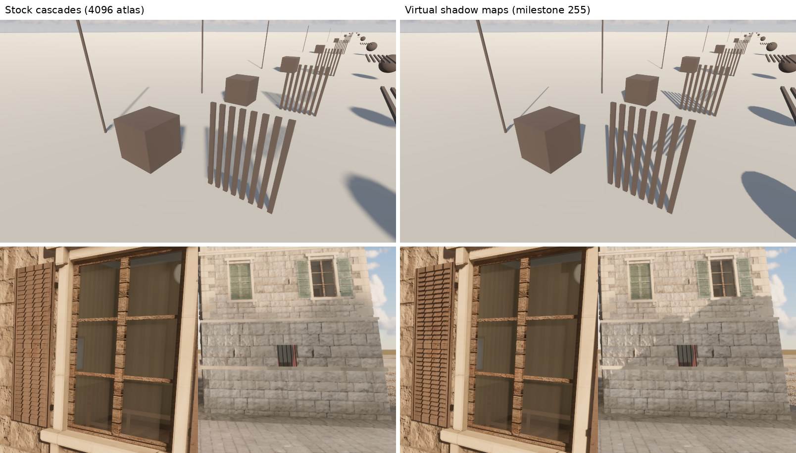

# 0396 — Virtual shadow maps for the sun

Status: **KEEP as an option (off)** · Branch `fellow/geometry` · Settings: `rendering/fellow/shadows/virtual/*` ·
Code: `servers/rendering/fellow_virtual_shadow.h` (the frame handed over, the requests read back),
`servers/rendering/renderer_scene_cull.cpp` (`_fellow_vsm_update`: pages, invalidation, passes),
`servers/rendering/renderer_rd/effects/fellow_virtual_shadow.{h,cpp}` and `shaders/effects/fellow_virtual_shadow.glsl`
(the table, clearing pages, marking them), `render_forward_clustered.cpp` (`_fellow_vsm_begin`, `_fellow_vsm_mark`,
`_fellow_vsm_append_passes`), `scene_forward_clustered.glsl` (`MODE_FELLOW_VSM`, `fellow_vsm_shadow`) · Check:
`showcase/tools/vsm_look.gd`

## Problem

Where FellowEngine stands against Unreal Engine 5 (the owner: where are we short of Unreal and of AAA?): the sun's
shadows are Godot's cascades — four slices of a 4096 atlas (decisions 0004, 0388 made them cheaper and fitted them to
the view) — so a texel near the camera is a few centimetres and far away a metre or more. Railings, shutters' louvres, a
fence's slats and poles lose their shadows' shape or come out as smears; decision 0388 measured a courtyard at
25.5-29.2 dB against a 16384 atlas. Unreal's virtual shadow maps keep a texel about a pixel wide at every distance.

## Change

* **Clipmap levels of pages.** The first shadowed directional light gets a virtual shadow map: levels (12) of 64 × 64
  pages of 128 × 128 texels, level 0's texel `texel_size` (2 mm), each level's twice the one before (level 11: 4 m),
  each level's window centred on the camera in the light's space (absolute page coordinates: pages keep their place
  as the camera moves). A texel holds the highest caster's height towards the light (fixed point, 1/1024 m, offset by
  2^31: 0 is no caster), so pages drawn from different frames' cameras agree.
* **Only the pages looked up.** After the depth pre-pass a compute pass takes each pixel's view position, the level its
  size asks for (`ceil(log2(size / texel_size) + lod_bias)`, the size a pixel spans at its depth), its page and the
  pages its filter and normal offset reach, as bits; they are read back asynchronously (a few frames late). The scene
  cull allocates the requested pages that are not resident in a physical pool (`pool_size` 4096: 1024 pages, 64 MB,
  R32UI), coarse levels first, at most `max_new_pages_per_frame` a frame, evicting pages not asked for in 8 frames,
  oldest first; pages leaving their level's window are freed.
* **Drawn once, kept.** A page is drawn when it is allocated, when a static caster that covered it changed or left (the
  invalidation events of the shadow caches, decision 0004), and every frame while a dynamic caster covers it now or
  covered it last frame (moved, animated, skinned, a material moving vertices, changed in the last few frames; casters
  moved only by the wind not on levels with texels of 5 cm or more, decision 0125's reasoning). Each frame's drawn
  pages are cleared (compute), then drawn by one shadow pass per region of 16 × 16 pages of a level holding some
  (their bounding rectangle, at most 2048 × 2048 texels): an orthographic camera at the level's window corner, the
  casters whose light-space boxes touch a drawn page of the region (a summed-area table of the drawn pages), into an
  empty framebuffer; the fragment finds its texel's page and `imageAtomicMax`es its height into the pool where the page
  is drawn this frame (`MODE_FELLOW_VSM`: the scene shader's depth variant with the pool as an image, a pipeline
  version after the colour passes', compiled when first needed). The passes go through the batched shadow lists
  (decision 0016) with the stock directional passes; HLOD proxies and members and instance ranges are drawn on the
  levels whose distances they cover.
* **Shading.** In the colour passes (a specialization bit) the light's shadow is looked up on the finest level a pixel
  asks for whose pages under its filter are resident, else a coarser one, else the cascades: a box filter two texels
  wide (9 texels), each texel's height compared with the receiver's plane at the texel's centre (its slope from the
  geometric normal), a bias of a texel, the lookup moved along the normal by a texel. Beyond the shadow's max distance,
  and where no level has the pages (the first frames, a page not yet allocated), the cascades as before; the light's
  fade as before.
* **On the CPU** the scan of the scenario's instances reads only their InstanceData and boxes (copies there of the
  change frame's low bits and of what makes a shadow uncacheable), about 27 ns an instance on this machine.
* Where a render buffers' pool does not hold what the cull's state thinks resident (the buffers resized, the pool made
  again) only the pages drawn that frame are looked up and the cull starts over. Not in views smaller than 320 × 240
  (the editor's previews), in reflection probes, with MSAA (no marking), in XR; Forward+ only. Off, the pool is freed
  and the frame is stock's.

## Checks (lavapipe; `vsm_look.gd`, a lab of poles 4 cm thick, fences of 5 cm slats, lattices of 2 cm bars, boxes and
balls at 2-150 m under a sun 32° high; the rooftops' square, `weathering_look.gd --lite=1`)

* The image: sharp shadows near and far where the cascades blur them — each fence slat's shadow apart at 2 and 5 m,
  the poles' lines, the balls' ellipses; on the rooftops each louvre of a shutter casts its own line, the
  neighbouring houses' silhouettes on a facade keep their steps (`docs/showcase/virtual_shadows_m255.jpg`).
* Pages: the lab at 960 × 540 83-167 resident, the rooftops' square at 1280 × 720 115-233 requested and resident —
  two to four pages per 16 384 pixels; at rest no page is drawn (0 passes a frame once the casters have been static for
  `directional_cache_static_frames`).
* Kept pages against pages drawn every frame (every caster made dynamic: `directional_cache_static_frames` 100000), 90
  frames, two views: one view the same pixels, the other 20 pixels at a box's foot up to 8 levels (pages kept from the
  first view were drawn from a camera at another height: a texel's height rounds the other way). A ball swinging
  through the lab (a dynamic caster, `--move=1`) against every caster dynamic: the same pixels — its pages drawn where
  it is and where it was.
* A closed room of thick walls (`room`): no light inside but through its door.
* The scene cull's part: 0.12 ms for the lab, 0.27-0.29 ms with 10 000 more instances (1.1-1.2 ms before the scan read
  only InstanceData: the instance and its geometry data were two cache misses each); the rooftops' square 0.13-0.26 ms.
* The rooftops' osteria: sunlight in dashes on its floor behind the arches where the cascades show none — the room's
  front wall and the building's arches meet with gaps of millimetres; with texels twice as large (lod bias 1) the
  dashes widen, with texels half as large (−1) they thin (light through a slit, not an artefact of the pages); a closed
  room of overlapping walls shows none. The geometry is the showcase's to fix.
* The image regression suite (the setting off): 48 of 48 scenes exact.

Not measured on a GPU (the owner: no GPU for now): the passes' and the lookups' cost, and whether the cascades can be
dropped where the pages cover the view.

## Decision

KEEP as an option (off): it changes the image, and its cost on a GPU is not known yet. Open:

* The cascades are still drawn for the pixels without pages; with the pages resident almost everywhere they could be
  reduced to one coarse cascade (the time a virtual shadow map should save).
* Soft shadows from the sun's size (Unreal's shadow-map ray tracing): the filter is two texels wide whatever the
  distance from the caster, so contact and far penumbrae are alike.
* Only the first shadowed directional light; positional lights keep the shadow atlas.
* Transparent surfaces are not marked (no depth in the pre-pass): their shadow is the cascades' unless an opaque pixel
  asked for the page.
* The scan of instances runs every frame (dynamic casters are found by it): a BVH query of the regions with resident
  pages, or worker threads, would bound it in large worlds.

## Rejected

* **One pass per level over its drawn pages' bounding rectangle**: two pages at a window's opposite corners make an
  8192 × 8192 pass, every fragment of a large ground run for nothing (lavapipe rasterizes it all); passes per region of
  16 × 16 pages bound a pass to 2048 × 2048.
* **Depths relative to the passes' camera** (a depth attachment per pass): pages drawn in different frames from
  different camera heights would not compare; the pool keeps absolute heights in fixed point instead (`atomicMax`, no
  depth attachment).