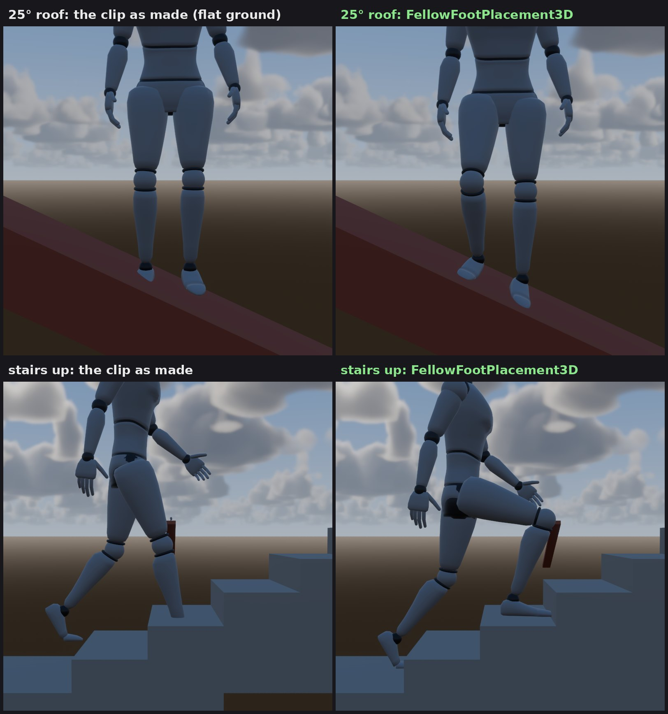

# FellowEngine — milestone 174 report (foot placement: the feet on the ground under them)

Status: **FINAL** (2026-11-22). Branch `fellow/geometry`. The cloud's CPU only (the course and the gates headless, the
pictures on lavapipe); no GPU, by the owner's decision.

## 0. Result

Clips are made on flat ground. On a slope, a stair or rubble the character stands where its capsule rests and its feet
go into the ground on one side and hang over it on the other — in the rooftops showcase, on every roof.
`FellowFootPlacement3D` (decision 0316), a skeleton modifier for any skeleton after its animation (and after a
`FellowFootLock3D`), puts them on the ground under them: rays under each heel and ball, each foot raised or lowered and
turned to the ground while down, the hips lowered for the lower foot and for a leg's reach. Its heights are eased in
the world (a foot down stays put while the body climbs over it or steps down a stair), following moving goals with
their velocity (no lag along a slope), and a swinging foot looks 0.05 s ahead for a step's edge.

The foot placement course (new): CMU's walk driving a CharacterBody3D (steps up to 0.35 m) over eight lanes.

| walk | feet down sunk p95 | floating p95 | swinging foot in the ground |
|---|---:|---:|---:|
| ramp up 20° | 10.9 → **0.8** cm | 8.6 → **0.8** cm | 27.7 % → **0** |
| ramp up 30° | 16.4 → **1.3** | 15.1 → **0.8** | 31.9 % → **0** |
| ramp down 20° | 6.0 → **1.2** | 10.0 → **0.1** | 11.3 % → **0.4 %** |
| stairs up | 5.1 → **0.2** | 15.8 → **4.3** | 13.1 % → **1.2 %** |
| stairs down | 2.0 → **0.0** | 16.1 → **2.5** | 3.8 % → **0** |
| rubble | 1.8 → **0.2** | 8.4 → **1.9** | 3.6 % → **0** |
| flat | 0 → 0 | 0.1 → 0.1 | 0 → 0 |

Legs near straight 0-0.2 % of the frames (as animated: 0.2 %); 4-7 µs a character (four rays, a fifth for a swinging
foot). The run: up 30° floating 18.4 → 1.7 cm, stairs up 16.2 → 2.2; down stairs a running foot lands late (floating
3.1 → 4.2 cm). In the rooftops showcase the player has one after its foot lock, with the lock's weight; its 38 animation
gates (flat ground, gaits, climb) are unchanged.

## 1. How it got there

* Eased relative to the body, a foot down lagged behind the body climbing over it: eased in the world.
* Eased without the goal's velocity, a swinging foot trailed its ground by 6-8 cm on a 20° ramp; the velocity is now
  measured when the pose changes, over the time since it last did (measured when the goal changed, it was always
  about zero: the goal changes slightly in the skeleton's other pass of the frame).
* The hips eased only: legs straightened in 6-17 % of the frames on the ramps; the legs' reach is enforced at once.
* Down slowly in the air: a foot stepping down a stair landed 7 cm over it (95th percentile); in the air it goes down
  as fast as up: 2.5 cm.
* The look ahead: none — a toe in the stairs in 11 % of the swing; 0.05 s — 1.2 %; 0.08 s — 0.4 % but feet landing
  over the step and the ramps worse.
* The course itself: a foot counts as down when low and still (low alone counted the last frames of a swing sweeping
  over a step's edge); errors against the animation's own clearance over its ground.

## 2. Checks

* The course: walk and run, eight lanes; with a foot lock before it.
* `showcase/tools/anim_quality.py run --baseline` (milestone 173): 38/38, no change; `fellow_agent.py check` of the
  showcase: no new error or warning.
* `FellowFootLock3D` on the shared leg IK: the transitions course's numbers identical.
* Pictures: `showcase/tools/foot_placement_lab.gd` on lavapipe (`docs/showcase/foot_placement_before_after.jpg`).
* `clang-format`, the class reference (`xmllint`, `make_rst.py --dry-run`).

## 3. Next (without the GPU)

* A running foot stepping down stairs (predicting where a swinging foot lands).
* Characters pushed by rigid bodies; the camera easing steps (`CharacterBody3D.get_last_step()`).
