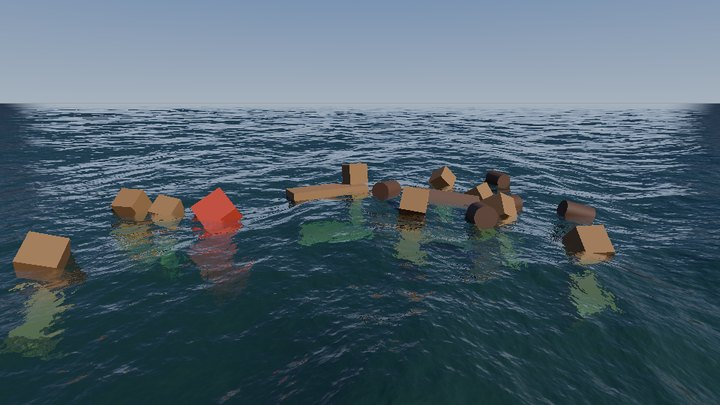

# FellowEngine — milestone 175 report (buoyancy: bodies floating on the waves)

Status: **FINAL** (2026-11-22). Branch `fellow/geometry`. The cloud's CPU only (the course headless; the comparison
with the GPU's waves and the pictures on lavapipe, the CPU's Vulkan); no GPU, by the owner's decision.

## 0. Result

`FellowWater3D`'s FFT waves were drawn on the GPU and nothing could float on them. Two pieces (decision 0317):

* **The waves on the CPU**: the cascades of 10 m and longer evaluated from the GPU's own modes (the same spectrum,
  random amplitudes and phases, quantized frequencies) on a 16-64 grid, two inverse FFTs a cascade, when a point is
  asked for at a new time. `get_surface_height(position)` returns the surface drawn there (the choppy displacement
  inverted), `get_surface_velocity(position)` the water's motion. Against the GPU's displacement read back on
  lavapipe: 1.3 cm rms off in a sea of 2.3 m significant height (the 160 m cascade's 58 cm rms), 0.1 cm in the 27 m
  cascade.
* **`FellowBuoyancy3D`**, a child of a RigidBody3D: its shapes filled with points, each pushed up by the water it
  displaces (Archimedes) and dragged towards the water's motion; forces at the points.

The buoyancy course (new, headless, Jolt):

* at rest in still water the displaced volume is the body's mass over the water's density within 0.01 % — boxes of
  250, 500 and 750 kg/m³ (their centres exactly at +0.125, 0, −0.125 m), a sphere, a barrel, a capsule, a convex wedge;
  a dense box sinks;
* stability as the theory of floating bodies has it: a tilted raft rights itself, a post lies down, a cube of half the
  water's density floats edge up (45.0°);
* in a 2.3 m sea a buoy heaves with the surface under it (correlation 0.997, 6 cm rms off), a raft (0.999, 2.8 cm),
  twenty crates stay on it;
* 4.3 µs a body a tick (16-64 points); the waves 0.32 ms an update while something floats.

## 1. How it got there

* The first CPU waves were the GPU's negated: the centring sign (−1)^(x+y) was applied on the wrong cells. The
  comparison with the read-back texture showed an error of exactly twice the waves.
* The first version took 1.4 ms an update (three cascades, three transforms, a sine and cosine per mode): the ripples'
  cascade left out, a grid sized to each cascade's energy, a phase table for the quantized frequencies, the horizontal
  velocity from the displacement's change instead of a third transform, a precomputed FFT plan: 0.32 ms.
* The drag: 1/s left bodies bobbing for 13-20 s; 3/s settles them in 5-8 s.

## 2. Checks

* `buoyancy.gd` (still water, stability, the sea, the CPU), drag 1-5; `gpu_match.gd` on lavapipe (two seas, with and
  without choppiness); `demo.gd` on lavapipe (the pictures).
* `tools/fellow_regression/regression.py run --only base/water,base/rain`: identical to the goldens (the GPU's waves
  unchanged by the shared spectrum code).
* `clang-format`, the class reference (`xmllint`, `make_rst.py --dry-run`, the doctool's signatures).

## 3. Next (without the GPU)

* The waves' update on a worker thread; floating on a `FellowShallowWater3D`'s simulated surface.
* `FellowDestructible3D`'s debris floating; a running foot stepping down stairs (decision 0316).
