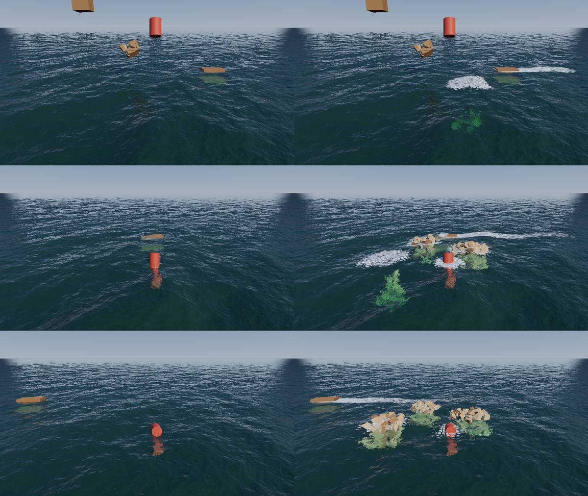

# FellowEngine — milestone 176 report (water interaction: debris floats, splashes and wakes)

Status: **FINAL** (2026-11-22). Branch `fellow/geometry`. The cloud's CPU only (the course headless; the pictures and
the regression suite's water and rain on lavapipe, the CPU's Vulkan); no GPU, by the owner's decision.

## 0. Result

Milestone 175 floated bodies on `FellowWater3D`'s waves; the rest of the scene still ignored the water. Now
(decision 0318):

* **Debris floats.** `FellowDestructible3D`'s pieces get a `FellowBuoyancy3D` while the scene has water
  (`debris_floats`, on by default): a wooden crate broken over a lake leaves 24 of 24 pieces afloat (the pile
  displacing its weight of water within 0.01 %), stone sinks slowed by the water (3.4 m/s at the bottom; 14.4 m/s, as
  through air, before).
* **Splashes and wakes leave foam.** `FellowWater3D.add_foam()` on a grid around the camera, drawn by the surface's
  shader through its foam noise; `FellowBuoyancy3D` splashes where its points strike the water and leaves a wake where
  they cross the waterline moving; `water_entered(speed)` / `water_exited` for a game's sounds and particles.
* **The waves off the main thread.** The CPU's waves are made on a worker after the frame's process: 0.33 ms → 2-10 µs
  of the main thread an update. Bodies above the waves' reach are skipped (0.2 µs a tick).

Left: milestone 175 — three crates broken over the sea, their pieces gone under, the water untouched. Right: now —
the pieces splash in and float in piles, a barrel ringed with foam, a raft's wake trailing behind it.

## 1. How it got there

* The foam first added to the waves' foam amount: the foam's noise shows nothing below 0.4 and a solid sheet above 0.9
  — white discs for splashes, no trail a raft's length behind. Measured the noise's coverage curve and mapped the
  amount onto 0.42-0.78 of it (a few bubbles to lace); a fade of its own (0.3/s, the waves' 0.6 too quick for a wake);
  each point's splash jittered (no discs).
* **The owner saw the splashes appear late.** The first demo's crates were thrown from too high and broken under the
  water: their pieces' first tick was 4 m down, taken as striking the water, and foam popped up 0.2 s after the crate
  had gone in. A body's points now start as under until it is seen out of the water (a body made under the surface
  does not splash); the demo's crates break in the air; the course has a crate made under water going down at 3 m/s
  (0.995 of foam round it before, none now).
* The foam's fade over the whole grid cost 82-95 µs a frame: only the cells foam was added to since there was none,
  15-38 µs.

## 2. Checks

* `benchmarks/tools/buoyancy/interaction.gd` (new): debris over still water and a sea (wood, stone, `debris_floats`
  off), the waves' threads (`--frame_work_ms=0` and `4`), piers over the sea, a pond's splash, wake and the crate made
  under water. Deterministic (the crates prefractured): the same numbers with and without the other work.
* `buoyancy.gd` (milestone 175's course): every number the same.
* `tools/fellow_regression/regression.py run --only base/water,base/rain`: identical to the goldens.
* `benchmarks/project/bench/destruction_check.gd`: passes (no water: no buoyancy added).
* `interaction_demo.gd` on lavapipe (the pictures, the video; `--before`).
* `clang-format`, the class reference (`xmllint`, `make_rst.py --dry-run`, the doctool's signatures).

## 3. Next (without the GPU)

* Waves made by bodies where a `FellowShallowWater3D` covers the water (its `add_impulse`); floating on its simulated
  surface (rivers).
* A running foot stepping down stairs (decision 0316); characters pushed by rigid bodies.
