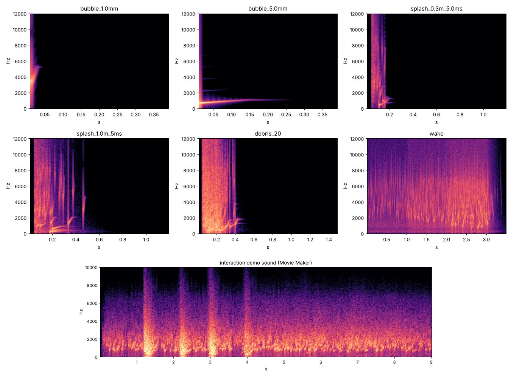

# FellowEngine — milestone 177 report (water's sound synthesised from its bubbles)

Status: **FINAL** (2026-11-23). Branch `fellow/geometry`. The cloud's CPU only (the synthesis offline and the courses
headless; Movie Maker on lavapipe, the CPU's Vulkan); no GPU, by the owner's decision. Nothing was listened to here:
the physics are checked on spectra; how it sounds is the owner's ear.

## 0. Result

The owner asked whether floating could make high-quality sound procedurally. It does now (decision 0319): water's
sound is synthesised from the physics of the air bubbles what strikes it entrains (van den Doel's model, 2005), with
no samples.

* Each bubble rings at Minnaert's frequency (3.26 m/s over its radius), decays by its losses, its pitch rising as it
  nears the surface — measured within 0.01 % of the frequency and 0.2 % of the damping for radii of 0.5-10 mm.
* A splash: a slap, a cloud of up to 300 bubbles whose number and sizes grow with what struck and how fast, a large
  body's cavity closing; laps where waves close over a floating body; a wake's rush and bubbles. Louder the faster (29
  dB from 1.5 to 11 m/s) and the larger, deeper and longer the larger.
* `FellowWater3D` plays them in 8 3D voices on the audio thread (0.1-0.9 ms a second of sound for a splash, 4 ms for
  a crate's twenty pieces at once); `FellowBuoyancy3D` and `FellowDestructible3D`'s debris play theirs; a game calls
  `play_splash()`.
* Heard 2-9 ms after the frame a strike is drawn in (36 ms for the first after 10 s of silence).

Top: one bubble of 1 mm and of 5 mm (the rise), a 0.3 m and a 1 m body at 5 m/s (the slap, the bubbles, the 1 m
body's cavity), twenty pieces, a wake rising and stopping. Bottom: the demo's sound — three crates breaking over the
sea (1.2, 2.1, 2.9 s), a barrel (3.9 s), the raft's wake throughout.

## 1. How it got there

* The model's pitch rise is linear in time: a 5 mm bubble swept to 2.3 times its pitch while it rang, a 1 m body's
  cavity a 0.8 s "whoop" — the rise capped at +60 %, the cavity damped as a torn pocket (2.5 times).
* Onsets at full amplitude: a wake hissed to 12 kHz — 8-sample onsets. Twenty pieces at once: 0 dBFS — the level
  lowered 4.4 dB.
* The demo's spectrogram: the floating debris' bobbing counted as water rushing past — a steady noise; bobbing now
  laps (small splashes where the water closes over a body's points).
* Voices stopped after a second of quiet started late (a physics tick): they play until 10 s of silence.
* Eight playbacks reported leaked at every exit: Godot's `AudioServer` did not free the playbacks waiting for deletion
  when it finished — freed there (a stock file, marked).

## 2. Checks

* `water_sound.gd` + `water_sound.py` (new): bubbles, splashes by speed and size, twenty pieces, a wake; spectra,
  envelopes, the CPU; the showreel (`showreel.wav`) for listening.
* `sound_timing.gd` (new, Movie Maker): when each strike is heard.
* `interaction.gd`: the sound's counts and time; its debris, foam and waves unchanged. `buoyancy.gd`: every number the
  same. `interaction_demo.gd` with Movie Maker: the demo with its sound.
* `tools/fellow_regression/regression.py run --only base/water,base/rain`: identical; no instance leaked at exit.
* `clang-format`, the class reference (`xmllint`, `make_rst.py --dry-run`, the doctool's signatures; the stream and its
  playback internal).

## 3. Next (without the GPU)

* By ear: what the owner hears too regular or too bright tunes the model's constants (the bubbles' size law, the slap,
  the wake's rush).
* The same synthesis for rain on water, a river's babble, a waterfall; the sound heard under water.
