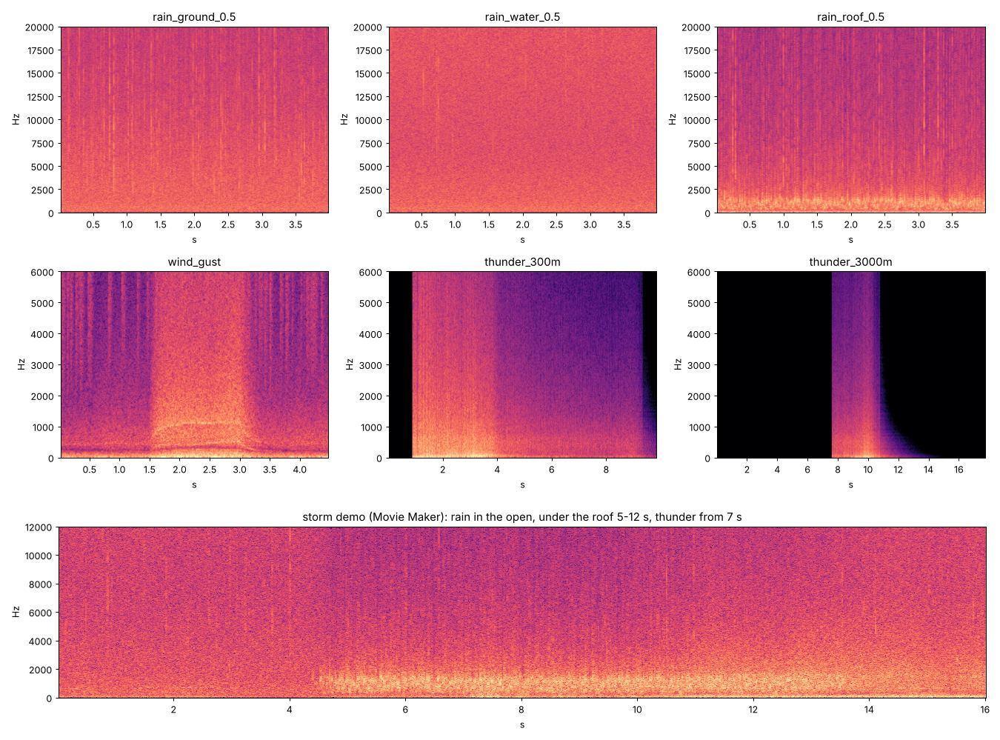

# FellowEngine — milestone 178 report (the weather's sound: rain, wind, thunder)

Status: **FINAL** (2026-11-23). Branch `fellow/geometry`. The cloud's CPU only (the syntheses offline, headless; the
storm with Movie Maker on lavapipe, the CPU's Vulkan). The owner allowed the GPU again during this milestone; nothing
here needed it. Nothing was listened to here: the physics and levels are checked on spectra; the owner's ear judges.

## 0. Result

After the water's sound (milestone 177: "brzmi super"), the owner asked for more of the world's sounds. The storm is
heard now (decision 0320), synthesised where the listener is, with no samples:

* **Rain** (`FellowRain3D`): distant drops as a bed; near drops each its own — on water the small bubbles of 0.8-1.1 mm
  drops ringing at 13-21 kHz (half the rain's sound on water is above 9 kHz, 18 % on the ground), on the ground a
  click; under a roof the drops knocking on it and the rain outside muffled (its centroid 5.2 → 1.1 kHz). Rays probe
  the cover over the listener and the water round it.
* **Wind** (`FellowWind3D`): rumble and rush with the gust where the listener stands (−45 dBFS at 3 m/s to −19 at
  20 m/s), edges whistling at the Strouhal frequency 0.2 v / d (found within 10 %), leaves rustling.
* **Thunder** (`FellowLightning3D`): from the bolt's own channel and its run through the cloud — every segment's
  N-wave arriving after its distance / 343 s (heard 23 ms after the ground point's), broadside claps, a near strike's
  crackle, the air taking the highs: 300 m −11 dBFS rolling 5.7 s, 3 km −20 dBFS and deep.
* 1.6-4 ms of the audio thread a second of sound each; the thunder built on a worker thread at the strike.

Top: rain on the ground, on water (the bubbles' band) and on a roof (knocks, drumming); a gust. Bottom: a strike 300 m
and 3 km away; the storm demo's sound (rain in the open, under the roof from 5 s, thunder from 7 s).

## 1. How it got there

* Rain first a hiss (centroid 7.2 kHz, no drop heard), a roof a 126 Hz rumble: the bed darker and quieter, the near
  drops louder, the roof's knocks over its drumming.
* Wind first all rumble (a microphone in the wind): the rumble a quarter, the rush and the whistles louder, the
  whistles' wander pulled back to the middle (they drifted 10-25 % flat).
* Thunder first short (2-3 s at any distance) and dull: the channel through the cloud (the long roll), the small
  kinks' pulses (the crack), a longer reverberation, 15 dB more. The bolt's channels now come from one function for
  the picture and the thunder (the lightning scene's golden identical).
* Levels set against each other with everything at once in the storm (its peak −0.9 dBFS): the thunder 3 dB down
  (−1.2).

## 2. Checks

* `benchmarks/tools/world_sound/weather_sound.gd` + `weather_sound.py` (new): rain at three strengths, on water, under
  a roof; wind 3-20 m/s and a gust; thunder 300 m-3 km, right and ahead; the CPU; `showreel.wav` to listen to.
* `storm_demo.gd` (new) with Movie Maker: a pier over a rough sea, rain, gusting wind, three strikes, the camera walking
  under a roof and out — everything synthesised as it runs (with milestone 177's water): the rain found 75 % water
  round the pier, 2 216 drops near and 3 109 knocks on the roof; 3 thunders built; the audio thread 4.2 ms (rain), 2.0
  (wind), 1.6 (thunder), 1.1 (the water's eight voices) a second of sound. `--timing` (both demos) for the RTX.
* The rooftops showcase has a `FellowWind3D` (3.5 m/s): its breeze is heard now.
* `tools/fellow_regression/regression.py run --only base/lightning,base/rain,base/snow,base/water`: identical.
* `clang-format`, the class reference (`xmllint`, `make_rst.py --dry-run`, the doctool's signatures; the stream and its
  playback internal).

## 3. Next

* With the GPU again: the milestones since 168 on the RTX (the water's foam in its shader, the storm, the showcase), the
  pending GI disagreement between the RTX and lavapipe (f533).
* By ear: the owner's notes tune the constants. More of the world: fire (crackle, roar), bodies striking each other
  (modal synthesis: wood, stone, metal), footsteps by surface.
