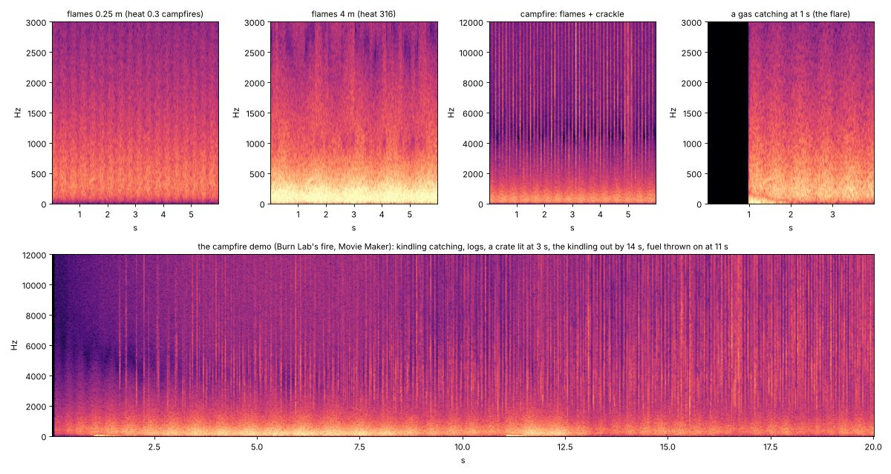

# FellowEngine — milestone 179 report (fire's sound: the flames' roar, the wood's crackle)

Status: **FINAL** (2026-11-23). Branch `fellow/geometry`. The cloud's CPU (the synthesis offline, headless; the
campfire with Movie Maker on lavapipe, the CPU's Vulkan); the RTX for the milestones since 176 (jobs f537, f538; the
campfire's frame times queued as f539). Nothing was listened to here: the physics and levels are checked on spectra and
counts; the owner's ear judges.

## 0. Result

After the water's sound (milestone 177) and the storm's (178) the owner asked for fire. A fire is heard now where it
burns (decision 0321), synthesised with no samples, from what the simulation does:

* **The flames** (`FellowGasVolume3D`): their heat release from the simulated fire (the flames' volume, about 1.2 MW
  a cubic metre) — a roar whose spectrum peaks at 160 / sqrt(D) Hz (found within 1-18 %), its loudness the heat's
  root (300 times the heat: 25 dB), puffing at the pool-fire rate 1.5 / sqrt(D) Hz with the simulation's own flicker;
  a low whoomp when it flares (fuel thrown on: +12 dB in the lows).
* **The wood** (`FellowBurnable3D`): cracks where it pyrolyses — snaps and rings with a power law of energies, runs,
  pops of sap — at a rate with the area of its burning front; the embers' ticks as its char glows.
* Each placed at its source (the fire's centre, each object's), 0.9-2.0 ms of the audio thread a second of sound.

Top: flames 0.25 m and 4 m across (the roar's peak 311 and 94 Hz), a campfire's flames and crackle, a gas catching
(the flare's lows). Bottom: the campfire demo's sound — the kindling catching (a flare at 1.5 s), the fire growing as
the logs and the crate catch (the cracks' lines denser), the fuel thrown on at 11 s, the flames low and the wood
crackling at the end.

The campfire (`fire_demo.gd`, Movie Maker, 20 s; Burn Lab's fire, a crate lit beside it at 3 s, the kindling out by
14 s, fuel thrown on at 11 s): the flames' heat from the simulation 1 → 19 campfires and back to 0.3-1, two flares;
cracks asked 2 → 39 a second as the wood caught, heard above 2 kHz 2 → 43; the sound −35 → −24 → −39 dBFS, peak −7.7.
Five voices (the flames, four objects), 1.2-1.6 ms of the audio thread a second of sound each.

## 1. How it got there

* The roar first peaked at a third of its corner and drowned the crackle (none found in a campfire): two-pole
  filters, the roar 9 dB down and the cracks 9 dB up.
* The crackle first followed the mass pyrolysed: Burn Lab's logs release 20-400 g/s (its burning runs ten times
  faster than wood's) and every object sat at the cap; the area of the burning front gives a few to 16 a second an
  object (15 a square metre; 25 gave the campfire 80 a second).
* The first count of cracks heard let the roar through (a one-pole difference) and found none in the large fire; a
  fourth-order band above 2 kHz finds what was asked.

## 2. Checks

* `benchmarks/tools/world_sound/fire_sound.gd` + `fire_sound.py` (new): flames of 0.25, 1 and 4 m, a campfire, a
  bonfire, a gas catching, crackle alone, embers; `showreel.wav` to listen to.
* `fire_demo.gd` (new) with Movie Maker: Burn Lab's campfire, a crate lit beside it, fuel thrown on; `--probe` prints
  the fire's heat and the objects' fronts every second, `--timing` / `--silent` for the RTX.
* `tools/fellow_regression/regression.py run --only base/fire,base/water,base/rain`: identical.
* `clang-format`, the class reference (`xmllint`, `make_rst.py --dry-run`, the doctool's signatures).

## 3. The RTX: milestones 176-178 (f537, f538)

* **GI (f537, the GI Lab room, milestone 168's template):** against the 16-bounce reference the RTX and lavapipe
  disagree the same way for stock SDFGI, FellowEngine's SDFGI and both with the render graph's full barriers (+0.73
  stops in the room, +0.65 in the dark view); DDGI by +2.07 / +1.76 stops with or without the barriers. The overrides
  checked applied. Not FellowEngine's code, not the render graph's synchronisation: something SDFGI and DDGI share on
  one driver (the sky's injection, a format) — a GPU item of its own.
* **Water (f538, Water Lab 1920x1080, alternating, six runs each):** milestone 168c 3.02 ms of GPU a frame, 178
  3.00 ms — the floating bodies' foam in the water's shader costs nothing measurable (both drifting up 0.4 ms with
  the heat over the session).
* **The demos (f538):** the interaction demo 1.15-1.21 ms of GPU (milestone 175's way 1.09-1.14), its CPU render 0.32
  ms (0.19-0.23); the storm demo 1.03 / 0.94 ms with its sound and 0.94 / 0.93 without: the sound costs the GPU
  nothing.

## 4. Next

* By ear: the owner's notes tune the constants.
* More of the world's sound: bodies striking each other (modal synthesis: wood, stone, metal), footsteps by surface,
  water meeting fire (sizzle).
* With the GPU: the GI difference SDFGI and DDGI share between the RTX and lavapipe (a driver-level cause: the sky's
  injection, formats).
