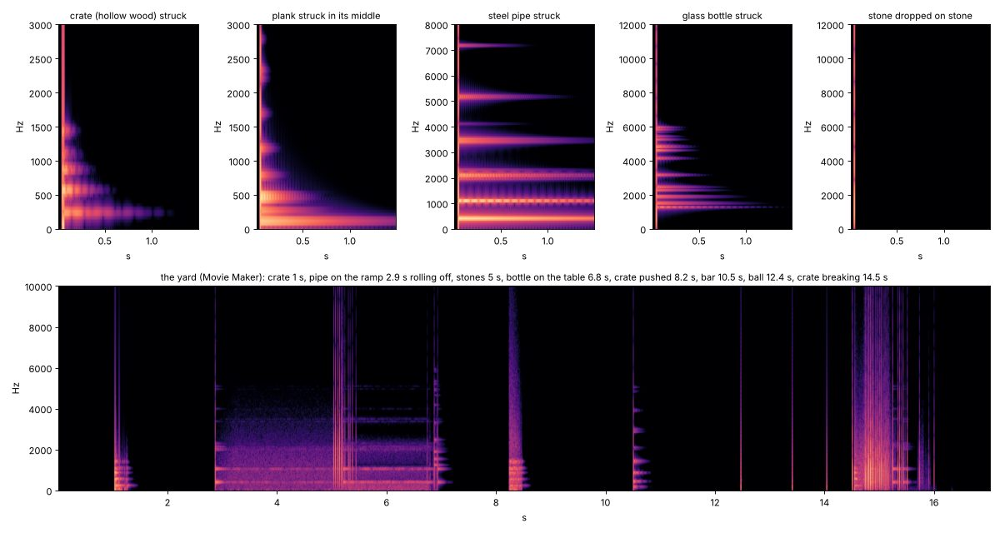

# FellowEngine — milestone 180 report (bodies' contact sound: modal synthesis)

Status: **FINAL** (2026-11-23). Branch `fellow/geometry`. The cloud's CPU only (the synthesis offline, headless; a yard
with Movie Maker on lavapipe, the CPU's Vulkan): the owner asked whether anything was left for the GPU — nothing
(milestone 179's campfire measured on the RTX, f539: its sound costs the GPU nothing, 0.89 ms a frame with and
without) — and the laptop's queue is paused. Nothing was listened to here: the physics and levels are checked on
spectra; the owner's ear judges.

## 0. Result

After water, weather and fire, the bodies themselves: a `FellowContactSound3D` on a `RigidBody3D` makes it heard
from its own vibration (decision 0322), from the physics' contacts, no samples:

* **What it is**: its modes from its shape and material — a beam's bending for a rod, a pipe, a plank (the steel
  bar's lowest mode within 3 % of beam theory), plates for slabs and a hollow box's walls, a ring for a bottle — and
  how long they ring from the material (wood under a second, steel seconds, rubber nothing).
* **How it is struck**: a strike's force lasts as long as the Hertzian contact (steel on stone 0.6 ms: bright;
  rubber 9-21 ms: dull), its loudness with the speed (6.9 dB a doubling, brighter as it gets harder), each mode
  weighted where it lands (a plank struck in its middle loses its second mode: −15 dB); a small stone is heard as its
  own sudden stop (a click), its modes ultrasonic.
* **Sliding and rolling**: the surfaces' roughness under the contact (scraping 18.6 dB louder a decade of speed,
  brighter), rolling smoother; resting damps.
* **The `impact` signal** for games (break, dust, guards hearing); a broken `FellowDestructible3D`'s pieces sound
  like its body.

Top: a hollow crate, a plank struck in its middle, a steel pipe, a glass bottle (struck in the hand), a stone
dropped on stone (its click). Bottom: the yard — the crate dropped, the pipe landing on a ramp and rolling off it,
stones, the bottle on a table, the crate pushed (its scrape), a steel bar, a rubber ball's bounces, a crate breaking
and its pieces clattering.

The yard (`impact_demo.gd`, 17 s): 35 strikes on eight bodies and 83 among a broken crate's 14 pieces, each heard
where it is; the pipe rolling 1.6 s; the loudest moment the crate breaking, −6.3 dBFS at 3.6 m.

## 1. How it got there

* Everything clipped at first (a crate's click 135 dB at a metre): full scale is 120 dB SPL at a metre, and the click
  uses how long the whole body takes to stop (a hollow crate's wall gives way: 15 ms) while its walls ring from the
  short contact where the blow lands.
* Fast modes decayed into denormal floats while slow ones rang (25 ms of CPU a second): flushed.
* Scraping barely grew with speed and was too loud: its drive as v^0.8, 15 dB down. Resting pieces kept their voices
  (the solver's jitter read as sliding): sliding needs 8 cm/s of slip and the body moving.

## 2. Checks

* `benchmarks/tools/world_sound/impact_sound.gd` + `impact_sound.py` (new): eight bodies struck in the hand and
  dropped, the plank struck at its end and middle, the crate dropped at 0.5-8 m/s, struck by metal and rubber, sliding
  at 0.3-3 m/s, the pipe rolling; `showreel.wav` to listen to.
* `impact_demo.gd` (new) with Movie Maker; `--timing` and `--silent` for the RTX when the queue runs again.
* `tools/fellow_regression/regression.py run --only base/destruction,base/structure,base/vehicle_damage,base/fire,base/water`:
  identical.
* `clang-format`, the class reference (`xmllint`, `make_rst.py --dry-run`, the doctool's signatures).

## 3. Next

* By ear: the owner's notes tune the materials and levels.
* Footsteps by surface (the character's feet as strikes and scuffs on the ground's material), fracture's own crack, a
  static floor ringing (a metal deck), squeaks.
