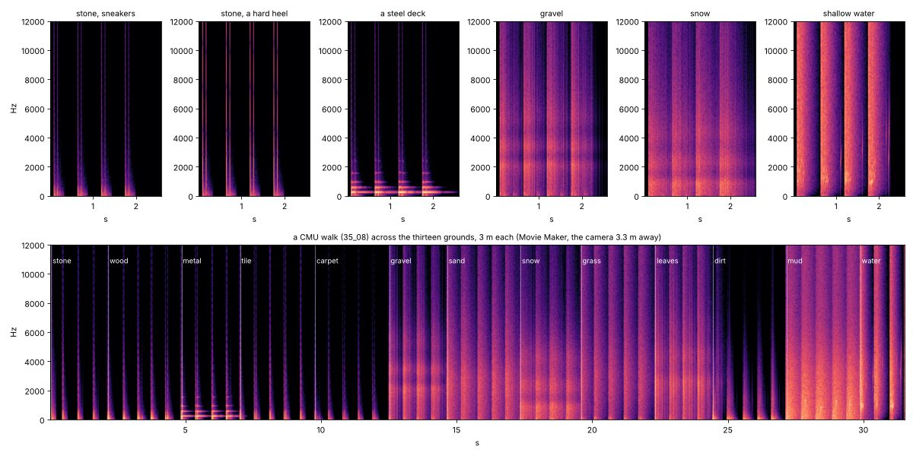

# FellowEngine — milestone 181 report (footsteps)

Status: **FINAL** (2026-11-23). Branch `fellow/geometry`. The cloud's CPU only (the synthesis offline, headless; a CMU
walk headless and with Movie Maker on lavapipe); the laptop's queue paused (the owner's question: nothing left for
the GPU). Nothing was listened to here: the physics and levels are checked on spectra and counts; the owner's ear
judges.

## 0. Result

The character's own sound, after the world's: a `FellowFootsteps3D` last on a skeleton hears its feet (decision 0323)
— no animation events, no recordings:

* **When**: each foot touching down, found from the feet as drawn (after foot locking and placement) against the
  ground under them; the sole rolling onto the ball; the toe lifting; a foot dragged. In a CMU walk across thirteen
  grounds every step is found, one every 0.43-0.60 s (median 0.535), the sound within the frame of the foot.
* **On what**: the collider's `FellowContactSound3D` (its new `surface`, or its material), a `fellow_surface` tag, a
  terrain's layers by their weights (grass blending into gravel: 10 % → 90 % gravel over ten metres), water over
  the ground.
* **How**: thirteen grounds — hard ones by the sole's contact through the shoe's and the floor's resonances (a steel
  deck rings, wood booms, a hard heel clicks: 2.2 kHz against a sneaker's 0.2), loose ones by grains crushed
  (Cook's PhISEM: gravel crunching at 2-5 kHz, snow lower, sand hissing, leaves crackling, grass brushing), mud's
  squelch and suck, water's splash (bubbles); sneaking −9.7 dB, running +11, landing +20; a sneaker squeaking on
  wood.
* The `footstep` signal (foot, where, on what, how fast) for games.

Top: four steps on stone in sneakers and with a hard heel, on a steel deck, gravel, snow, water. Bottom: the walk
across the thirteen grounds (each ground's first step labelled).

## 1. How it got there

* Hard ground was all thump at first (no click: the sole's contact too long, a floor resonance under concrete),
  loose ground 26 dB too loud, the CPU 20-67 ms a second (dead resonances decaying into denormal floats).
* In the walk the steps came late, missed or in pairs: CMU's soles stand 3-5 cm up, a swinging foot passed as low
  (a touch must now be planted), each sole point had its own state (a foot's now). A clip that walks only three steps
  (16_08) gave way to CMU's 35_08, looped where its gait matches.
* At 3 m the steps were 20 dB quieter than offline: heard at the level synthesised at 3 m, and 6 dB more.

## 2. Checks

* `benchmarks/tools/world_sound/footstep_sound.gd` + `footstep_sound.py` (new): thirteen grounds, four shoes, gaits,
  weights, a terrain's mix, scuffs; `showreel.wav` to listen to.
* `benchmarks/tools/foot_placement/footsteps_demo.gd` (new): a CMU walk (35_08, from the una-dinosauria/cmu-mocap
  conversion; not committed) across the thirteen grounds (Movie Maker), and with `--terrain` over a FellowTerrain3D
  whose grass blends into gravel.
* `clang-format`, the class reference (`xmllint`, `make_rst.py --dry-run`, the doctool's signatures).

## 3. Next

* By ear: the owner's notes tune the grounds and levels.
* The showcase's climber hearing its own steps on the roofs (tiles, stone) — on the RTX when the queue runs again.
* Clothing's rustle, breathing; wet hard floors; snow's squeak in the cold.
