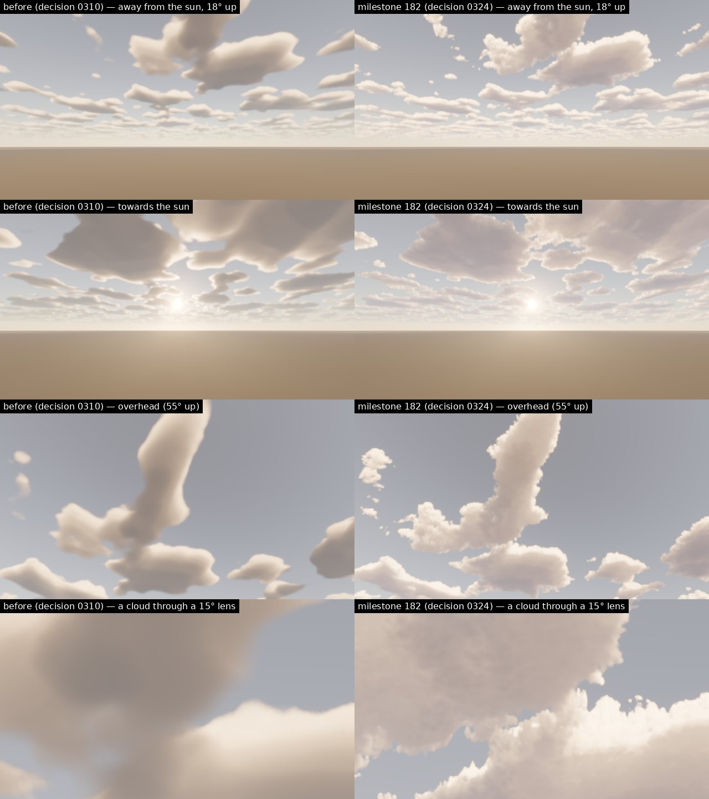

# FellowEngine — milestone 182 report (realistic clouds)

Status: **FINAL** (2026-11-23). Branch `fellow/geometry`. Lavapipe only (the owner's GPU queue paused at their wish):
the showcase's sky, the image regression suite. The clouds' cost on the RTX is still to be measured.

## 0. Result

The owner: our clouds "look like dough, quite close". They were soft, smooth, cream blobs: their density ramped up
over 100-200 m at their rims (a cottony, out-of-focus halo), eroded no finer than 150 m (smooth where one sees them),
lit grey by four octaves of multiple scattering (a third of what a thick cloud reflects), faded by a fixed exponential.
With `post/clouds/realism` (decision 0324, on):

* **Sharp, detailed**: the density ramp at a rim eight times steeper at the tops; the detail warped, then two finer
  octaves (cauliflower of 40-150 m, turbulence of 10-40 m) bumping the edges in and out, as far as they are a pixel or
  more; rough outlines (the weather field's finer octaves, the shapes warped); finer steps; Catmull-Rom upsampling.
* **Lit as thick clouds are**: multiple scattering by two-stream diffusion (a sunlit side 0.8 E / π, white paper in the
  sun; inside, 1 / (1 + 3/4 (1 − g) τ)), a billow turned from the sun dimmed, the sky's light diffused through the cloud
  above.
* **Hazed by the air**: the atmosphere's aerial perspective at the clouds' distance instead of the fade.

Left: decision 0310's clouds; right: these. Away from the sun, towards it, overhead, a cloud through a 15° lens.

## 1. Measurements

`showcase/tools/sky_look.gd` (new: the showcase's sky without its square — its sky shader, sun, haze, sky sun and
clouds — from the ground and from 20 km up) and `benchmarks/tools/sky/sky_metrics.py` (new), lavapipe, 1280 × 720:

| view | edges (levels a pixel) | texture (levels) | cloud p50 (the sky behind) | cover |
|---|---|---|---|---|
| overhead | 1.26 → 3.33 | 0.91 → 1.91 | 163 → 185 (171) | 0.20 → 0.21 |
| 55° up, away from the sun | 2.32 → 4.06 | 0.93 → 1.74 | 177 → 193 (176) | 0.32 → 0.33 |
| across the sun | 2.21 → 2.53 | 1.79 → 2.05 | 192 → 204 (193) | 0.27 → 0.28 |
| away from the sun | 2.29 → 2.92 | 1.68 → 2.11 | 195 → 209 (193) | 0.31 → 0.33 |
| towards the sun | 2.16 → 2.09 | 1.21 → 1.21 | 174 → 191 (190) | 0.43 → 0.41 |

* Stable: a still camera, 24 frames with the wind moving the clouds — the mean change from frame to frame 0.021 → 0.043
  levels, its 99th percentile 0.87 → 1.09.
* From 20 km up the outlines' fractal dimension is 1.27 before and 1.24 after (Lovejoy's satellites: 1.35): this
  measure does not see the change (the finer octaves under a pixel there, the lit tops merging).
* Cost on lavapipe (not the RTX): the clouds' share of a frame 38 → 115 ms (three times).
* The image regression suite: 37 scenes unchanged; its sky with `realism` off its golden bit for bit, on a new golden
  (after the finer octaves' reach was made to follow the pixels' size: at 512 × 288 the finest had been noise).

## 2. How it got there

Eroding with the finer octaves shrank the clouds (cover overhead 0.20 → 0.13): bumped in and out instead. The sharp
ramp drew contour lines on the bases (the thickness above and the far light samples summing its steps): those read
the smooth ramp. Diffusion made the clouds bright but evenly (the bases as bright as the sunlit sides): a billow's
facing brought the relief back.

## 3. Next

* The RTX: the clouds' cost a frame at 1080p (decision 0310's never measured there either); if it is too much,
  coarser fine steps and fewer detailed light samples (4 % on lavapipe), or the finer octaves nearer.
* The showcase's `sky_brightness` (4, milestone 168, to make up for the grey clouds): the lit clouds now near white;
  the owner's eye at 2-4.
* Cloud types from a weather map (cumulus, stratocumulus, altostratus, cirrus).
