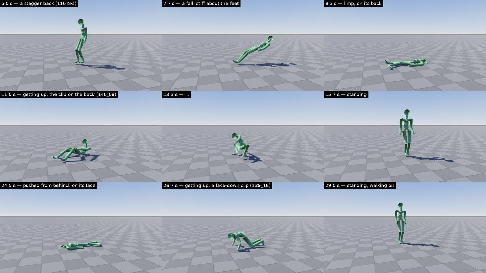

# FellowEngine — milestone 183 report (balance, falls and getting up)

Status: **FINAL** (2026-11-23). Branch `fellow/geometry`. The cloud's CPU only (Jolt Physics headless; a character
filmed on lavapipe); the laptop's GPU queue paused at the owner's wish.

## 0. Result

Milestone 166 gave characters physical animation: hits knock a part and it comes back; strength 0 is a ragdoll. Now,
with `FellowPhysicalAnimation3D.balance` (decision 0325, opt-in), a push is judged by its **capture point** — where the
centre of mass would have to be stood over to stop:

* **near** (under 0.12 m): the body takes it where it stands;
* **further**: it **staggers** — the motion matcher is pushed that way (`FellowMotionMatcher3D.push()`, the facing held:
  CMU's back and side steps) about as far as the capture point;
* **beyond a step's reach** (0.7 m): it **falls** — stiff about its feet as an inverted pendulum, then limp;
* lying still, it **gets up**: of the get-up clips (CMU subjects 139 and 140: face down, on a side, on the back) the one
  that starts on the face it lies on and fits its pose best (turned and shifted over the ground to it), blended from
  the ragdoll's pose; where the clip ends the motion matcher takes over and it walks on.

## 1. Measurements

`benchmarks/project/bench/balance_check.gd` (Jolt, 60 Hz; one character standing, pushed at the chest):

* pushes of 20 N·s are taken back (capture point 0.08 m); 40-160 N·s stagger 0.1-0.64 m (capture point 0.17-0.67 m)
  and stand again after 0.77 s; 200 N·s (0.84 m) falls;
* falls from the front, behind and either side: on its back (from the front) or its face; lying still after 0.9-1.3 s;
  the clip chosen starts on that face (140_08 on the back, 139_16 and 139_17 face down) and fits the body within
  7-12 cm; the bodies at most 1.6-2.3 m/s while blending into it; standing after 3.0-5.4 s, the hips 1.0 m up, the
  bodies 2 mm from the animation once it walks on;
* walking, 70 N·s from the side: a stagger, walking on after 0.75 s;
* the drive 12.5 µs a step; with balance off `physical_check.gd` gives milestone 166's numbers.

`bench/balance_video.gd` films it (lavapipe, 32 s): a small push, a stagger back, a fall onto the back and getting up,
a stagger sideways while walking, a fall onto the face and getting up.

## 2. How it got there

The get-up clips' still lying frames won the motion matcher's search when standing still (the character lay down at
the start): they are left out of it. The first get-ups shot the bodies at 100 m/s (a step still driven towards the
standing pose): the targets start at the bodies. Pushed from behind, the ragdoll came apart on landing (all of a
230 N·s push on the chest's 10 kg): a push is spread over the body. On its back it chose a clip starting on a side and
crossed its legs blending: the clip must start on the same face.

## 3. Open

* The joints open 4-11 cm as a body falls and lands (Jolt's two position steps; six close a lying body's to 1.4 cm).
* No bracing (arms reaching towards the fall); a stagger's steps are the motion matcher's own back and side steps.
* Getting up on flat ground only (not on slopes, against walls).
* The showcase's climber: falls from a hold, landing, getting up — next, on the rooftops.
