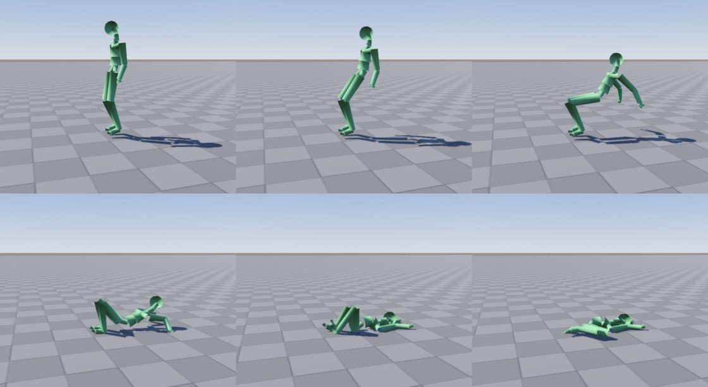

# FellowEngine — milestone 184 report (falls that buckle, feet that step)

Status: **FINAL** (2026-11-23). Branch `fellow/geometry`. The cloud's CPU only (Jolt Physics headless; the character
filmed on lavapipe); the laptop's GPU queue paused at the owner's wish.

## 0. Result

The owner on milestone 183's film: the character "sometimes slides unnaturally, and the falls are very sudden". Both
were measurable, and both are fixed (decision 0326):

* **Falls buckle.** A push it cannot catch made the body topple stiff and go limp as a plank: its hips hit the ground
  0.37 s after the push at 3.6-4.3 m/s (as fast as dropped from where they stood), the feet dragged up to 95 cm. Now, after
  a reaction's time, the legs give way — the hips sink along the line from the feet as it leans about them, the knees
  bend forward over the feet, which stay where they stand, the arms reach towards the ground — and it goes limp near the
  ground: falling back it sits and rolls onto its back, sideways it sits onto a hip, forward it drops to its knees.
  The hips land 0.60-0.62 s after the push at 2.61-2.74 m/s, the feet slipping 5-10 cm (46-95) — people take about 0.7 s and land at 2.75 ± 0.42 m/s
  (Hsiao and Robinovitch 1998; van den Kroonenberg et al. 1996).
* **No slide after getting up.** The motion matcher was put where the clip's root ends with a pose of its own, and the
  whole body slid 37-65 cm to it in 0.4 s. `FellowMotionMatcher3D.play_from()` (new) hands it the clip's last frame
  where the clip is played; it goes on from there.
* **Feet that would slide step** (`FellowMotionMatcher3D.foot_step_lift`, on): a foot lock let go of on the ground
  waits for its step (it crept along in a ratchet, 14-21 cm), the step lifted on an arc; a foot dragged low by the
  animation is lifted with its speed. In Matching Lab's crowd the feet move over the ground 41 % less.

## 1. Measurements

`benchmarks/project/bench/balance_check.gd` (Jolt, 60 Hz; pushed at the chest):

* falls (200 N·s) from every side: the hips at 0.3 m 0.37 → 0.60-0.62 s after the push, coming down at 3.6-4.3 →
  2.6-2.7 m/s; limp 0.57 s after it with the hips 0.36 m up (falling forward 0.48 s, the knees at the ground); the
  feet's slip (each stance's farthest, summed) 46-95 → 5-10 cm; on its back from the front, face down otherwise; lying
  still after 1.3-1.4 s, standing after 3.0-5.4 s;
* after getting up the hips stay where the clip leaves them (they slid 37-65 cm), the feet step into the motion
  matcher's stance (their slip 74-101 → 4-33 cm, the steps' low ends counted);
* staggers (40-160 N·s): the feet's slip 1-19 cm (up to 56); standing still, a weight shift is a step;
* the joints' largest gap: staggers 43-61 mm, falls 40-86 mm (50-111); the drive 13.1 µs a step; with balance off
  `physical_check.gd` gives milestone 183's numbers but the ragdoll's depth into the floor (52 mm, 46).

Matching Lab, 16 characters, 60 s: the foot slide in contact 0.0625 → 0.0834 m/s, of which stepping (raised 1 cm or
more) 0.0468 — on the ground 0.0366 m/s (−41 %); popping p99 37 → 39 mm.

`bench/balance_video.gd` films it again (lavapipe, 32 s): a small push, a stagger back, a fall back and getting up, a
stagger sideways while walking, a fall forward and getting up.

## 2. How it got there

The hips first swung out by the lean at their height and left the legs' reach (the feet dragged); they stay on the
line from the feet. Falling forward, the bent knees reached the ground early; turning them up bent them backwards and
kicked a foot — it goes limp there and the ragdoll kneels. Re-teleporting the motion matcher by its hips still glided
the feet between two stances; played on from the clip's frame it chose a crouch by the pose, so its first search goes
by the trajectory. The drag lift first did nothing (the leg IK skipped a foot only lifted); the creeping was the lock's
ratchet, not flickering contacts.

## 3. Open

* No stumbling step before a fall: the legs give way where it stands.
* The joints still open 4-9 cm as the ragdoll lands (Jolt's two position steps).
* A light foot body can jitter for a quarter of a second as the get-up blend presses it into the ground.
* The showcase's climber: falls from a hold, landing, getting up — on the rooftops.
