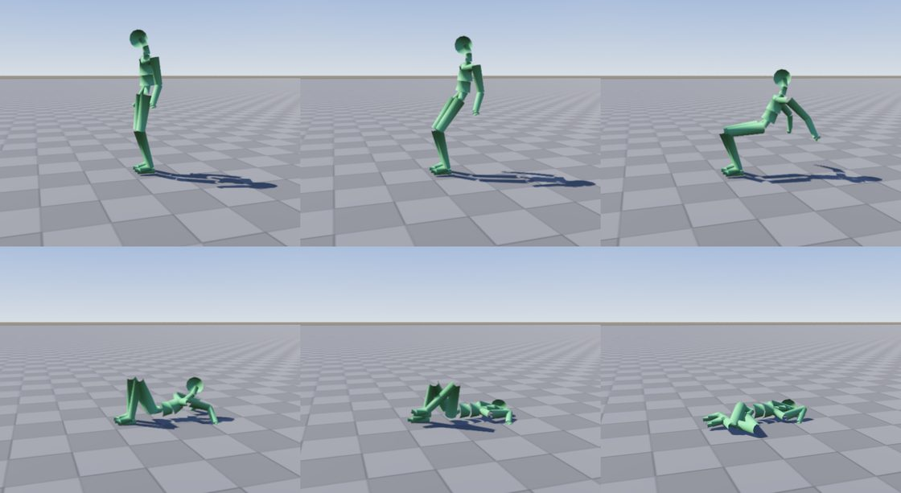

# FellowEngine — milestone 185 report (a ragdoll with bones, feet on the ground)

Status: **FINAL** (2026-11-23). Branch `fellow/geometry`. The cloud's CPU only (Jolt Physics headless; the character
filmed on lavapipe); the laptop's GPU queue paused at the owner's wish.

## 0. Result

The owner on milestone 184's film: "now the feet hang over the ground, and the ragdoll folds the body as if it were a
soft body with no bones". Both were there to measure, and both are fixed (decision 0327):

* **A ragdoll with bones** (`FellowPhysicalAnimation3D.anatomical_limits`, on). Every limp joint had been the same
  50-degree cone: the trunk's five segments folded it double, knees bent backwards and through themselves, elbows
  backwards; and the masses went by the capsules' volumes (the neck 13 kg, the head 0.19), so the joints between bodies
  a hundred times apart in mass stretched 4-9 cm. Now the node finds a person in the skeleton — the trunk, the limbs off
  it, each limb's upper and lower part, legs and arms — and gives each part its own joint: knees and elbows hinges
  (−3° … 145°), a hip limited from the thigh's rest (−15° … 120°), a spine segment 12°, the pelvis's and the shoulders'
  short bones nearly rigid, with joint friction; its masses a person's (de Leva 1996). The joints now open 1-3 cm at
  most, the knees stay between 112° and 153° as it lands, the trunk bends 58° at most.
* **Feet on the ground.** The recordings' floors differ: of the feet the motion matcher held down, half stood 2-5 cm
  over the ground. `FellowMotionMatcher3D.foot_grounding` (on) lowers (or raises) a planted foot so that its ankle or
  toe is as high as the database's are when down; the planted feet now stand within −0.8 … +1.6 cm of the ground
  (from −3.0 … +3.1). The physical feet are soles (boxes from the heel past the ball), not capsules round the
  ankle-to-ball bone that stood 1-5 cm up; the mannequin's feet got soles too.

## 1. Measurements

`benchmarks/project/bench/balance_check.gd` (Jolt, 60 Hz), milestone 184 (`--anatomical=0 --grounding=0`) → 185:
the joints' largest gap 23-61 → 0-7 mm in staggers, 40-86 → 15-27 mm in falls; a limp knee's flexion from folding
through itself to 112 … 153°, an elbow's −26 … 96° → 17 … 155°; the trunk's bend at most 52-75° → 39-58°; the falls'
timing as before (the hips at 0.3 m after 0.60-0.62 s).

Matching Lab, 16 characters, 60 s: planted feet over the ground −3.0 / −0.2 / +3.1 cm (5th / 50th / 95th percentile)
→ −0.8 / 0.0 / +1.6 cm; their slide on the ground 0.0366 → 0.0312 m/s; popping unchanged.

With balance off (`physical_check.gd`): tracking 3.4 mm (3.7); hits knock the chest and the head 58 and 134 mm (104,
226: they now weigh 2.1 and 3.9 kg); the ragdoll 30 mm into the floor (52).

`bench/balance_video.gd` films it again (lavapipe, 32 s).

## 2. How it got there

The hinges' limits came out reversed (Jolt's six-degree joint measures angles the other way). With the joints right
the body still stretched: the masses, by volume, put 0.1-0.2 kg bodies between 7-kg ones. A fall's landing swung the
legs over the body (a hip limited about a squat's 90 degrees): the hip's flexion is now limited from the thigh's rest
and the joints have friction. Grounding from the animation's ankle missed feet held where they landed; from the held
ankle it works.

## 3. Open

* The hips' and shoulders' limits are symmetric about the pose it goes limp in (but the hip's flexion).
* A foot can stick in the floor at a reset (put there in its rest pose); it is not put back until 0.75 m away.
* The matcher's first idle at the start is a recording's bent-over stance (motion matching's, not the ragdoll's).
