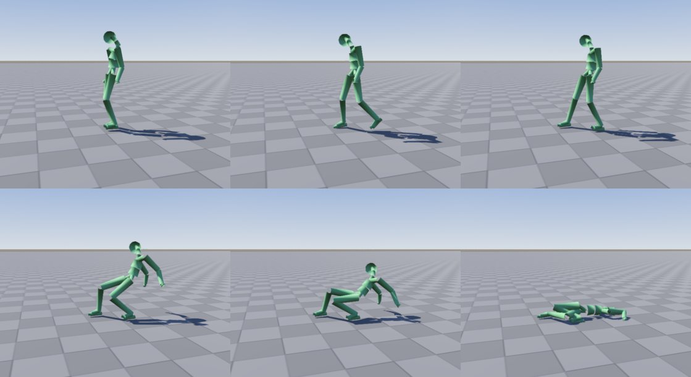

# FellowEngine — milestone 186 report (a step before the fall, caught bodies put back)

Status: **FINAL** (2026-11-23). Branch `fellow/geometry`. The cloud's CPU only (Jolt Physics headless; the character
filmed on lavapipe); the laptop's GPU queue paused at the owner's wish.

## 0. Result

Two of milestone 184's and 185's open items (decision 0328):

* **A step before the fall** (`FellowPhysicalAnimation3D.fall_step_time`, 0.4 s). A push it could not catch made the
  legs give way where it stood, the feet never leaving the ground. Now a push one step could almost catch (its capture
  point beyond `fall_threshold`, within twice it) is first stepped after — the motion matcher pushed that way as fast as
  the centre of mass would go, the database's own step — and after 0.4 s the legs give way from where the step took it,
  the feet landing flat (a foot in the air turns flat about its ankle and comes down to the ground). People step first
  (the stepping strategy); falling where it stood looked like a puppet whose strings were cut. In the five 200 N·s falls
  the foot on the side pushed steps 0.45-0.63 m, and the hips reach the ground 1.0-1.2 s after the push.
* **A caught body put back** (`stuck_rescue`, on). A foot that went through a thin floor stayed caught under it (only a
  body 0.75 m away was put back): 8 cm under a 3 cm slab it was 54, 62, 74 mm from its place after 0.25, 0.5 and 1 s.
  Now a body held at full strength 5 cm from its place without coming nearer is put there after 0.3 s if the place is
  free (a shape query): 0.5 mm after half a second.

## 1. Measurements

`benchmarks/project/bench/balance_check.gd` (Jolt, 60 Hz), milestone 185 (`--fall_step=0 --stuck_rescue=0`) → 186,
falls of 200 N·s at the chest from every side: the fall begins 0.02 → 0.40 s after the push, after one step (0 → 1 foot
lifted; the stepping foot 0.45-0.63 m); the hips at 0.3 m 0.60-0.73 → 1.02-1.23 s after the push (0.62-0.83 s after the
fall begins); the feet's slip 4.1-18.8 → 5.1-20.8 cm (all), the joints' largest gap 16-27 → 17-31 mm; the limp trunk
bends further (42-56 → 64-94°, within its limits: it lands from a wider stance). Staggers (20-160 N·s): as far as before,
the feet's slip within 7 mm. With balance off (`physical_check.gd`), milestone 185's numbers; the drive 11.7 µs a step.

A foot caught 8 cm under a 3 cm slab: 54 / 62 / 74 mm from its place after 0.25 / 0.5 / 1 s → 54 / 0.5 / 0.4 mm.

`bench/balance_video.gd` films it again (lavapipe, 32 s): both falls now step first.

## 2. How it got there

The stuck rescue first ran in falls too: the knees' targets are near the ground there, and a knee put back tore its
joints 91 mm open; it runs only while the animation is followed. The stepping foot was still in the air when the legs
gave way and the fall kept it there; lowered by its sole measured flat it came down only 3 cm; turned flat about the
ankle first, it lands. A foot put into the 1 m thick test floor at a reset was pushed out by Jolt within a quarter of a
second: milestone 185's "caught at a reset" did not recur there; a thin floor catches it.

## 3. Open

* One step only (not stepping until the push is caught).
* The trunk bends up to 94° in these falls (the spine's and the neck's limits added up).
* The matcher's first idle at the start is a recording's bent-over stance.
* The showcase's climber: falls from a hold, landing, getting up — on the rooftops.
