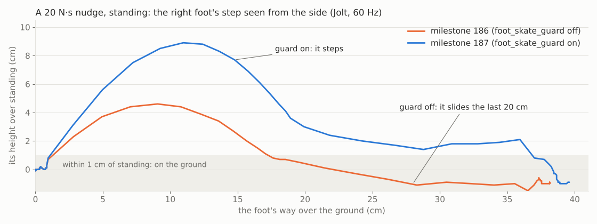

# FellowEngine — milestone 187 report (feet that step, not skate)

Status: **FINAL** (2026-11-23). Branch `fellow/geometry`. The cloud's CPU only (Jolt Physics headless; the character
filmed on lavapipe); the laptop's GPU queue paused at the owner's wish.

## 0. Result

A stagger's feet still skated over the ground (decision 0329). Measured with a new metric — how far a foot's body goes
over the ground while within 1 cm of its standing height — a 60 N·s push skated the feet 13.4 cm, a 20 N·s nudge
(the motion matcher's own weight shift) 20.8. Traced: a foot let go of to step where its animation had gone (a CMU
clip's shuffle, a transition's blend between two stances) kept its contact on, and since milestone 185 the grounding
took its step's arc back down to the ground within 0.04 s — it slid there, 14-26 cm at 1-1.6 m/s.

`FellowMotionMatcher3D.foot_skate_guard` (new, on) keeps the arc over the grounding and lifts a foot down but not held
by its speed as it moves (at most 4 cm): it steps. Standing, pushed at the chest: 20 N·s 20.8 → 3.2 cm over the
ground, 60 N·s 13.4 → 2.2, 80 N·s 11.7 → 5.7; after getting up 7-29 → 7-16 cm; Matching Lab's crowd's feet in
contact move over the ground 21 % less. Walking and falls as before.

## 1. Measurements

`benchmarks/project/bench/balance_check.gd` (Jolt, 60 Hz), the guard off (milestone 186, to the digit) → on: the
skating 20.8 / 4.8 / 13.4 / 11.7 / 5.3 / 4.0 / 4.2 / 0.6 → 3.2 / 4.8 / 2.2 / 5.7 / 5.3 / 4.9 / 4.5 / 2.0 cm (20, 40,
60, 80, 100, 130, 160, 200 N·s); the slip (within 3 cm) at 60 and 80 N·s 23.4 and 25.0 → 8.2 and 8.9 cm; after getting
up 24.8 / 24.8 / 28.6 / 7.1 → 15.7 / 16.4 / 10.6 / 7.1 cm; five pushes while walking 6.8-30.7 → 7.9-31.1 cm (the
motion matcher's path the same); falls unchanged.

Matching Lab, 16 characters, 60 s: a foot in contact moving over the ground with it down 0.0312 → 0.0245 m/s; locked
0.0211 → 0.0213; the planted feet over the ground −0.8 / 0.0 / +1.6 → −0.7 / 0.0 / +1.7 cm; popping p99 39.2 mm both.

`bench/balance_video.gd --program=staggers` films four staggers with the feet in view, `--skate_guard=0` milestone
186's.

## 2. How it got there

A clearance from the database for feet in the air (their 5th percentile at each speed) came first: the crowd's feet
skimmed 22 % less, but the staggers' feet (in contact as they slid) did not change, and pushed while walking the
physical feet skated more in each of five trials — dropped. The skating metric first summed Jolt's jitter (1-2 mm an
update); one push while walking was one chaotic sample (five now).

## 3. Open

* Steps go to where the animation's foot is, not to where it will land (the database's next contact).
* One step before a fall (milestone 186); the trunk bends up to 94° in those falls.
* The matcher's first idle at the start is a recording's bent-over stance.
* The showcase's climber: falls from a hold, landing, getting up — on the rooftops.
