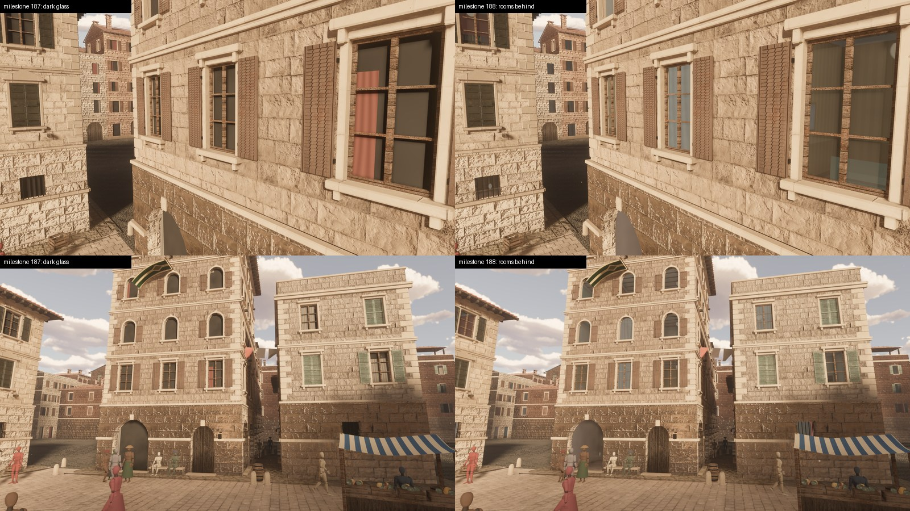

# FellowEngine — milestone 188 report (rooms behind the windows)

Status: **FINAL** (2026-11-24). Branch `fellow/geometry`. Built and looked at on lavapipe in the cloud; measured on the
RTX 5070 Ti laptop at 1920x1080 once the owner allowed the GPU again (jobs f542-f546).

## 0. Result

The owner asked for something more visible that brings the engine nearer AAA. A city's windows are where a game's
street reads as a film set or as a city: the rooftops' glass was dark with a curtain drawn on it, the same at every
angle. `FellowInteriorMaterial3D` (new; decision 0330) puts a room behind each window without its geometry — interior
mapping: the view's ray followed into a box behind the glass, so the room moves with the eye. Walls with paper,
panelling, pictures, a door or a bookcase; floors of cotto, boards, parquet or stone with a rug; beamed ceilings;
furniture on two planes; a hanging lamp; drapes or nets behind the glass (none behind a shop's arch or a door); lit by
the day through the window, seen through Fresnel's law, grime, the sky's reflection and old panes out of true. Each
window is its own room, from its glass's UV2 (`tools/window_uv2.gd`): the rooftops' 68 house meshes carry it.

On the RTX the rooms cost nothing measurable against the dark glass (the frame 5.3-8.2 ms against 5.4-8.5 ms in four
views), and they add no flicker: every pattern is filtered over the pixel's footprint.

## 1. Measurements

`showcase/tools/windows_look.gd --timing=1` (120 frames after 60, twice): GPU ms with the rooms / the old glass — east
8.23, 8.12 / 8.36, 8.53; north 7.43, 7.63 / 7.34, 7.66; close 7.57, 7.78 / 7.83, 8.28; street 5.33, 5.40 / 5.44, 5.52.

Flicker (decision 0331's measure, the buildings' pixels changing by more than 3 levels): with the rooms against plain
dark glass, still 0.59 / 0.71 % against 0.53 / 0.73 % (east / north, milestone 189's TAA).

The regression suite's new scene `base/interiors` (a wall of six windows with lamps in half the rooms, a block in grid
mode); the class reference checked (`make_rst.py`, the schema).

## 2. How it got there

* Lit as the scene's light would light them the rooms were nearly black beside sunlit plaster; they glow with
  `daylight` 1.0, as games' interiors do. The glass's grime as a dusty albedo hazed them over in the orange sun.
* Rooms of plain plaster read as empty boxes: paper, panelling, props, patterned floors and ceilings, furniture, a lamp.
* A shop's arch put its floor 0.9 m under it and its top through the ceiling: a tall window's floor at its bottom. A
  net across a whole arch read as a shower curtain: no curtains behind a tall window's glass.
* On lavapipe the windows were among the brightest spots of the flicker's map: every pattern now box-filtered over
  the pixel's footprint where the ray meets it.
* MSVC refused the shader as one string literal (16 380 bytes at most): adjacent raw literals.

## 3. Open

* No sunlight through the window onto the floor; no rooms at night in the showcase (it is a golden hour).
* Furniture as flat silhouettes on two planes (layered interior mapping), not boxes.
* Rooms from cubemaps (artists' rooms) not supported — procedural only.
