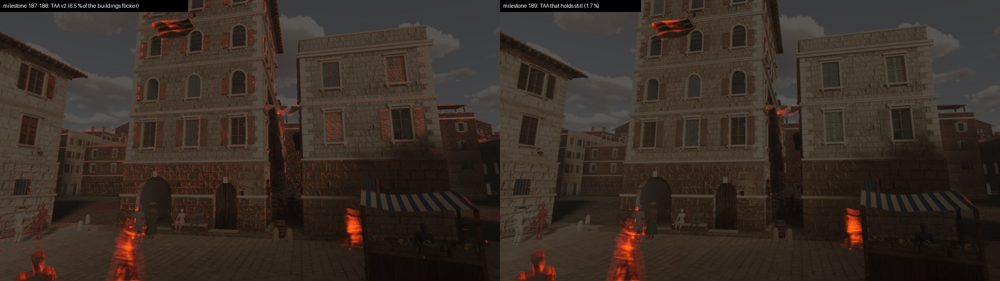

# FellowEngine — milestone 189 report (TAA that holds still)

Status: **FINAL** (2026-11-24). Branch `fellow/geometry`. Measured on the RTX 5070 Ti laptop at 1920x1080 (the owner
allowed the GPU again for this: jobs f541-f550), first swept on lavapipe in the cloud.

## 0. Result

The owner: "when I last ran the rooftops there was a lot of shadows flickering on the buildings". Measured frame by
frame — each pixel's second temporal difference over the buildings, with the camera still and, compensated for the
motion, moving (`benchmarks/tools/flicker/flicker_metrics.py`) — with every shadow and lighting feature off in turn:
soft shadows, the sun's size, FellowEngine's contact shadows, the directional shadow cache, SSAO and SSIL, SDFGI and
its screen gather. None of them mattered. TAA did: with TAA off a still view flickered *less*. FellowEngine's TAA v2
(decision 0001) followed the jitter's sub-pixel aliasing — the shutters' slats, the rusticated stone's sunlit grains,
the joints' dark, which read as flickering shadows — instead of averaging it, and under motion pulled pixels towards the
frame's own aliased 3x3 mean.

TAA v2 now keeps its history where it is trusted the more the jittered frame disagrees with it, measured as stock
Godot's resolve measures it (`postfx/taa_v2_stability`, new, on), and softens moving pixels only where their history was
clipped (`postfx/taa_v2_soften_untrusted`, new, on; decision 0331). The rooftops' buildings' pixels flickering by more
than 3 levels: still 6.7-7.6 → 1.8-1.9 %, moving 8.0-9.6 → 1.6-1.9 % — as steady as stock's TAA still, steadier
moving, and sharper than both moving. Against PBR Lab's ground truth it flickers less than before where the camera pans
and around a moving object, and is 0.1-1.5 dB further from the truth (foliage strafed the most).

## 1. Measurements

The rooftops, RTX, 1920x1080, the windows' glass plain, 24 frames still then 48 moving at 1.4 m/s (`flicker_look.gd`);
buildings' pixels over 3 levels (still second difference / moving motion-compensated residual), sharpness (still /
moving):

| TAA | east still | moving | sharpness | north still | moving | sharpness |
|---|---:|---:|---|---:|---:|---|
| stock Godot | 1.65 % | 2.20 % | 3.49 / 2.79 | 1.90 % | 2.47 % | 3.69 / 3.10 |
| v2, milestone 188 | 6.67 % | 8.04 % | 3.76 / 2.57 | 7.60 % | 9.63 % | 3.95 / 2.45 |
| **v2, milestone 189** | **1.75 %** | **1.63 %** | 3.68 / 2.84 | **1.92 %** | **1.92 %** | 3.94 / 3.20 |

Every feature off in turn (f541, milestone 188's TAA; east, still / moving second difference over 3 levels): as it was
6.65 % / 63.4 %; contact shadows 6.65 / 63.6; shadow cache 6.69 / 63.4; SSAO and SSIL 6.54 / 63.6; soft shadows (hard)
7.80 / 64.6; SDFGI 7.42 / 63.2; its screen gather 6.62 / 63.6; a 0.5° sun 6.90 / 62.9; the sun's shadows 7.56 / 65.3;
TAA **1.91** / 68.2.

PBR Lab against its ground truth, PSNR dB: camera pan 37.62 → 37.55 (stock 36.12), moving object 38.46 → 37.79
(37.76), thin dolly 34.09 → 33.01 (32.10), specular orbit 31.74 → 31.57 (31.63), foliage strafe 32.19 → 30.66
(31.51); flicker against the truth's own change lower where the camera pans (0.00564 → 0.00542) and around the moving
object (0.00074 → 0.00058). The decision record has the nineteen configurations measured on the way.

Cost: none to measure (PBR Lab, 1080p, three interleaved runs each: GPU 2.04-2.07 ms against 2.07-2.08 ms).

## 2. How it got there

* No GPU at first: the sweep on lavapipe at 640x360, one process a feature (LLVM's 6 GB a rooftops run). Nothing stood
  out; the people and the banner dominated.
* f541 on the RTX: TAA the only feature that mattered. f542: v2's anti-flicker halved the still flicker, stock's TAA
  was steadier still under motion; the facades' parallax filtered at the pixel's level of detail changed nothing
  measurable (kept: correct mipmaps, no 32-step parallax where it cannot be seen).
* f543: a first stability term, steady (0.5-0.7 %), and no motion softening; f545, against the ground truth: 0.4-2 dB
  lost — its relative difference weighed darker samples less and drifted bright. f547-f549: stock's absolute
  difference, and the softening kept for clipped histories only.
* The moving second difference counts the image's own motion (a texture moving v pixels a frame changes by about v²
  times its curvature): motion-compensated in 64-pixel blocks (phase correlation) to see the flicker.

## 3. Open

* Foliage strafed in PBR Lab is 1.5 dB further from its ground truth than milestone 188's (0.85 below stock's): the
  softening that helped it softened trusted facades too.
* The shutters' slats are 15 000 triangles a house: steady now, but a simpler mesh far away would be cheaper.
* FSR 3.1's accumulation (the upscaling path) not measured for this flicker.
