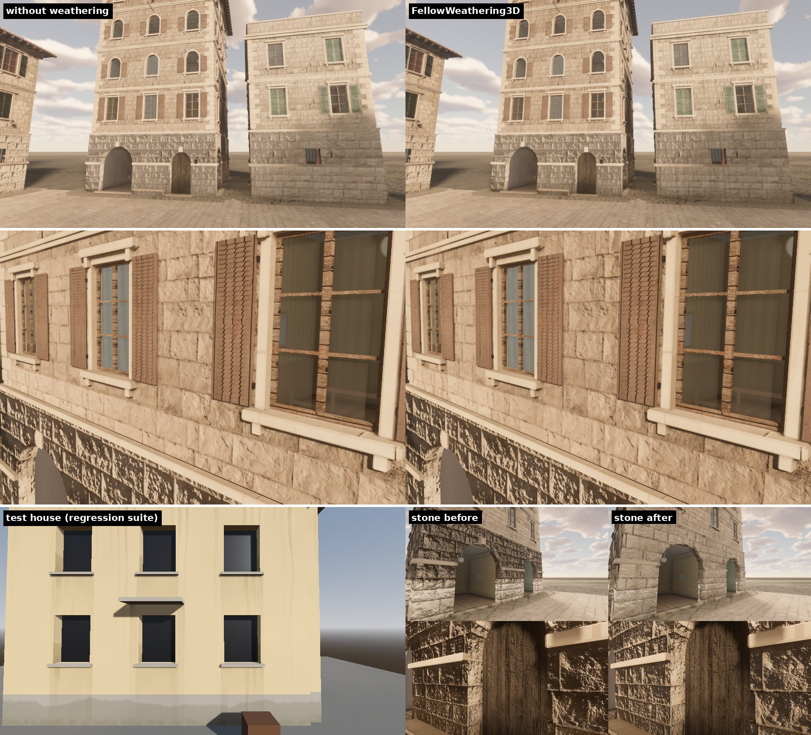

# FellowEngine — milestone 190 report (weathering)

Status: **FINAL** (2026-11-24). Branch `fellow/geometry`. Built and looked at on lavapipe in the cloud only (the owner:
on to AAA without the GPU); the GPU's cost is to be measured.

## 0. Result

After rooms behind the windows (milestone 188) the rooftops' buildings still read as new: every wall clean from the
eaves to the street. A real town's walls are drawn by the weather, and an AAA city paints it in by hand (masks, decals,
vertex colours). `FellowWeathering3D` (new; decision 0332) draws it from the geometry instead: dark streaks hanging
from every sill, hood, cornice and balcony — lanes of their own width, length and darkness, darker under a ledge's
ends, a curtain of grime under a sill — damp rising from the street to a ragged tide line with salt above it, and a
patina; nothing under a mass that shelters the wall. No textures, no painting: one node, a render layer for what it
weathers.

It finds the ledges and the ground in the scene seen from above in horizontal layers — sixteen heightfields of 1.75 m
around the camera, drawn into one array texture, each holding its own highest surface — because one heightfield sees
only the cornice over a column, never the sills under it. The layers follow the camera one a frame.

During the milestone the owner asked why the rooftops' rusticated stone showed "more shadow than texture": the
photograph's rock-faced normal map (31° on average) at 0.5 under the low sun drew every block as its shading. At 0.22,
over a colour softened less, the stone shows (each other term of its relief off in turn changed nothing).

## 1. Measurements

Lavapipe, 960x540. The test house (the suite's new scene `base/weathering`): streaks under the six sills, the balcony
and the cornice, darker at the sills' ends and in a curtain under each; damp to a tide line on its stone base and none on
the wall over the balcony; a crate on another layer untouched. The rooftops (`showcase/tools/weathering_look.gd
--lite=1`: the square's buildings alone — lavapipe's whole town outgrows the cloud's 6 GB): the streaks and damp under
every ledge (`--debug=1` draws them red and green), subtle over the photographs, so the showcase's streaks are darker and
longer than the defaults.

The regression suite: every other scene exact. Memory: 64 MB of layers at the defaults. GPU time: not measured.

## 2. How it got there

* One heightfield (the rain's shelter, or the node's own): the cornice hid every sill; the balcony's floor counted as
  the ground. Layers of 3 m showed the sills; 1.75 m keeps a sill and the hood over it apart, with the search going up
  to five streak lengths and down through the damp's reach, a column empty all the way down "far below".
* Lanes six a metre, every one running: a barcode; four a metre, half of them, soft edges, a broad wash, the ledges'
  ends and a curtain under short ledges.
* Sixteen textures read through a sixteen-way `switch`: every lookup inlined sixteen times, and lavapipe's LLVM ran out
  of memory compiling the rooftops' pipelines. One array texture: a heightfield can now draw into a layer of an array.
* The layers moved all in one frame (sixteen depth passes over the town every four metres): one a frame now, all at once
  after a cut.

## 3. Open

* The GPU's cost (the layers' depth passes, a wall's dozen texel reads) — on the RTX when the GPU is back.
* Roofs (streaks from the ridge, moss), wetness after rain darkening the streaks, normals and roughness: albedo only.
* A ledge must stand out more than 1.2 texels (7.5 cm at the defaults) to be seen; a layer sees one ledge over a point.
