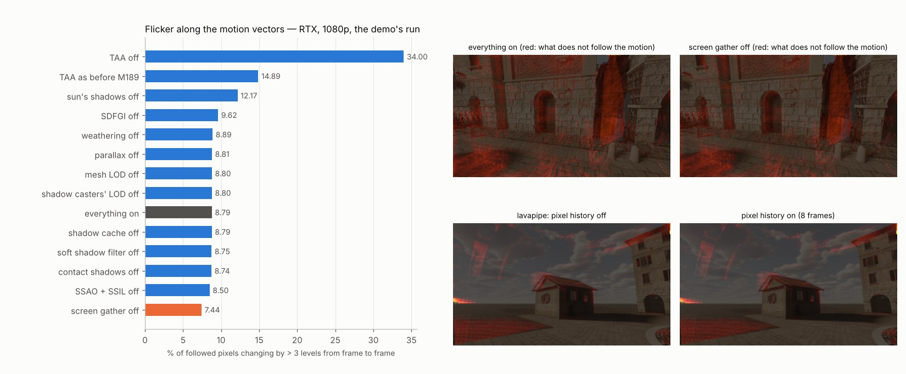

# FellowEngine — milestone 191 report (flicker under motion; the fountain, the controls and the camera)

Status: **FINAL** (2026-11-24). Branch `fellow/geometry`. The flicker diagnosed on the RTX (the owner's GPU, with his
leave); the change measured on lavapipe in the cloud (the owner then asked for no GPU work for now).

## 0. Result

The owner played the rooftops after milestone 190 and listed five things: the shadows on a building still flicker while
moving; off the fountain only with a jump; the jump and many other animations unrealistic; the camera dull and the
control unsatisfying; the sky not epic enough. In his order (the bugs first): this milestone takes the flicker, the
fountain and the control and camera; the animations are milestone 192 (Mixamo's motion capture, his choice), the sky
milestone 193.

**Flicker under motion** (decision 0333). The still camera's measure of decision 0331 means nothing while running, so
the showcase now reads back the scene's motion vectors (`velocity_dump.gd`) and `reproj_flicker.py` measures, for every
pixel, what does not follow its surface's motion from frame to frame. On the RTX, each feature off in turn over the
demo's run: TAA is what holds the picture together (off: 34 % of the pixels flicker by more than 3 levels, as before
milestone 189: 14.9 %, now 8.8 %); the sun's shadows do not flicker themselves (off, more of the town is lit and its
texture shows: 12.2 %); the weathering, the parallax, LOD, the shadow cache, its soft filter and contact shadows change
nothing; what a feature adds lies in the shaded parts, lit only by the indirect light — the most of it SDFGI's screen
gather (off: 7.4 %), then SSAO and SSIL (8.5 %). The gather's resolve now keeps a **history per pixel**
(`sdfgi/screen_gather_pixel_history`, 8 frames), followed by the camera's motion and kept only where the point lay at
the same distance: on lavapipe the shaded pixels' flicker 11.2 → 10.5 % (> 3 levels) and 4.1 → 3.9 % (> 8), the
light's level unchanged. On the RTX to be measured.

**The fountain.** The edge guard (milestone 154: the body slides along a drop rather than walk off it, as Assassin's
Creed's low profile) held the body on any drop over 0.7 m, and the fountain's rim is 0.75 m. A drop under 1.3 m is now
walked off; at a deeper one the body goes over after pushing at it for 0.35 s, or at once with the drop key.

**The control.** A jump pressed up to 0.15 s before landing is kept for the landing (a buffer); one pressed up to 0.12 s
after walking off an edge still jumps (coyote time); falling pulls 1.45 times harder than rising (a jump's arc snappier,
a fall less floaty; not a jump at a wall); turning back at speed brakes hard first (1.6 times the deceleration: a plant
and a turn, not a slow arc); the landing's settle can be cut by the next jump.

**The camera.** It leans into turns (up to 2.5°, by the turn's rate times the speed), dips on a landing (up to 22 cm
after a fall faster than 3.5 m/s, sprung back), drops back as the body speeds up and closes in as it brakes (+0.45 /
−0.3 m), levels its pitch towards the gait's when the mouse has been still for 2 s, and turns with a pad's right stick
(a dead zone, the response squared).

## 1. Measurements

* The RTX (1080p, `play_look.gd --demo --demo_only=run --skip=120 --frames=180 --hide_player=1 --velocity=1`, one
  feature off per run; about 128 million pixels followed): decision 0333's table.
* Lavapipe (`flicker_look.gd --lite=1 --view=ref --speed=5.5 --turn=12 --velocity=1`, 960x540, the configs after a
  warm-up sequence): the pixel history on and off, the gather off — decision 0333.
* The fountain: headless, the player walked and ran off its rim: down both times (before: held on the rim).
* The regression suite: every scene exact.

## 2. How it got there

* The block-matching motion of milestone 189's `flicker_metrics.py --motion` did not tell the features apart at a
  run's speed with a turning camera (its residual was its own compensation's error): the motion vectors instead.
* The textures' mipmaps without TAA's sharpening bias (−0.5): a twentieth less flicker on the lit walls on lavapipe,
  none on the shaded ones, every texture softer — not taken.
* A first lavapipe comparison seemed to take a third of the shaded walls' flicker out: SDFGI was still converging in the
  run's first sequence. Every comparison follows a warm-up sequence now.

## 3. Open

* The pixel history on the RTX (the same jobs, `--set=rendering/fellow/sdfgi/screen_gather_pixel_history=1` against
  the default) and its GPU time.
* The residual TAA leaves on the textures' sub-pixel detail under motion — most of what is left.
* The control and the camera: the owner's judgement in play.
