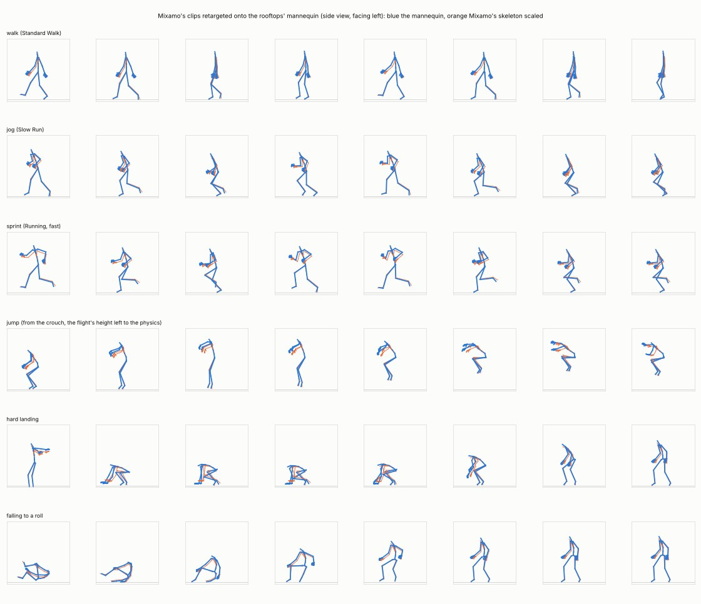

# FellowEngine — milestone 192 report (Mixamo's motion capture on the rooftops' character)

Status: **FINAL** (2026-11-24). Branch `fellow/geometry`. The showcase only; no GPU (the owner's wish). The clips are
the owner's (Mixamo's licence: a game may use them, their files may not be handed out) and are not in the repository.

## 0. Result

The owner: "the jump and many other animations look very unrealistic". The rooftops' character now plays motion
capture — Mixamo's — for its idle, its four gaits (walk, jog, run, sprint), its jumps (standing and running), the fall,
the landings (soft and hard) and the roll (decision 0335):

* `showcase/tools/blender/mixamo_retarget.py` puts Mixamo's skeleton's motion on the mannequin's: every bone turned in
  the world as Mixamo's turns from its T-pose, the hips scaled by height, the legs by IK to Mixamo's ankles so the feet
  stand on the ground; gaits cut to one stride from the left foot's strike with their measured speeds, the jumps from
  just before the takeoff with the flight's height left to the physics (the old jump crouched while the body already
  rose), the landings from the touchdown.
* `showcase/tools/build_mocap_clips.gd` makes the player's library in `showcase/rooftops/mocap/` (ignored by git); the
  player plays it where it exists — the gaits' blend points at the clips' own speeds, a running jump above 3 m/s, a hard
  landing (down on a hand) after a fall of more than 3 m — and its own clips otherwise.
* The owner signed in to Mixamo in the app's browser; the eleven clips (and a faster jog) were downloaded there.

## 1. Measurements

* The mannequin follows Mixamo's skeleton within a few centimetres in every clip; its ankles stand at 8.2-9.1 cm (rest
  8.5) in stance.
* `anim_quality.py`: 30 of 38 gates with the mocap (38 with the mannequin's own clips). In steady gaits the feet slide
  0.3-1.5 cm a stance and the right foot strikes at half the left's stride. The walk's knees are more bent and its
  ankle less pointed than the gates' biomechanical bands, the runners straighten their knees more at push-off (5.5-11°
  against at least 15°) — captured motion against the gates' model. What is worse: **starting and stopping** — a foot
  slides 15-70 cm while the gaits mix as the body accelerates or brakes (the mannequin's own clips: 2-22 cm), and the
  jump at a wall (still the mannequin's clip) swings the arms in from a mocap sprint at 2,720°/s.

## 2. How it got there

* Mixamo's "Jogging" was barely faster than its walk (1.6 m/s): "Slow Run" (3.0 m/s) is the jog.
* The jumps first kept Mixamo's flight height (the hips a metre above the player's own rise): taken out.
* Mixing the gaits only between speeds, cycles from the mixed strides, slower crossfades, the mannequin's own idle:
  none helped the starts and the stop as a whole.

## 3. Open

* Start and stop clips (Mixamo's "Start Walking", "Running To Stop") and the hangs and climbs (the second batch of
  Mixamo's clips) — next.
* The jump at a wall from a mocap clip (Mixamo's "Running Jump" up onto a higher level).
