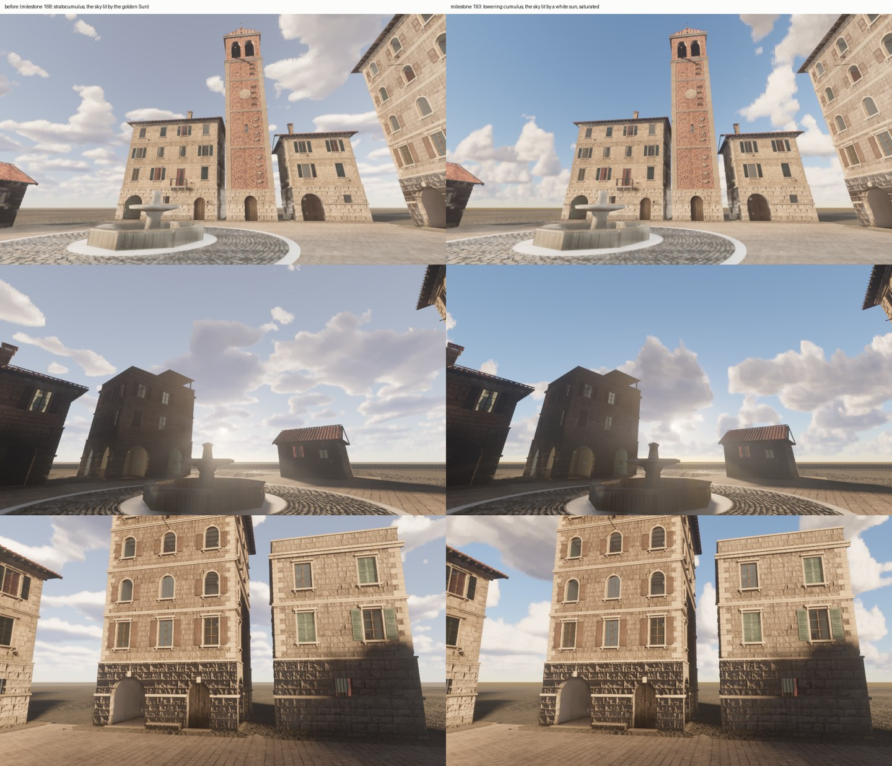

# FellowEngine — milestone 193 report (an epic sky for the rooftops)

Status: **FINAL** (2026-11-24). Branch `fellow/geometry`. The showcase only; looked at on lavapipe in the cloud (no GPU
work for now). Milestone 192 (Mixamo's motion capture on the rooftops' character) waits for the owner's clips and
follows.

## 0. Result

The owner asked for a sky "more epic, as in the Witcher 3 or other AAA games". The rooftops' golden-hour sky was a grey
lavender over a flat layer of stratocumulus; now it is a deep blue over towering cumulus (decision 0334):

* **The sky was lit by a sun reddened twice**: the sky's own sun took the scene Sun's golden colour, and FellowEngine's
  atmosphere reddens a sun through the air itself — the sky's blue scattering cut to 0.57. Now the sky's sun is white
  and the air does the reddening (its luminance kept).
* **The depth fog had been laid over the sky**: the saved scene had lost `fog_sky_affect` 0 (set by the scene's builder
  since milestone 168). Off again.
* **Deepened**: the sky seen (not the light it sheds on the scene) saturated 1.6 times about its luminance, and three
  times the sun's energy instead of four (AgX had desaturated it at four).
* **Towering cumulus**: their bases at 1.5 km, 2.2 km tall, fewer — puffed, shaded beneath, with gaps of blue.

The clear sky over the square 170, 176, 191 → 130, 160, 193 (sRGB); the buildings' light unchanged.

## 1. How it got there

* The fog over the sky off and the frame more saturated: a little bluer, still pale.
* The atmosphere cleaner (less haze, more Rayleigh): brighter, not bluer.
* The sky lit by a higher sun (22-24°): a midday blue, the golden hour gone.
* The sky's raw colour (a linear tonemap, the clouds off) was itself grey: the sun's colour twice reddened.
* Saturation in the sky shader alone at four times the sun's energy hardly showed (AgX); at three it did.

## 2. Open

* The clouds' own drama: silver linings towards the sun, darker bases, crepuscular rays through the gaps.
* The GPU's cost of 2.2 km of cloud instead of 0.6 (the fine steps inside clouds) — on the RTX when the GPU is back.
* The owner's judgement in play.
