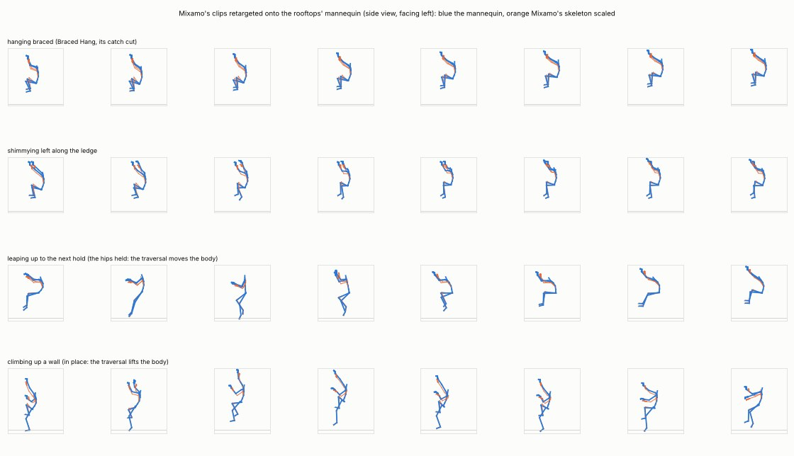

# FellowEngine — milestone 194 report (Mixamo's hangs and climbs on the rooftops' character)

Status: **FINAL** (2026-11-24). Branch `fellow/geometry`. The showcase only; no GPU. The clips are the owner's
(Mixamo's licence) and not in the repository.

## 0. Result

The second batch of Mixamo's clips (decision 0336), downloaded in the app's browser on the owner's account: the
character now hangs, shimmies, hops from hold to hold and climbs walls with motion capture too.

* The hang: Mixamo's Braced Hang without its catch, looped.
* The shimmy by side: Mixamo's leads with a hand, so the left and the right clip follow the stick (the mannequin had one
  clip for both ways).
* The hops up, left and right: their wind-up, flight and catch, the hips held — the traversal moves the body from hold
  to hold, the arms and legs reach about the hips as Mixamo's.
* The climb up a wall in place (the traversal lifts the body).
* The hips where the traversal expects them: Mixamo's hang hung 13 cm higher and its climb 77 cm — hands the IK could
  not have put on the ledge; moved, with every joint, to the mannequin's own clips' heights.

Also downloaded, not played yet: Mixamo's start and stop (its start is a weight shift and three slow steps — 2.9 s to
1 m/s —, its stops three seconds from a walk and 0.9 s from 1.3 m/s: a cinematic's, not a player's pace), the climb up
from the hang, the run up a wall and the vault (root-motion clips of the traversal: Mixamo's hips carry the travel and
it must be moved onto the root bone first).

## 1. Measurements

`anim_quality.py`: 30 of 38 gates, as milestone 192's — every gate of the hangs, holds and climbs passes: the hang's
fastest joint 1,200°/s (the mannequin's own 1,750), from hold to hold 2,130°/s (2,200 the gate). The eight that fail
are milestone 192's: the walk's and the runners' joints against the gates' bands, a stop's 19 cm of slide and the
starts' (15-70 cm), the jump at a wall's arms.

## 2. How it got there

* The hops whole, played over the move's time: three times their speed, the head at 2,330°/s. Their action alone.
* The hips' anchor first broke the hang (a variable of the loop's centre reused): its hips 75 cm out from the wall in
  the stick figures; fixed.

## 3. Open

* The starts and stops: Mixamo's are too slow for a player; the foot lock holding a mocap foot through the gaits' blend
  (it lets go past 0.3 m of drag) is next.
* The climb up from the hang, the run up a wall and the vault from Mixamo (their travel onto the root bone).
