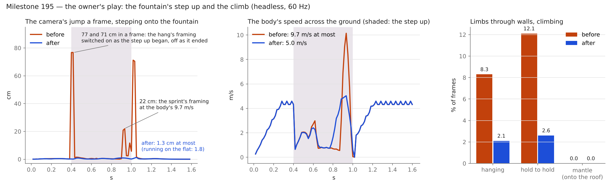

# FellowEngine — milestone 195 report (the fall, the step up onto the fountain, the hangs and climbs)

Status: **FINAL** (2026-11-24). Branch `fellow/geometry`. No GPU. Decision 0337.

## 0. Result

Five things the owner saw playing the rooftops after milestone 194, fixed:

* **The fall face down, then onto the feet**: Mixamo's "Falling Idle" is a skydiver's pose; the character falls with
  the mannequin's own fall again. Mixamo's jumps, landings, roll, idle and gaits stay.
* **The camera jumping as the character steps up onto the fountain**: the camera took its framing for hanging (half
  way to level, 0.5 m closer) in one frame as the step up began and dropped it as it ended — 0.77 m and 11° in a frame,
  then 0.71 m; and the step up (a mantle with the mannequin's clip) held the body at the rim until the very end, then
  moved it 0.7 m in a tenth of a second (9.7 m/s), which the camera's sprint framing followed: 0.22 m sideways in a
  frame. The hang's framing now eases in and out and is not a mantle's; the camera follows a smoothed speed held
  through a mantle; the engine's mantle lets the body over the top earlier, easing in and out of the hold (at most
  5.0 m/s). The camera's largest jerk 0.77 m → 0.013 m (running on the flat: 0.018 m).
* **Strange movements while hanging still** and **climbing not smooth**: Mixamo's hang and climb (milestone 194) back
  to the mannequin's own, made for the traversal's fixed hands and braced feet.
* **Limbs through the building**: the braced feet now look for stone that stands out above them (a band 14 cm proud of
  CasaCrema's front had taken a shin through it, 27 cm), stand 15 cm off the stone instead of 12, and the moves between
  holds place them on the stone too (they had been on the wall's plane): limbs through the walls hanging 8.3 → 2.1 % of
  the frames, from hold to hold 12.1 → 2.6 % (Mixamo's: 17.4 %).

## 1. Measurements (headless)

| | before | after |
|---|---|---|
| the fountain: the body across the rim, fastest | 9.7 m/s | 5.0 m/s |
| the fountain: the camera's largest jerk (second difference a frame) | 0.77 m, 11° | 0.013 m, 0.1° |
| the fountain: limbs through the rim | 0 % | 0 % |
| hanging: limbs through the walls (deepest) | 8.3 % (20.5 cm) | 2.1 % (4.4 cm) |
| hold to hold: limbs through the walls (deepest) | 12.1 % (27.3 cm) | 2.6 % (6.0 cm) |
| the mantle onto CasaCrema's roof: the hips' fastest change | 222 m/s² | 190 m/s² |
| `anim_quality.py` gates | 30 / 38 | 30 / 38 |

Step by step: the framing eased 0.22 m; the speed smoothed 0.022 m; the mantle's way 0.013 m. The fountain approached
at a run from 3.5 m and 6 m and at an angle, and at a walk: the same. The traversal's step 4.7 → 5.9 µs (the rays above
the feet; debug build); `climb_check.gd` and `traversal_check.gd` as before; the regression suite's 40 scenes
identical.

## 2. How it got there

* The mantle's way first smoothed by repeated averaging with the hold put back each pass: the fountain at 4.7 m/s,
  but on CasaCrema the body left the hang with a kink (565 m/s², the gate 400) and the toes went into the eave; the ease
  in and out made analytic instead. Over the top from 0.3 of the rise put the toes into the rim; a fifth.
* The moves between holds' feet on the stone, without looking above the foot: worse (14.8 %) — the bands above the
  feet were what the shins went through.

## 3. Open

* The jump at a wall's knee 11 cm into the wall as it is caught (8.8 % of the approach), the toes on the tiles (3.9 %).
* The showcase's graphics (the owner's sixth point: materials and light, the distant view) — milestone 196.
