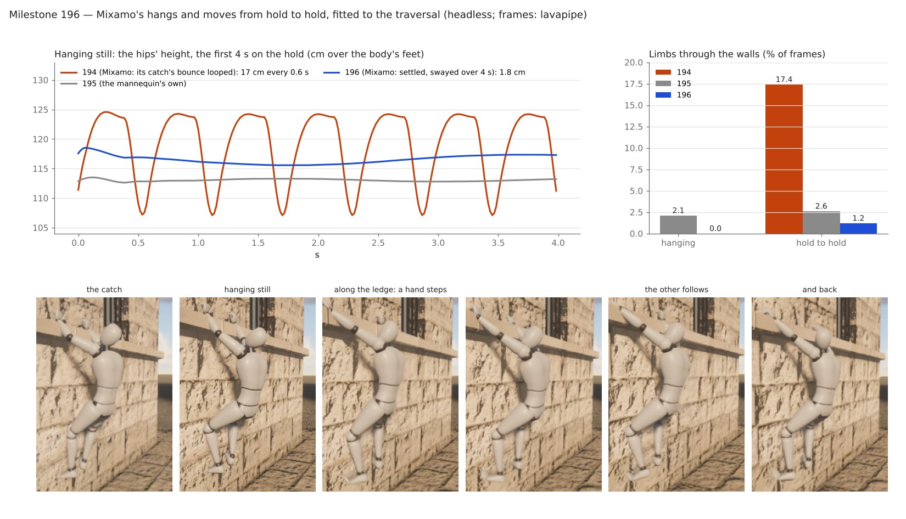

# FellowEngine — milestone 196 report (Mixamo's hangs and moves from hold to hold, fitted to the traversal)

Status: **FINAL** (2026-11-24). Branch `fellow/geometry`. Decision 0338. The clips are the owner's (Mixamo's licence)
and not in the repository.

## 0. Result

The owner, after milestone 195 had given the hangs and the climb back to the mannequin's clips: "then why did we bother
with Mixamo? We must polish the climbing and free-running animations to the max." The hangs and the moves from hold to
hold are Mixamo's again, now fitted to the traversal instead of fighting it:

* **Hanging still**: Mixamo's "Braced Hang" is a jump into the hang and its settling — milestone 194 had looped the
  settling's bounce (the hips 17 cm up and down every 0.6 s: the "very strange movements"). Now its settled moment,
  swayed over four seconds (1.8 cm), and the catch itself played when a hold is caught from the air.
* **Hand over hand** from Mixamo too — up from its "Climbing Up Wall" (a half-cycle a move), across from its shimmies —
  instead of the mannequin's reaches between Mixamo's hops.
* **The hands between holds** follow the captured arm (`FellowTraversalPose3D.hand_flight_weight`); the IK puts them
  on the hold as they take it.
* **The shimmy** at the body's pace (0.6 m/s), its hands where the clip's are along the edge (`hand_slide`): they hold,
  then step.
* **Knees and toes off the wall**, for every scene: a knee turned out about the leg's hip-to-ankle line, a foot pitched
  onto the stone. Limbs through the walls: hanging 0 %, from hold to hold 1.2 % (milestone 194's Mixamo: 17.4 %).

## 1. Measurements (headless)

| | milestone 194 (Mixamo) | 195 (mannequin) | 196 (Mixamo, fitted) |
|---|---|---|---|
| hanging still: the hips' vertical range | 17.2 cm | 0.5 cm | 1.8 cm |
| hanging: the fastest joint (p95 / max) | — | 1,567 / 1,750°/s | 615 / 814°/s |
| hold to hold: the fastest joint (p95 / max) | — / 2,130°/s | 1,887 / 2,000°/s | 1,355 / 2,140°/s |
| limbs through the walls: hanging / hold to hold | — / 17.4 % | 2.1 / 2.6 % | 0.0 / 1.2 % |
| `anim_quality.py` gates | 30 / 38 | 30 / 38 | 30 / 38 |

`climb_check.gd` and `traversal_check.gd`: every lane as before; the regression suite's scenes identical.

## 2. How it got there

* The moves Mixamo's with the IK on the hands throughout: 14.6 % of the hanging frames with a limb through the wall;
  the hands' flight to the clip: 8.3 %; the knees and toes kept off the stone at the feet's weight: 4.2 %; at full
  weight whatever the feet's (a hop's legs swing free): 0 %.
* `climb_look.gd` films the climbing (lavapipe: 6 minutes for 10 s; the owner then allowed the GPU: the RTX films it).

## 3. Open

* Mixamo's climb up from the hang onto the top, run up a wall and vault (their travel onto the root bone).
* The jump at a wall's knee (11 cm into the wall as it is caught), the toes on the tiles.
* Milestone 197: the showcase's graphics (materials and light, the distant view).
