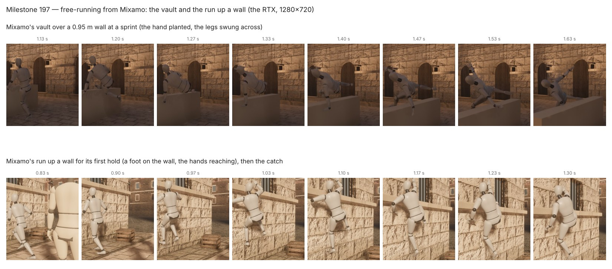

# FellowEngine — milestone 197 report (free-running from Mixamo: the vault and the run up a wall)

Status: **FINAL** (2026-11-25). Branch `fellow/geometry`. Decision 0339. The clips are the owner's (Mixamo's licence)
and not in the repository. Tested on the owner's RTX through the job queue (jobs f553-f556).

## 0. Result

* **The vault**: Mixamo's — the hand planted, the legs swung across — at the sprint's pace (1.6 m in 0.6 s over a
  0.95 m wall). An engine fix on the way: a mantle with a clip's root motion had held the body at the wall through
  Mixamo's whole vault (its hold was looked for after the root's peak too).
* **The run up a wall** for the first hold: Mixamo's — a foot on the wall, the hands reaching — then its catch.
* **The climb up from a hang** stays the mannequin's: Mixamo's goes through CasaCrema's eave (half the mantle's frames)
  and ends crouched.
* **The RTX's check of milestone 191's history per pixel**: the flicker along the motion 8.58 → 8.11 % of the pixels
  (> 3 levels).
* `climb_look.gd --program=course`: a low wall and a 3 m block on the square to film the free-running.

## 1. Measurements

| | before | after |
|---|---|---|
| the vault over 0.95 m: the body's way, time | 1.6 m, 0.57 s (the mannequin's) | 1.6 m, 0.6 s (Mixamo's) |
| the approach: limbs through the wall | 8.8 % | 6.0 % |
| the approach's fastest joint | 2,721°/s | 2,717°/s (gate 2,200) |
| `anim_quality.py` gates | 30 / 38 | 30 / 38 |
| the RTX, flicker along the motion (> 3 levels) | 8.58 % (no history per pixel) | 8.11 % |

## 2. How it got there

* Mixamo's vault whole: 1.3 m/s over the wall; its root from the hips' offset: 0.66 m under the ground at the landing;
  then the hold at the wall that never let go (the engine fix).

## 3. Open

* The arm's swing up out of the sprint at the jump at a wall; the climb up from a hang over an eave; the toes on the
  tiles.
* The showcase's graphics (materials and light, the distant view) — next.
