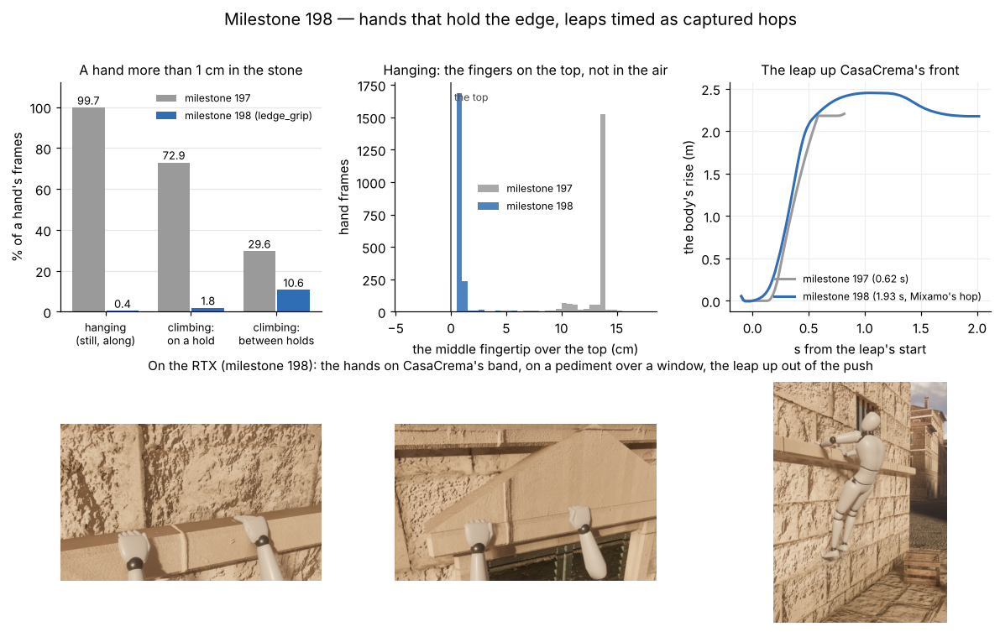

# FellowEngine — milestone 198 report (hands that hold the edge, leaps timed as captured hops, blends)

Status: **FINAL** (2026-11-25). Branch `fellow/geometry`. GPU: the RTX filmed the climbing (jobs f557-f559).
Decision 0340.

## 0. Result

The owner, after milestone 197: the character "does not grip the edge with its hand but somewhere in the air, the
hands sometimes go through the edge, the jump up is not anatomical — no energy put into the leap, it just flies up —
and the blending between animations is sometimes sudden and violent". All four, fixed:

* **The grip** (`FellowTraversalPose3D.ledge_grip`): a hand on a ledge is held as a climber's — the knuckles over the
  edge, the palm down the face, the fingers and the thumb on the top (they had stood 13.7 cm over it, in the air, the
  wrist on the top 6 cm in: the forearm through the edge's corner); over a moulding under the edge, by a step's edge;
  the wrist straightened towards the shoulder where the arm must reach. A hand on a hold more than 1 cm in the stone
  hanging **99.7 → 0.4 %** of its frames, climbing **72.9 → 1.8 %**, between holds **29.6 → 10.6 %**.
* **On the hold as it is caught**: the hand's place by its knuckles all the way between holds, its IK homing in over
  the second half of its way, its target no longer eased 50 ms behind (it had reached the hold 3 cm short, a twentieth
  of a second late), the hands in twice as fast as the rest of the pose when a hold is caught from the air; the
  fingers open up the face while the knuckles are still under the top, closing over it as they rise.
* **The leap up** follows Mixamo's "Braced Hang Hop Up": the push, the body where the clip's hips were, the hands
  letting go and catching when the clip's did, the feet off the wall and on it again; slower for a longer leap (a
  flight under gravity). The 2.3 m leap up CasaCrema's front: 0.62 → 1.93 s, the body's stop at the top 23 → 6 g.
* **The blends**: the player's states switch at once and `FellowInertializer3D` carries the pose on from where it was
  (0.3 s) instead of mixing two animations' poses over 0.2 s: the approach's fastest joint 2,717 → 1,659°/s, the 31st
  of 38 animation gates passing.

## 1. Measurements (headless; `climb_look.gd`, `anim_quality.gd`)

| | milestone 197 | milestone 198 |
|---|---|---|
| hanging still and along a ledge: a hand > 1 cm in the stone | 99.7 % | **0.4 %** |
| climbing CasaCrema: a hand on its hold in the stone / between holds | 72.9 % / 29.6 % | **1.8 % / 10.6 %** |
| the fingertips over the top (median: hanging, climbing) | 13.7 cm, 3.7 cm | **0.9 cm** |
| the leap up: time, the body's fastest, its sharpest stop | 0.62 s, 6.7 m/s, −231 m/s² | **1.93 s, 7.3 m/s, −62 m/s²** |
| the wrists' turn against the forearms (95th percentile) | 897°/s | 668°/s |
| `anim_quality.py` gates | 30 / 38 | **31 / 38** |
| from hold to hold: fastest joint p95; the hips' acceleration p95 | 1,355°/s; 447 m/s² | 1,299°/s; 311 m/s² |
| limbs through the walls from hold to hold (elbows, knees, ankles, toes) | 1.2 % | 0.4 % |

`climb_check.gd` and `traversal_check.gd`: every lane as before (all of it is opt-in); the traversal's step 5.5 →
6.6 µs (debug build; the stone under the holds probed), the pose's 3.6 → 3.9 µs. The regression suite's base group: its
28 scenes identical to their goldens (the climb, the traversal and the ledge corners among them).

## 2. How it got there

* The grip's wrist alone left the fingers in the air; the hand turned, the fingers along the top, then aimed at points
  on it; the fingers curled by the knuckles' height over the hold's own edge (between holds the hand's target is on its
  way, under it) and opened up the face below it.
* The RTX's first film showed the little fingers standing up: a hand's knuckles slope back to the little finger's
  (1.9 cm under the index finger's: under the top); the hand turned by its knuckles' row, level along the edge.
* A moulding under CasaCrema's band (8 cm proud, its top level with the edge the traversal found): the palm inside it;
  the stone under each hold probed, its step held by its own edge.
* The grip's place blended in with its shape cut through the corner between holds (15.8 %); all the way: 10.6 %.
* The grip turned to and let go of in 0.06 s put every catch and release at the 2,000°/s joint limit; 0.12 s in, 0.24 s
  out with the wrist's bend held against the forearm, and the elbows' bend limited to 720°/s (an elbow turned over in a
  frame, the joint limit after it took the hand 15 cm off its hold for two frames).
* The leap slowed at most 1.25 times: the hips at 8 m/s; 1.6 and the rise eased at its ends.

## 3. Open

* A hand reaching a hold the arm cannot reach yet (hand over hand up, the body still low) waits open under the edge;
  the 10.6 % between holds is mostly that.
* The hips' own stop at the top of a leap (the clip's legs and the pose: −220 m/s² against the body's −62).
* The showcase's graphics (materials and light, the distant view) — milestone 199, on the RTX.
