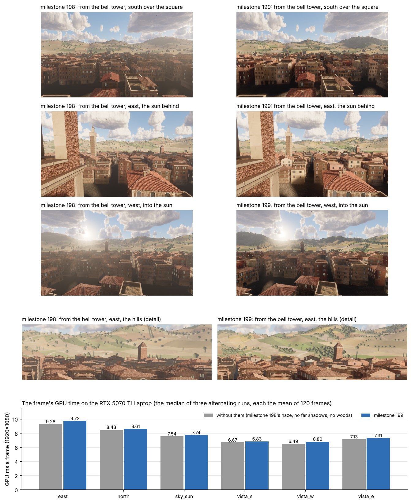

# FellowEngine — milestone 199 report (the view from the bell tower: the hills' light, woods, the far city, the haze)

Status: **FINAL** (2026-11-25). Branch `fellow/geometry`. GPU: the RTX rendered every trial (jobs f560-f570).
Decision 0341. Showcase only — no engine change.

## 0. Result

The owner: "I would also improve the showcase's graphics in general", then "carry on towards AAA with the GPU", and
first "materials and light, the distant view". From the bell tower's beam the rooftops' city and country had been a
milky, flat picture: hills lit as if flat, trees strewn as dots, every far house the same brown, black streets, and a
veil over all of it.

* **The hills' light baked**: each hill's soft shadow on the next under the low sun, the sky a valley's sides hide —
  the relief back past the sun's shadow maps.
* **Woods**: a quarter of the country — the steepest slopes, the valleys' folds, copses — 13,727 trees, their canopy
  closed; 2,343 more in rows along the fields' hedges; the 5,839 trees strewn one by one gone (528 lone oaks kept).
* **The fields** gold, deep green, brown and grey, each plot its own shade.
* **The far city**: each house its own finish — smooth plaster in its colour, Siena's brick or the square's honey
  sandstone — and every house casting shadows, to 320 m (the square's shadows as sharp as before).
* **The streets**: their dark basalt cobbles toned to a warm grey stone.
* **The veil lifted**: the depth fog from 150 m out (none over the square, the hills still hazed), the volumetric dust
  a layer low over the town (the square's light shafts as they were). The darkest 1 % of the view south 46 → 16 of
  255.
* The cost: +0.13 to +0.44 ms a frame on the RTX (1-5 %).

## 1. Measurements (the RTX 5070 Ti Laptop, 1920x1080, `weathering_look.gd`)

| | milestone 198 | milestone 199 |
|---|---|---|
| vista_s / vista_w / vista_e: the darkest 1 % of the frame (of 255) | 46 / 48 / 41 | **16 / 17 / 22** |
| east, across the square; the reference shot's view | 45; 20 | 40; 13 |
| broadleaf trees: strewn / woods / rows / lone | 5,839 / 0 / 0 / 0 | 0 / 13,727 / 2,343 / 528 |
| the city's houses: one ashlar / plaster / brick / sandstone | 794 / 0 / 0 / 0 | 0 / 264 / 158 / 372 |
| the city's houses casting shadows; the sun's shadows' reach | 142; 140 m | 794; 320 m |
| the haze at 200 m, 1 km, 2 km | 15 %, 55 %, 80 % | 2 %, 37 %, 68 % |
| GPU ms: east, north, sky_sun, vista_s, vista_w, vista_e (median of 3, alternating) | 9.28, 8.48, 7.54, 6.67, 6.49, 7.13 | 9.72, 8.61, 7.74, 6.83, 6.80, 7.31 |

## 2. How it got there

* The baked shadows first (f564): the hills' relief, the far city still brown.
* Each far house its own finish (f565, f566): plaster, brick and stone side by side; the woods, rows and fields.
* The streets: SDFGI's six cascades, SSAO and SSIL off, the weathering off — 2-10 % lighter (f565). Drawn red, the dark
  ground was the streets' cobbles (f567), and toned they were barely lighter: a veil outweighed what they reflect.
* The veil's parts (f568): the volumetric fog (its 64 m of sunlit dust applied to everything beyond) and the depth fog
  (4 % at 50 m); not the light shafts, the bloom or the atmosphere.
* The haze's strength between two tries (f569), then the GPU times in three alternating pairs (f570).

## 3. Open

* The far trees' low meshes are round from the tower (the lone oaks, the rows); the woods past 1.5 km are painted.
* The string courses' and cornices' smooth tone (milestone 159's reference) left.
* The reference shot's darkest shade a little darker (20 → 13 of 255: the depth fog no longer over the square).
