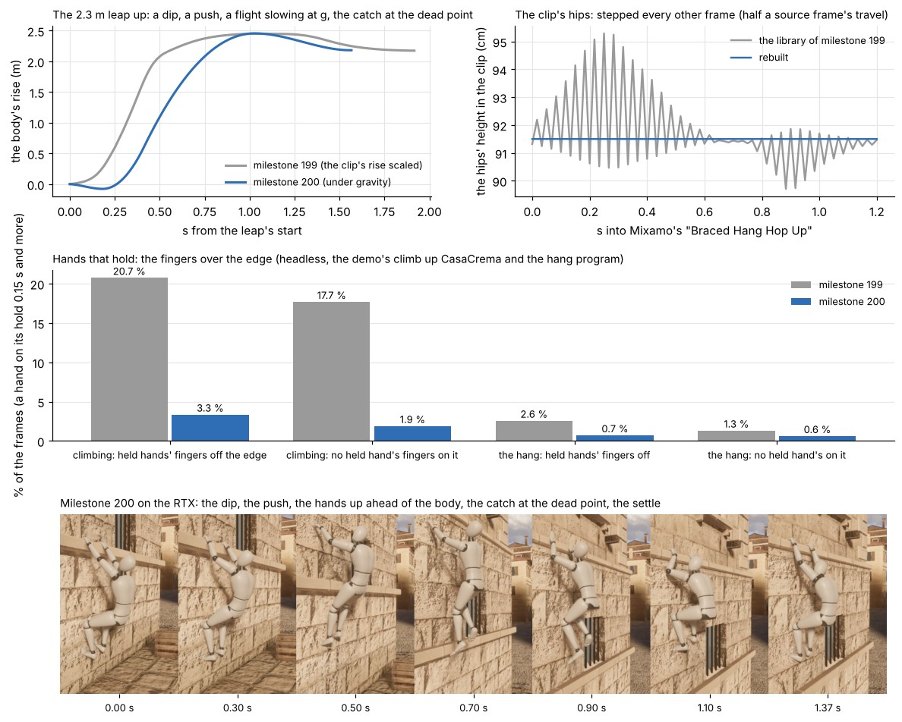

# FellowEngine — milestone 200 report (hands that hold on, a leap up under gravity, the motion capture unstepped)

Status: **FINAL** (2026-11-25). Branch `fellow/geometry`. GPU: the RTX filmed the climbing (jobs f571-f572).
Decision 0342.

## 0. Result

The owner, after milestone 199: "why, hanging, do the hands alternately straighten and bend? The character would fall
in reality; the push up still looks unnatural." Three causes, all fixed:

* **Fingers that let go of a hold they held.** Milestone 198's grip curled the fingers over the edge by how high the
  knuckles were over it — meant for a hand still on its way to a hold. Wherever an arm fell a centimetre short of its
  hold (the body settling into the hang after a leap, the other hand's reach pulling it) the held hand's fingers sprang
  open, after each leap both hands at once. A hand on its hold now keeps them over the edge wherever its knuckles are,
  and the body follows the holds without lag (`hang_fit`'s steady drift at once). Climbing, a held hand's fingers off
  the edge **20.7 → 3.3 %** of its frames; frames with no held hand's fingers on the edge — the fall the owner saw —
  **17.7 → 1.9 %**.
* **The leap up under gravity** (`FellowTraversal3D.leap_gravity`): a dip, a push from rest to the speed that carries the
  body to the dead point, the flight slowing at g alone, the hands up ahead of the body (they had stayed by the chest
  as it flew past them) and catching at the dead point, the settle into the hang; Mixamo's hop played over the phases.
  Milestone 198 had scaled the clip's 0.7 m rise onto the 2.3 m leap: up at 7 m/s, stopped at 3.5 g in a tenth of a
  second, then creeping on for 0.4 s. Now 1.93 → **1.58 s**, its sharpest stop −62 → **−10 m/s²** (gravity).
* **Hips that shivered.** The motion capture's hips (the hops, the reaches, the jump at the wall) were stepped every
  other frame by the retarget — up to 10 cm a frame. Rebuilt: from hold to hold the hips' acceleration p95
  **311 → 143 m/s²**.

## 1. Measurements (headless; `climb_look.gd` at 60 fps, `anim_quality.gd` at 120)

| | milestone 199 | milestone 200 |
|---|---|---|
| climbing: settled held hands' fingers off the edge; no held hand's on it | 20.7 %; 17.7 % | **3.3 %; 1.9 %** |
| the hang program: the same | 2.6 %; 1.3 % | 0.7 %; 0.6 % |
| the leap up (2.3 m): time; the body's fastest; its sharpest stop | 1.93 s; 7.3 m/s; −62 m/s² | **1.58 s; 5.9 m/s; −10 m/s²** |
| the leap up: the wrists over the shoulders in flight | −26 to +28 cm | **+11 to +43 cm** |
| hanging, the hips against the body (median, p90) | 40, 126 m/s² | **9, 60 m/s²** |
| from hold to hold: the hips' acceleration p95; the fastest joint p95 | 311 m/s²; 1,299°/s | **143 m/s²; 1,257°/s** |
| `anim_quality.py` gates | 31 / 38 | 31 / 38 |

`climb_check.gd`, `traversal_check.gd`: every lane identical (`ledge_grip`, `leap_gravity` are opt-in).

## 2. How it got there

* The fingers hooked alone left the arms short after each leap; a hard reach (the body moved at once) made the hips
  jump at every catch; the fit's own goal followed instead (its steady drift at once, its jumps eased).
* The leap under gravity first kept the hands' eased way: on the RTX they stayed by the chest until the top (f571); up
  with the body (f572).
* The hips' shiver was in the clips themselves (not the pose): the retarget took the hips' travel out at the nearest of
  Mixamo's 30 frames a second from hips sampled at 60.

## 3. Open

* A hand catching a hold its arm cannot reach yet (the across move's lead hand) arrives a few frames after the
  traversal says it holds; as a hand takes a hold above, the fit pulls the body up 40 cm in 0.15 s (milestone 153).
* The leaps along and across keep Mixamo's hops' timing scaled (milestone 198).
