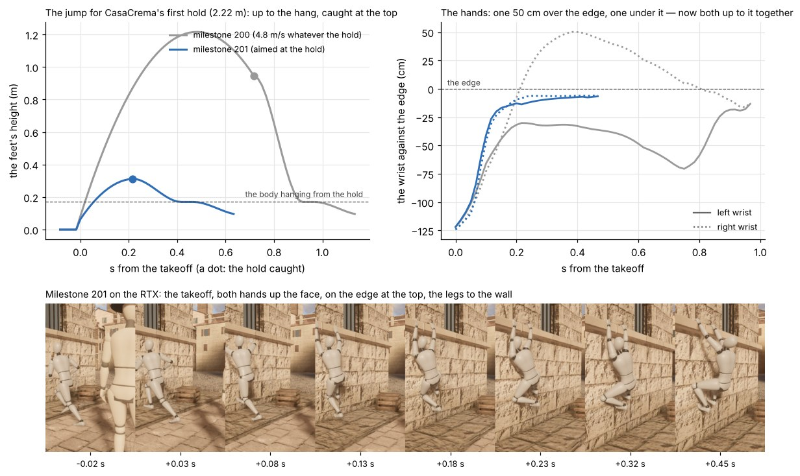

# FellowEngine — milestone 201 report (a jump at a wall aimed at its hold)

Status: **FINAL** (2026-11-25). Branch `fellow/geometry`. GPU: the RTX filmed the jump (job f573).
Decision 0343.

## 0. Result

The owner, after milestone 200: "why does the character jump very high, reach with one hand and fall onto the edge
instead of jumping straight to the edge?" The jump at a wall was the player's jump whatever the hold's height, and its
clip (Mixamo's start up a climbing wall) reaches with one hand:

* **The jump aimed** (`FellowTraversal3D.aim_jump_at_hold`): as fast as brings the body to its top 8 cm over its hang
  from the hold — for CasaCrema's first hold (2.22 m) 2.13 m/s, not 4.8. The hips' top over their hang **0.87 → 0.06
  m**; the shoulders no longer over the edge (27 cm over it → 47 cm under it).
* **Caught at the top**: 0.72 s after the takeoff, on the way down → **0.22 s, at the top**; the drop into the hang
  0.77 m → **0.14 m** (the hips' fastest fall after the catch 5.3 → 0.6 m/s).
* **Both hands**: the pose's IK takes both hands up the wall's face and in over the top as the body rises (the clip's
  arms and legs the catch's first frame's): the wrists at the catch 57 / 28 cm from their holds → **9 / 3 cm**, none
  over the edge (the right had reached 50 cm over it); the fingers over the edge 0.98 / 0.75 s after the takeoff →
  **0.30 / 0.23 s**.

## 1. Measurements (headless; `climb_look.gd` at 60 fps, `anim_quality.gd` at 120)

| | milestone 200 | milestone 201 |
|---|---|---|
| the jump for the first hold: the takeoff speed; the body's rise | 4.8 m/s; 1.22 m | **2.13 m/s; 0.31 m** |
| the hips' top over their hang | +0.87 m | **+0.06 m** |
| the takeoff to the catch; the drop into the hang | 0.72 s; 0.77 m | **0.22 s; 0.14 m** |
| the wrists at the catch from their holds (left, right) | 57, 28 cm | **9, 3 cm** |
| the fingers over the edge after the takeoff (left, right) | 0.98, 0.75 s | **0.30, 0.23 s** |
| climbing: settled held hands' fingers off the edge; no held hand's on it | 3.3 %; 1.9 % | **0.2 %; 0.0 %** |
| the hang program: the same | 0.7 %; 0.6 % | **0.0 %; 0.0 %** |
| hanging: the fastest joint p95; the hips' acceleration p95, max | 937 °/s; 234, 437 m/s² | **809 °/s; 147, 150 m/s²** |
| limbs through walls: the run and the jump | 4.0 % of the frames | **0.0 %** |
| `anim_quality.py` gates | 31 / 38 | 31 / 38 |

`climb_check.gd`, `traversal_check.gd`: every lane identical (the aim is the controller's call).

## 2. How it got there

* The jump aimed alone: caught at the top, but the left hand (the clip's, low by the wall) came up through the stone
  under the edge.
* The hands' way: the IK whole as it comes in, up the face, then in over the top, on the hold by the catch.
* The clip's foot, still swinging up the wall at the catch, flung on to the shoulder by the catch's blend: the clip played
  from its push to its hand set on its hold; then its limbs the catch's (the wrist's twist and the knee's swing across
  the body at the catch gone).

## 3. Open

* The top 6 cm higher than aimed (the takeoff's frame climbs a little more than its speed).
* A hold higher than the player's jump reaches is still caught on the way down.
